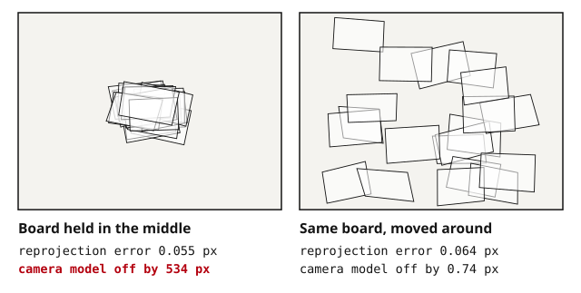

We rendered one ChArUco board at five sizes in the frame, held near the middle or moved around, and calibrated a camera whose true parameters we know. Twenty sessions of 20 images for each case.



Both frames show a board that is 20 % of the frame wide. The reprojection error is the same. The camera model is not: 534 px off at its worst pixel in one case, 0.74 px in the other.

Everything on this page comes from rendered images, not from a real camera. The last section says what that leaves out.

## The short answer

- **The board's size in the frame matters less than where the corners land.** Corners in every part of the frame across the set of images is what the camera model needs.
- **About 60 % of the frame width is a good size to start from.** It reaches most of the frame in 20 images without much planning, and the model came out within 0.13 px.
- **Bigger kept getting better.** 80 % gave 0.07 px. A ChArUco board as wide as the frame, partly outside it, gave 0.04 px.
- **The floor is 3 px per marker bit.** Below that the markers stop decoding and a ChArUco board gives nothing.

Size here means the board's width as a share of the frame width, with the board square to the camera.

## The test

- **Camera.** 1920 × 1440 px, focal length 2250 px (46° across), radial distortion k1 = −0.12.
- **Board.** ChArUco, 14 × 9 squares of 20 mm, markers of 15 mm, DICT_6X6_250, 280 × 180 mm.
- **Images.** Tilt of 5 to 35°, blur of 0.8 px, noise of 2 gray levels. The distance sets the board's share of the frame.
- **Session.** 20 images, solved with `calibrateCamera` and OpenCV's standard five distortion terms. 20 sessions per case, OpenCV 5.1.
- **Model error.** The true camera and the solved one are compared over the whole frame after the best rotation between them is removed. We report the worst pixel.

Each number in the tables is the median of 20 sessions unless it says otherwise.

## The board moved around the frame

The whole board is in every image, and its center can be anywhere in the frame.

| Board width in the frame | Pixels per square | Frame cells with corners, of 48 | Reprojection error (px) | Model, worst pixel (px) | Worst session (px) |
|---|---|---|---|---|---|
| 20 % | 27 | 37 | 0.064 | 0.74 | 3.81 |
| 30 % | 41 | 41 | 0.046 | 0.38 | 0.76 |
| 45 % | 62 | 42 | 0.056 | 0.28 | 0.92 |
| 60 % | 82 | 44 | 0.036 | 0.13 | 0.50 |
| 80 % | 110 | 45.5 | 0.022 | 0.07 | 0.27 |

"Frame cells" cuts the frame into 8 × 6 cells and counts the ones where at least one corner was found in the session.

Every size works. A bigger board is better, steadily, and the improvement does not stop at 60 %. The small board is also the least even from session to session: its worst one was off by 3.81 px, against 0.50 px for the worst session at 60 %.

## The board held in the middle

Same boards, same tilts, but the board's center stays within 6 % of the frame center.

| Board width in the frame | Frame cells with corners, of 48 | Reprojection error (px) | Model, worst pixel (px) | Same, k3 and tangential terms fixed (px) |
|---|---|---|---|---|
| 20 % | 8 | 0.055 | 534 | 19.6 |
| 30 % | 12 | 0.046 | 117 | 3.52 |
| 45 % | 20 | 0.055 | 17.0 | 1.20 |
| 60 % | 24 | 0.032 | 0.68 | 0.17 |

The reprojection error does not move. It is measured only where corners were found, and there the fit is fine. Outside that area nothing holds the distortion terms, and they run off.

A model with fewer terms runs off less. The last column fixes k3 and the tangential terms with `CALIB_FIX_K3 | CALIB_ZERO_TANGENT_DIST`. Our simulated lens has only k1, so nothing is lost by fixing the others here. A real lens may need them.

At 60 % of the frame width, even a board that never leaves the middle reaches half the cells, and the model is within 0.68 px. That is the practical case for a big board: it covers the frame when you do not plan your views.

## A board bigger than the image

A ChArUco board is detected when part of it is outside the image. So it can be as wide as the frame, or wider. Here at least half of its corners are in each image.

| Board width in the frame | Whole board in the image (px) | Board partly outside (px) |
|---|---|---|
| 60 % | 0.13 | 0.15 |
| 80 % | 0.07 | 0.06 |
| 100 % | does not fit tilted | 0.04 |

Both columns are the model's worst pixel. The board as wide as the frame gave the best result of the whole test. Its corners reached 47 or all 48 cells of the frame in every session.

This holds for patterns with markers. A plain checkerboard has to be fully visible to be detected at all, so it has to stay smaller than the frame; see [ChArUco, checkerboard or AprilGrid](/calibacademy/charuco-vs-checkerboard-vs-aprilgrid/).

## How small the squares can get

We moved the same board away from the camera, 40 images per step, and counted what OpenCV found.

| Pixels per square | Pixels per marker bit | Markers decoded | Corners found | Corner error, median (px) |
|---|---|---|---|---|
| 41 | 3.8 | 100 % | 100 % | 0.03 |
| 33 | 3.1 | 99 % | 99 % | 0.04 |
| 27 | 2.5 | 88 % | 77 % | 0.04 |
| 23 | 2.2 | 36 % | 16 % | 0.06 |
| 20 | 1.9 | 3 % | 0 % | 0.14 |
| 18 | 1.7 | 0 % | 0 % | none |

A 6 × 6 marker is 8 cells across with its border, so a marker bit is the marker's width in pixels divided by 8. On this board the markers are 0.75 of the square.

The markers give up first. The corners that are found stay accurate down to the point where none are found. So the number to check is pixels per marker bit, and 3 is a safe floor at this blur.

## More squares, or less tilt

**More squares.** A 28 × 18 board on the same 280 × 180 mm, at 60 % of the frame width, gave 0.09 px at the worst pixel against 0.13 px for the 14 × 9 board. Four times the corners, a modest gain.

At 30 % of the frame width the same dense board had squares of 21 px and marker bits of 1.9 px. Of 400 images, 1 was detected, with 10 corners. A denser pattern is only better while its markers decode. (With 252 markers it also needs DICT_6X6_1000.)

**Less tilt.** With tilts held to 0 to 10° at 60 % of the frame width, the worst pixel was 0.18 px against 0.13 px, and the focal length error 0.017 % against 0.007 %. Worse, but not by much, as long as the board still moves across the frame.

## Sizing a board, step by step

**1. Find the width your camera sees at the working distance.**

```
width seen = sensor width × distance / focal length
```

A sensor 8.8 mm wide behind a 12 mm lens at 800 mm sees 587 mm. The [FOV calculator](/tools/fov/) does this from a sensor list.

**2. Start from 60 % of that width.** 0.6 × 587 = 352 mm, so a board 300 to 400 mm wide. Bigger is fine for a ChArUco board, as long as you can hold it flat and move it.

| Board (mm) | Is 60 % of a view about | Substrate |
|---|---|---|
| 110 × 85 | 180 mm wide | ceramic |
| 150 × 100 | 250 mm wide | ceramic |
| 185 × 110 | 310 mm wide | ceramic |
| 230 × 140 | 380 mm wide | ceramic |
| 200 × 150 | 330 mm wide | composite |
| 300 × 200 | 500 mm wide | composite |
| 400 × 300 | 670 mm wide | composite |
| 600 × 400 | 1000 mm wide | composite |
| 800 × 600 | 1330 mm wide | composite |

**3. Check the marker bits.** Pixels per millimeter is the image width in pixels over the width seen. With a 2448 px image, 2448 / 587 = 4.2 px per mm. A 15 mm marker is then 63 px wide, or 7.8 px per bit. Anything from 3 up decodes.

**4. If the board has to be small, plan where it goes.** A board at 20 % of the frame width works when the images put it in every part of the frame, edges and corners included. It needs more care, and more images help: see [how many images](/calibacademy/how-many-calibration-images/).

For views wider than about 1.3 m, two or more boards with separate marker IDs can stand in for one huge panel; see [the multi-board guide](/calibacademy/multi-board-marker-ids/). For how flat each substrate stays, see [composite, ceramic or glass](/calibacademy/composite-ceramic-or-glass/).

## What we got wrong

The earlier version of this page had a results table from single runs. Six of its claims do not hold up over 20 sessions:

- **"13 px at 20 % fill, 1.4 px at 60 %."** That table did not separate how big the board was from where it sat. Moved around the frame, the small board gives 0.74 px. Held in the middle, 534 px.
- **"The gain flattens above 60 %."** It kept going: 0.13 px at 60 %, 0.07 px at 80 %, 0.04 px at 100 %.
- **"Rounding down is better than up."** For a ChArUco board, the bigger board did better even when it did not fit in the frame.
- **"Denser patterns win: 0.24 px against 1.4 px."** We measured 0.09 px against 0.13 px, and at 1.9 px per marker bit the dense board was detected in 1 image of 400.
- **"With tilts limited to 10° the error rose from 1.4 px to 9 px."** We measured 0.18 px against 0.13 px.
- **"Squares of at least 25 px."** For a ChArUco board the markers decide. At 27 px per square 23 % of the corners were already lost.

## Check your own images

This script reads a folder of calibration images, finds the ChArUco board, and prints which parts of the frame got corners. Set the board at the top to match yours. It needs numpy and opencv-python 4.8 or later.

```python
import sys, glob, numpy as np, cv2

COLS, ROWS, SQUARE, MARKER = 14, 9, 20.0, 15.0               # squares across, squares down, sizes in mm
DICTIONARY = cv2.aruco.DICT_6X6_250

board = cv2.aruco.CharucoBoard((COLS, ROWS), SQUARE, MARKER, cv2.aruco.getPredefinedDictionary(DICTIONARY))
detector = cv2.aruco.CharucoDetector(board)
grid = np.zeros((6, 8), int)                                 # the frame cut into 8 x 6 cells
obj, img, square_px, size = [], [], [], None
for path in sorted(glob.glob(sys.argv[1] + "/*")):
    image = cv2.imread(path, cv2.IMREAD_GRAYSCALE)
    if image is None: continue
    size = image.shape[::-1]
    corners, ids, _, _ = detector.detectBoard(image)
    if ids is None or len(ids) < 6: continue
    pts, ids = corners.reshape(-1, 2), ids.ravel()
    obj.append(board.getChessboardCorners()[ids]); img.append(corners)
    np.add.at(grid, ((pts[:, 1] * 6 / size[1]).astype(int).clip(0, 5), (pts[:, 0] * 8 / size[0]).astype(int).clip(0, 7)), 1)
    where = {i: p for i, p in zip(ids, pts)}                 # distance between neighbors in a row = one square
    square_px += [np.linalg.norm(where[i + 1] - p) for i, p in where.items() if i + 1 in where and (i + 1) % (COLS - 1)]

print(f"{len(obj)} images with corners, squares about {np.median(square_px):.0f} px, marker bits about {np.median(square_px) * MARKER / SQUARE / 8:.1f} px")
for row in grid:
    print("  " + " ".join("##" if n >= 20 else "+ " if n else ". " for n in row))
print(f"cells of the frame with corners: {(grid > 0).sum()} of 48   (## 20 corners or more, + fewer, . none)")
rms = cv2.calibrateCamera(obj, img, size, None, None)[0]
print(f"reprojection error {rms:.3f} px")
```

On one of our sessions with the small board moved around the frame it prints:

```text
20 images with corners, squares about 27 px, marker bits about 2.5 px
  .  ## ## .  .  .  .  . 
  .  +  ## ## ## ## +  . 
  .  +  +  +  +  ## ## . 
  +  ## ## ## ## ## ## + 
  +  ## ## ## ## ## ## + 
  +  ## ## ## ## ## ## + 
cells of the frame with corners: 38 of 48   (## 20 corners or more, + fewer, . none)
reprojection error 0.078 px
```

And on a session with the same board held in the middle:

```text
20 images with corners, squares about 27 px, marker bits about 2.5 px
  .  .  .  .  .  .  .  . 
  .  .  .  .  .  .  .  . 
  .  .  +  ## ## +  .  . 
  .  .  +  ## ## +  .  . 
  .  .  .  .  .  .  .  . 
  .  .  .  .  .  .  .  . 
cells of the frame with corners: 8 of 48   (## 20 corners or more, + fewer, . none)
reprojection error 0.058 px
```

The reprojection error is lower for the second session. Its camera model was off by 213 px at the worst pixel; the first session's by 0.57 px. The map shows what the error number cannot.

## What this test is not

- **Simulation.** Rendered images of a flat board. A real large board bends more than a small one, and that works against the gain from size; [composite, ceramic or glass](/calibacademy/composite-ceramic-or-glass/) measures it.
- **No focus.** In the model a small board close up and a large board far away are the same picture. A real lens is focused at one distance, and a board far from it is blurred.
- **One lens.** 46° across with mild distortion. Wide-angle and fisheye lenses were not tested.
- **One blur level.** The pixel sizes at which markers stop decoding move with focus, contrast and detector settings.
- **ChArUco only.** Checkerboards and circle grids were not run here.
- **One camera.** Stereo and hand-eye setups add their own limits on where the board can go.

The scripts and the saved results are in our repository under `docs/content/experiments/target-size/`.
