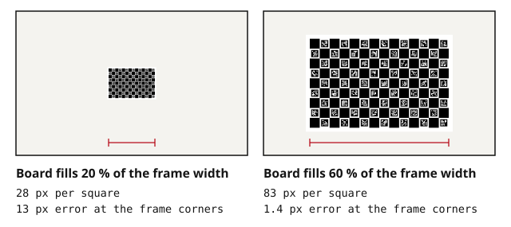

The right size for a calibration target is set by your camera, lens and working distance, not by the target catalog. This guide gives the rule, the reasoning, and the numbers from a controlled test, so you can pick a board in a few minutes.

## The rule

In a typical calibration view the board should fill **about 60 % of the frame**, with some views pushing it to the edges and corners. At that size, each checker square should be at least **25 px** across and each marker bit at least **3 px**.

Fill here means the board's width as a share of the frame width.



Fill is what matters because the camera model is only constrained where the board puts corners. Distortion is strongest at the edges of the image, so a board that never reaches them leaves the distortion coefficients guessing out there.

## What the data shows

We rendered a ChArUco board through a synthetic camera with known intrinsics and distortion, detected it with OpenCV's `CharucoDetector`, calibrated with `calibrateCamera`, and compared the result with the truth.

Fifteen views, tilts up to 35°, image noise added, the same camera every time; only the board's share of the frame changed.

| Board fill | Pixels per square | RMS reprojection | Focal error | Undistortion error at frame corners |
|---|---|---|---|---|
| 20 % | 28 | 0.29 px | 0.55 % | 13 px |
| 30 % | 41 | 0.30 px | 0.34 % | 7 px |
| 45 % | 62 | 0.23 px | 0.07 % | 5 px |
| 60 % | 83 | 0.14 px | 0.06 % | 1.4 px |
| 80 % | 112 | 0.10 px | 0.01 % | 1.9 px |

Two things stand out. The reprojection error never looks bad, even when the model is wrong by 13 px at the corners: it is measured only where corners were found. And the gain flattens above 60 %, where the whole board becomes hard to keep in frame at steep tilts.

A few more runs from the same setup:

- **Same fill, more corners.** A 28 × 18 board at 42 px per square gave 0.24 px maximum undistortion error; a 14 × 9 board of the same physical size at 83 px per square gave 1.4 px. Denser patterns win.

- **Small board close vs large board far.** A 200 × 150 mm board at 60 % fill matched the 600 × 400 mm board at 60 % fill. Size in millimeters did not matter; share of the frame did.

- **Tilt.** With the same board at 60 % fill but tilts limited to 10°, focal error rose from 0.06 % to 0.34 % and the corner error from 1.4 px to 9 px. Fill does not substitute for angles.

- **More views.** Going from 15 to 30 views at 60 % fill cut the corner error from 1.4 px to 0.15 px.

## Step 1: find your coverage

Coverage at the working distance is the sensor dimension scaled by distance over focal length:

```
coverage width  = sensor width  × distance / focal length
coverage height = sensor height × distance / focal length
```

For a 2/3″ sensor (8.8 × 6.6 mm) with a 12 mm lens at 800 mm, that is 587 × 440 mm. The [FOV calculator](/tools/fov/) does this from a sensor list and also reports pixels per millimeter, which you need for step 3.

Use the distance at which the camera will actually work. Calibrating at a different distance means a different focus, and a lens's intrinsics change with focus.

## Step 2: pick the board size

Multiply the coverage long side by 0.6 and pick the nearest board. Rounding **down** is better than up: a slightly small board can be moved closer for some views, while a board that does not fit in the frame at 30° tilt costs you views.

| Board (mm) | Fills 60 % of a frame about | Substrate |
|---|---|---|
| 110 × 85 | 180 mm wide | ceramic |
| 150 × 100 | 250 mm wide | ceramic |
| 185 × 110 | 310 mm wide | ceramic |
| 230 × 140 | 380 mm wide | ceramic |
| 200 × 150 | 330 mm wide | composite |
| 300 × 200 | 500 mm wide | composite |
| 400 × 300 | 670 mm wide | composite |
| 600 × 400 | 1000 mm wide | composite |
| 800 × 600 | 1330 mm wide | composite |

For the 587 mm coverage above, 0.6 × 587 = 352 mm, so the [300 × 200 composite board](/targets/charuco-composite/) is the pick, with the 400 × 300 as the alternative if you can move it a little further away.

Ceramic boards are for small fields of view and for when position accuracy below a few micrometers matters; see the [ceramic ChArUco target](/targets/charuco-ceramic/), and [composite, ceramic or glass](/guides/composite-ceramic-or-glass/) for how the three substrates compare.

For fields wider than about 1.3 m, use two or more boards with distinct marker IDs instead of one huge panel; the [multi-board guide](/guides/multi-board-marker-ids/) covers the setup.

## Step 3: check the pixels

At the working distance, pixels per millimeter is `image width / coverage width`. Multiply by the square size:

- **Square ≥ 25 px.** Below that, corner refinement loses accuracy and detections become unstable at tilt. 30 to 40 px is comfortable.

- **Marker bit ≥ 3 px.** A 6 × 6 marker has 8 cells including its border; divide the marker size in pixels by 8. Below 3 px per bit the IDs stop decoding and ChArUco falls back to nothing.

- **Prefer more squares over bigger ones** when both pass. Twice the corners at half the pixels each gave the better calibration above.

The [FOV calculator](/tools/fov/) reports both numbers for each board it suggests and flags boards whose markers would not decode.

## When you cannot reach 60 %

**Working distance is long and the board would be enormous.** Bring a smaller board closer for the calibration, as long as the lens stays at the working focus. Infinity-focused outdoor cameras tolerate this; macro setups do not.

**The lens is wide or fisheye.** Coverage grows quickly with distance, and distortion sits at the edges. Use the largest board you can keep flat, bring it close, and take extra views with the board in each corner of the frame. Fill is judged in the distorted image, so a board that looks bent at the edge is doing its job.

**Stereo or multi-camera.** The board must be visible in both cameras at once, so size it for the shared field of view, which is narrower than either camera's. Expect to need more views to cover each camera's edges.

**The board has to stay put (hand-eye, robot cells).** Fill applies to the camera's view at each robot pose; the [hand-eye guide](/guides/hand-eye-calibration-opencv/) explains how the poses are chosen.

**Line-scan, telecentric and thermal cameras** each break one assumption above and have their own guides.

## Views and tilt

Size gets the board into the frame; the views do the rest. Plan for:

- 15 to 30 views, with the board reaching every edge and corner of the frame across the set

- tilts of 30° to 45° about both axes, not just one

- a few near and far views to spread the depth

The [OpenCV calibration guide](/guides/opencv-camera-calibration/) walks through capture and the per-view error check that catches a bad frame.

## Common problems

| Symptom | Likely cause | Fix |
|---|---|---|
| Good RMS, straight lines still bend after undistortion | Board never reached the frame edges | Add views with the board in each corner; check fill |
| Markers not detected at tilt | Fewer than 3 px per marker bit | Larger board, closer, or a pattern with larger markers |
| Corners detected but jitter between frames | Squares under 25 px, or motion blur | Bigger squares or more light and a shorter exposure |
| Board does not fit at 30° tilt | Board sized for a frontal view | Go one size down |
| Results differ between calibrations | Lens focus or aperture changed | Lock focus and aperture; calibrate at the working settings |
| Large board, poor flatness | Foam or paper substrate at 600 mm and above | Rigid composite or multiple smaller boards |

## Next steps

- Open the [FOV calculator](/tools/fov/) with your sensor, lens and distance and read off the recommended board.

- [Choose a pattern](/guides/charuco-vs-checkerboard-vs-aprilgrid/) for your software and lens.

- Then follow the [OpenCV calibration guide](/guides/opencv-camera-calibration/) for capture and checks.
