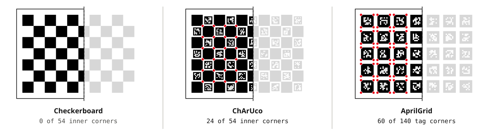

## The short answer

| Pattern | Best for | Avoid when |
|---|---|---|
| [Checkerboard](/targets/checkerboard-composite/) | Single camera, full board always in view, highest corner accuracy | Board gets cut off at the image edge; multi-camera rigs |
| [ChArUco](/targets/charuco-composite/) | Stereo and multi-camera, wide lenses, partial views; OpenCV native | Very low resolution where markers can't be decoded |
| [AprilGrid](/targets/aprilgrid-composite/) | Camera–IMU calibration with Kalibr; robotics stacks built on AprilTag | Pure OpenCV pipelines (less tooling than ChArUco) |

## Why partial views matter more than you think

Lens distortion is strongest in the corners of the image, and that is exactly where a plain checkerboard can't be used — the detector needs every inner corner visible. Coded patterns let you push the board right to the edge, which is where the distortion model actually gets constrained.

The figure is a measurement, not a sketch. Each board was rendered with 45 % of its width outside the image and passed to OpenCV 5.0.

`findChessboardCorners`, given the board's full size, returns nothing. `CharucoDetector` returns 24 of the 54 inner corners, each with its ID. The AprilTag detector returns every tag that is completely in view: 15 tags, 60 corners.

## Picking square and marker size

