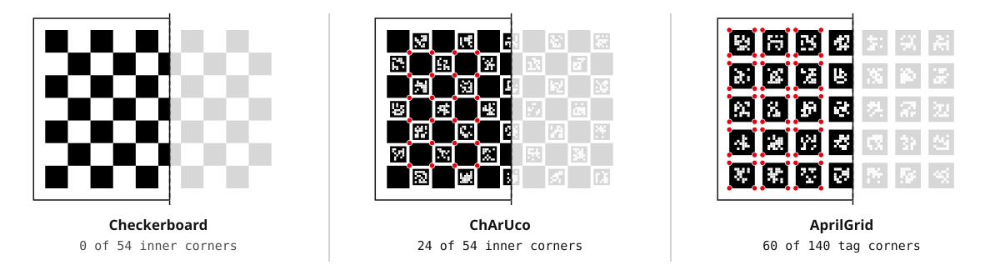

We drew five calibration patterns of the same size, rendered 24 views of each with a known camera, and calibrated. Twenty times each. Then we did it again with the board allowed to hang over the edge of the image.



The figure shows what is at stake: three boards with 45 % of their width outside the image, passed to OpenCV 5.0. The checkerboard detector returns nothing. `CharucoDetector` returns 24 corners. The tag detector returns the 15 tags, 60 corners, that are completely in view.

Everything on this page comes from rendered images, not from a real camera. The last section says what that leaves out.

## The short answer

With the whole board in every image, all five patterns gave a camera model within 0.11 px of the true one at the worst pixel. The pattern is not what limits accuracy.

They differ in two other things:

- **How many views survive.** When the board may be cut off by the image border, a ChArUco board and an AprilGrid kept all 24 views. The checkerboard kept 7.5 and the circle grids 3.5 to 4.5. The circle grid solved in 10 of 20 sessions and the asymmetric one in 14.
- **How the points are found.** Tag corners taken straight from OpenCV's marker detector gave a model 1.3 to 1.9 px off. The same images with a line fitted to each tag edge gave 0.03 px.

| Pattern | Use it when | Watch for |
|---|---|---|
| [Checkerboard](/targets/checkerboard-composite/) | One camera, and you can keep the whole board in view | Every image where a corner is cut off is lost |
| [ChArUco](/targets/charuco-composite/) | Stereo and multi-camera rigs, tight spaces, OpenCV pipelines | Markers stop decoding before corners do when the image is soft or the board is far |
| [AprilGrid](/targets/aprilgrid-composite/) | Kalibr, or your own code with good corner refinement | Corners from a plain marker detector are not good enough |
| [Circle grid](/targets/circlegrid-composite/) | Soft or low-contrast images with the whole grid in view | Lost views at steep angles; odd row count on the asymmetric grid |

Which software reads which pattern is a separate question with its own page: [Which software reads which calibration target?](/calibacademy/calibration-software-target-compatibility/)

## The question

On the OpenCV forum someone planning a stereo calibration [asked in 2021](https://forum.opencv.org/t/calibration-using-charuco-question/1810) whether a ChArUco board is the best option, since it would let the edges of the image be calibrated more. The post has no reply.

An earlier version of this page answered yes, and gave that as the reason. We had not measured it. This version does.

## The test

- **Camera.** 1280 × 960 px, focal length 1500 px (46° across), radial distortion k1 = −0.12. One lens.
- **Boards.** Five patterns of about 300 × 210 mm: a 10 × 7 checkerboard and ChArUco board with 30 mm squares, a 6 × 4 AprilGrid with 40 mm tags, a 10 × 7 circle grid and an asymmetric grid of 63 circles.
- **Views.** The board fills 45 to 80 % of the image width, tilted up to 35°. Blur of 0.8 px and noise of 2 gray levels are added.
- **Session.** 24 views, solved with the standard OpenCV model. 20 sessions for each row.
- **Model error.** The true camera and the solved one are compared pixel by pixel after the best rotation between them is removed. We give the mean and the worst pixel.

The renderer, detectors and solver are those of [Plumbline](/plumbline/). The checkerboard uses `findChessboardCorners` with `cornerSubPix`, the more exact of the two detectors we tried.

## Whole board in every image

| Pattern | Solved | Views used | Image covered | RMS (px) | Model error, mean (px) | Model error, worst pixel (px) | Worst session (px) |
|---|---|---|---|---|---|---|---|
| Checkerboard | 20/20 | 24 | 85 % | 0.024 | 0.015 | 0.070 | 0.16 |
| ChArUco | 20/20 | 24 | 85 % | 0.045 | 0.032 | 0.106 | 0.29 |
| AprilGrid | 20/20 | 24 | 98 % | 0.027 | 0.013 | 0.033 | 0.13 |
| Circle grid | 20/20 | 23 | 98 % | 0.011 | 0.021 | 0.080 | 0.14 |
| Asymmetric circle grid | 20/20 | 21.5 | 95 % | 0.008 | 0.011 | 0.050 | 0.10 |

Each cell is the median of 20 sessions. "Image covered" is the share of an 8 × 6 grid over the image that holds at least one point. "Worst session" is the largest worst-pixel error among the 20.

All five are good. The differences between 0.03 and 0.11 px are smaller than what a printed board or a warm lens adds.

The RMS does not rank them. The circle grids have the lowest RMS, 0.008 to 0.011 px, and are not the most exact. More on that below.

## Board allowed over the edge

Same kind of views, but the center of the board may go 90 % of the way to the point where half the board is outside the image.

| Pattern | Solved | Views used | Image covered | RMS (px) | Model error, mean (px) | Model error, worst pixel (px) | Worst session (px) |
|---|---|---|---|---|---|---|---|
| Checkerboard | 20/20 | 7.5 | 78 % | 0.023 | 0.058 | 0.158 | 5.53 |
| ChArUco | 20/20 | 24 | 100 % | 0.043 | 0.051 | 0.132 | 0.28 |
| AprilGrid | 20/20 | 24 | 100 % | 0.026 | 0.022 | 0.055 | 0.22 |
| Circle grid | 10/20 | 3.5 | 69 % | 0.010 | 0.049 | 0.149 | 0.33 |
| Asymmetric circle grid | 14/20 | 4.5 | 67 % | 0.008 | 0.025 | 0.077 | 0.42 |

This is where the coded patterns earn their place. Every ChArUco and AprilGrid view was usable. Two thirds of the checkerboard views were lost, and one checkerboard session ended 5.5 px off. The circle grid had too few views to solve in 10 of its 20 sessions, the asymmetric grid in 6.

## Does going over the edge improve the model?

Not on this lens. With the board over the edge, the ChArUco sessions covered the whole image instead of 85 %. The worst-pixel error went from 0.106 to 0.132 px. For the AprilGrid it went from 0.033 to 0.055 px.

Views cut off by the border carry fewer points: 904 points a session instead of 1296 on the ChArUco board. More coverage did not make up for that here.

So the reason to choose a coded board is that you lose no views, not that the edges of the image are calibrated better.

Coverage still matters. A board that never gets near the edges leaves them unconstrained, as the [target size guide](/calibacademy/calibration-target-size/) shows. Here the boards kept inside already reached 85 % of the image. With a wide lens they may not, and we have not tested one.

## Tag corners depend on how you find them

A checkerboard corner is the crossing of two edges. A tag corner is the end of two edges, with white on three sides. It is harder to place.

The same AprilGrid images, three ways of placing the corners:

| Tag corners from | Solved | Views used | Image covered | RMS (px) | Model error, mean (px) | Model error, worst pixel (px) | Worst session (px) |
|---|---|---|---|---|---|---|---|
| Edges fitted with a line | 20/20 | 24 | 98 % | 0.027 | 0.013 | 0.033 | 0.13 |
| OpenCV, `CORNER_REFINE_SUBPIX` | 20/20 | 24 | 98 % | 0.289 | 0.465 | 1.296 | 1.86 |
| OpenCV, no refinement | 20/20 | 24 | 98 % | 0.716 | 0.583 | 1.894 | 3.02 |

With OpenCV's marker detector the model is about 40 times worse, and the RMS shows it: 0.29 px instead of 0.03.

OpenCV's own tutorial says the same in words and [recommends ChArUco corners over marker corners](https://docs.opencv.org/5.0/tutorials/objdetect/aruco_calibration/aruco_calibration.html) for calibration.

A forum post from 2025 reports the effect on a clean generated image: [corners that land on whole pixels](https://forum.opencv.org/t/aruco-detector-doesnt-provide-subpixel-accuracy/20478) and offsets of half a pixel that differ from corner to corner.

Kalibr refines tag corners in its own detector. We did not run Kalibr, so these rows say nothing about it.

## How exactly each detector places a point

60 views for each cell, whole board in the image, RMS distance in px between a found point and where it truly is.

| Pattern and detector | Standard | Soft focus (blur 2.5 px) | Board small (18 to 28 % of width) | Tilt up to 60° | Noise × 4 |
|---|---|---|---|---|---|
| Checkerboard, `findChessboardCorners` + `cornerSubPix` | 0.024 | 0.027 | 0.023 | 0.037 | 0.049 |
| Checkerboard, `findChessboardCornersSB` | 0.117 | 0.131 | 0.105 | 0.148 | 0.118 |
| ChArUco, `CharucoDetector` | 0.048 | 0.078 | 0.064 | 0.097 | 0.077 |
| AprilGrid, edges fitted with a line | 0.029 | 0.122 | 0.046 | 0.123 | 0.067 |
| AprilGrid, OpenCV `CORNER_REFINE_SUBPIX` | 0.307 | 1.034 | 0.763 | 0.362 | 0.353 |
| AprilGrid, OpenCV no refinement | 0.723 | 1.018 | 0.721 | 0.772 | 0.752 |
| Circle grid, `findCirclesGrid` | 0.134 | 0.134 | 0.021 | 0.122 | 0.134 |
| Asymmetric circle grid, `findCirclesGrid` | 0.088 | 0.089 | 0.016 | 0.073 | 0.089 |

Three things in this table surprised us.

**`findChessboardCornersSB` was five times less exact than the older detector.** 0.117 px against 0.024 px in the standard views, and less exact in every condition. We do not know why. It may be the lens distortion in the render, or our flags. The checkerboard sessions on this page use the older detector.

**Circle centers are off by 0.13 px when the circles are large.** The circles here are about 50 px across. The center of the dark blob is not the image of the center of the circle once the view is tilted and the lens distorts. With the grid small in the image the error is 0.02 px.

Noise does not change it, which is what a bias looks like. The sessions still solved to within 0.08 px. The board poses seem to take up most of this bias, which is also why the RMS is so low.

**Markers give out before corners do.** In soft focus the ChArUco board was found in all 60 views but complete in none, 2646 corners instead of 3240. The corners it did return were still within 0.08 px.

## What we got wrong

- **"Coded patterns calibrate the edges better."** The earlier page said so. On this lens they did not.
- **"A checkerboard has the highest corner accuracy."** True for one of its two detectors, 0.024 px. An AprilGrid with fitted edges was at 0.029 px and a small circle grid at 0.02 px.
- **An asymmetric circle grid with 10 rows.** Our first asymmetric grid had an even number of rows. `findCirclesGrid` numbered it from an end that did not match the board, and every session solved to nonsense, 40 to 77 px off on single views. With 9 rows it worked. Use an odd number of rows, as in the usual 4 × 11 grid.
- **Circle grids "detected" 38 of 60 times.** The first run let the outer circles touch the image border. The detector was fine; our views were not.

## What to do

- **One camera, room to keep the board in view:** any of the five. A checkerboard is the simplest to check by eye.
- **Stereo, several cameras, a tight cell:** ChArUco or AprilGrid, so a view counts even when one camera sees half the board.
- **AprilGrid or ArUco grid in your own code:** do not calibrate on raw marker corners. Use ChArUco, or refine the corners, and look at the RMS: about 0.3 px on sharp images was the mark of unrefined corners in this test.
- **Checkerboard:** one odd and one even count of squares, such as 10 × 7, so stereo pairs cannot match it upside down.
- **Asymmetric circle grid:** odd number of rows.
- **Any pattern:** the smallest feature decides the working distance. The [target size guide](/calibacademy/calibration-target-size/) and the [FOV calculator](/tools/fov/) work that out.

Print a page of each before you buy a board. The [checkerboard](/tools/generator/checkerboard/), [ChArUco](/tools/generator/charuco/), [AprilGrid](/tools/generator/aprilgrid/) and [circle grid](/tools/generator/circles/) generators write a PDF at 1:1.

## Try it yourself

This script needs numpy and opencv-python only. It draws an AprilTag grid, views it from 40 angles and measures how far OpenCV's four corner methods put the tag corners from where they are.

```python
# How exactly does OpenCV place the corners of a tag? numpy and opencv-python (4.8 or newer) only.
import numpy as np, cv2

A = cv2.aruco
d = A.getPredefinedDictionary(A.DICT_APRILTAG_36h11)
board = A.GridBoard((6, 4), 0.040, 0.012, d)                 # 24 tags of 40 mm, 12 mm apart
flat = board.generateImage((3064, 2024), marginSize=32)       # 10 px per mm, 32 px of white around
obj = np.array(board.getObjPoints()).reshape(-1, 3)[:, :2]    # tag corners in meters, tag by tag
src = (32 + obj * 1e4 - 0.5).astype(np.float32)               # the same corners in the flat image (pixel centers at whole numbers)

for name, refine in (("no refinement", A.CORNER_REFINE_NONE), ("CORNER_REFINE_SUBPIX", A.CORNER_REFINE_SUBPIX),
                     ("CORNER_REFINE_CONTOUR", A.CORNER_REFINE_CONTOUR), ("CORNER_REFINE_APRILTAG", A.CORNER_REFINE_APRILTAG)):
    err = []; rng = np.random.default_rng(0)                    # the same 40 views for every method
    for view in range(40):
        # a tilted view: move the four image corners of the board by random amounts
        quad = np.float32([[250, 180], [1050, 180], [1050, 700], [250, 700]]) + rng.uniform(-90, 90, (4, 2)).astype(np.float32)
        H = cv2.getPerspectiveTransform(np.float32([[0, 0], [3064, 0], [3064, 2024], [0, 2024]]), quad)
        img = cv2.warpPerspective(flat, H, (1280, 960), flags=cv2.INTER_AREA, borderValue=120)
        img = cv2.GaussianBlur(img, (0, 0), 0.8).astype(np.float32) + rng.normal(0, 2, (960, 1280))
        img = np.clip(img, 0, 255).astype(np.uint8)
        true = cv2.perspectiveTransform(src.reshape(-1, 1, 2), H).reshape(-1, 4, 2)
        p = A.DetectorParameters(); p.cornerRefinementMethod = refine
        corners, ids, _ = A.ArucoDetector(d, p).detectMarkers(img)
        for c, i in zip(corners, ids.ravel()):
            err.append(c.reshape(4, 2) - true[i])
    err = np.concatenate(err); shift = err.mean(0); rms = lambda e: np.sqrt((e ** 2).sum(1).mean())
    print(f"{name:22s} {len(err)} corners   RMS {rms(err):.2f} px   mean shift ({shift[0]:+.2f}, {shift[1]:+.2f}) px   RMS without the shift {rms(err - shift):.2f} px")
```

Output with OpenCV 5.0 and 5.1:

```text
no refinement          3840 corners   RMS 0.77 px   mean shift (-0.01, -0.00) px   RMS without the shift 0.77 px
CORNER_REFINE_SUBPIX   3840 corners   RMS 0.45 px   mean shift (-0.00, -0.00) px   RMS without the shift 0.45 px
CORNER_REFINE_CONTOUR  3840 corners   RMS 0.76 px   mean shift (-0.00, +0.00) px   RMS without the shift 0.76 px
CORNER_REFINE_APRILTAG 3840 corners   RMS 0.70 px   mean shift (+0.48, +0.49) px   RMS without the shift 0.14 px
```

`CORNER_REFINE_APRILTAG` puts every corner half a pixel down and to the right. Apart from that shift it is the best of the four, 0.14 px. A constant shift moves the principal point by the same half pixel and leaves the rest of the model alone.

The scripts and saved results for the tables are in the site repository under `docs/content/experiments/target-choice/`.

## What this test is not

- **Not a real camera.** No lens blur that varies over the image, no glare, no print error, no board that bends.
- **One lens.** 46° with mild distortion. A fisheye or a very wide lens may change the answer about going over the edge.
- **One board size and one resolution.** About 300 × 210 mm at 1280 × 960 px.
- **Not Kalibr, MATLAB or ROS.** OpenCV 5.1 and Plumbline's detectors only.
- **The `findChessboardCornersSB` result is unexplained.** Treat it as an open question, not as a verdict on that detector.
- **Twenty sessions a row.** Enough to see 0.03 against 1.3 px. Not enough to rank 0.03 against 0.05.
