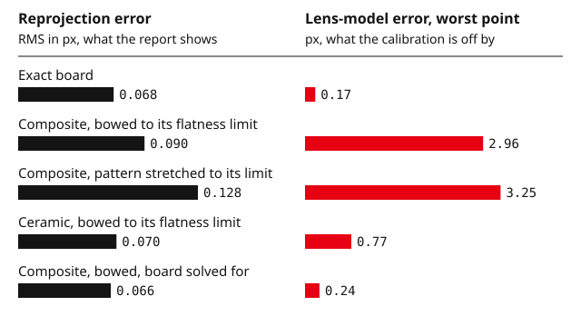

We took boards from our shop, bent and stretched each one as far as its specification allows, and calibrated a known camera with it as if it were perfect. Twenty sessions of 20 views for every case.



The figure shows a 300 × 200 mm composite board and a 230 × 140 mm ceramic board. On the left is what the calibration reports. On the right is how far the camera model it produced is from the true camera at the worst pixel.

Everything on this page is simulation: points projected through a known camera, not photographs of boards. The limits are the published ones, not measurements of boards we shipped. The last section says what that leaves out.

## The short answer

| Board in the test | RMS, px | Focal length | Worst pixel, px |
|---|---|---|---|
| Exact board | 0.068 | 0.00 % | 0.17 |
| Composite, bowed to its flatness limit | 0.090 | −0.16 % | 2.96 |
| Composite, pattern stretched to its limit | 0.128 | +0.14 % | 3.25 |
| Ceramic, bowed to its flatness limit | 0.070 | −0.04 % | 0.77 |
| Composite, bowed, board solved for | 0.066 | +0.01 % | 0.24 |

- **Flatness costs the most, and the report hides it.** A composite board bowed by its full 0.5 mm per meter moved the model by about 3 px at the worst pixel, on the 200 mm board and on the 800 mm board. The reprojection error went from 0.07 to 0.09 px.
- **Ceramic is about four times better, not perfect.** At its 20 µm flatness limit the 230 × 140 mm board gave 0.77 px, against 0.20 px for an exact board.
- **The shape of a print error matters more than its size.** A pattern that is uniformly too large changed nothing but distances. A spacing that grows toward one end cost 19.96 px on the 300 mm board at the composite limit.
- **Solving for the board takes all of it out.** With OpenCV's `calibrateCameraRO`, the composite board at any of its limits gave the same model as an exact board, 0.24 px. Only the overall scale stays wrong.
- **So choose by field of view first.** Ceramic stops at 230 × 140 mm and composite starts at 200 × 150 mm. Glass is for backlight.

## The question

How flat is flat enough? One answer on the OpenCV forum says the board ["has to be ABSOLUTELY FLAT"](https://forum.opencv.org/t/calibration-problem/13762/2). That is the usual advice, and it comes without a number.

One forum member [simulated it for an automated rig](https://forum.opencv.org/t/getoptimalnewcameramatrix-aspect-ratio-distortion/10258/11) and settled on about ±0.5 mm across a 24 × 12 inch target, noting that flatness mattered more than expected.

The earlier version of this page had a rule of its own: compare the board's tolerance with the size of one pixel on the board, and if it is below a pixel, composite is enough. It also said ceramic's flatness was down at the noise. We had tested neither. This time we did.

## The test

- **Camera.** 5 MP, 2448 × 2048 px, a 12 mm lens (39° across) with some barrel distortion. Its true parameters are known.
- **Boards.** ChArUco boards as we sell them. Composite: 200 × 150 mm (24 inner corners), 300 × 200 mm (54) and 800 × 600 mm (140). Ceramic: 230 × 140 mm (91).
- **Limits.** Composite: any corner within 0.3 mm + 0.2 mm per meter of board length of its nominal place, and flat to 0.5 mm per meter. Ceramic: 2 µm and 20 µm.
- **Sessions.** 20 views, the whole board in the image, its long side covering 45 to 80 % of the image width, tilted up to 35°. Each corner gets 0.05 px of noise.
- **The error.** The real board differs from the nominal one in one way at a time, at the limit. The calibration is told the nominal flat board and run with `cv2.calibrateCamera`, OpenCV 5.1.

Three numbers come out of each session, and each table cell is the median of 20 sessions. **RMS** is the reprojection error the calibration reports. **Focal length** is the error of the fitted focal length.

**Worst pixel** is the largest distance, anywhere in the image, between where the true camera and the fitted model put the same ray, after the best rotation between the two is taken out.

With an exact board the worst pixel is 0.17 to 0.37 px, depending on the board. That is the floor: 0.05 px of noise and 20 views.

## Flatness: the same cost at every size

Three shapes, each as high as the flatness limit allows over the plate: a bow along the long side, a dome, and a twist with two opposite plate corners up and two down.

| Board | Flatness limit | Exact board | Bow | Dome | Twist | RMS with the bow | Focal length with the bow |
|---|---|---|---|---|---|---|---|
| Composite 200 × 150 | 0.10 mm | 0.37 | 2.97 | 2.30 | 0.65 | 0.087 | −0.16 % |
| Composite 300 × 200 | 0.15 mm | 0.17 | 2.96 | 2.58 | 0.48 | 0.090 | −0.16 % |
| Composite 800 × 600 | 0.40 mm | 0.19 | 2.90 | 2.64 | 0.65 | 0.101 | −0.16 % |
| Ceramic 230 × 140 | 0.02 mm | 0.20 | 0.77 | 0.65 | 0.18 | 0.070 | −0.04 % |

The Exact board, Bow, Dome and Twist columns are the worst pixel in px.

The three composite boards land on the same 3 px. That follows from the geometry: scale the board, its bow and the camera distance by the same factor and the camera sees the same images. A limit given per meter costs the same at every size.

Ceramic's 20 µm on a 230 mm plate is 0.09 mm per meter, less than a fifth of the composite limit. The pattern covers more of the ceramic plate, so the cost is about a quarter: 0.77 px. That is above the floor of 0.20 px, so it is not free.

A twist costs little, because it has no net curvature for the focal length to absorb. A bow or a dome reads as a slightly different lens.

The RMS column is the uncomfortable one. A session at 0.090 px looks as good as one at 0.068 px. Nothing in the report says the focal length is 0.16 % off, which is 1.6 mm on a distance of one meter.

Larger bows, such as a paper print curling by a millimeter or more, are in the [printed target guide](/calibacademy/printed-target-costs-half-a-pixel/).

## Where the pattern sits: shape matters more than size

A tolerance of 0.36 mm on the 300 mm board says how far a corner may be from its nominal place. It does not say in what way. Five ways, each moving the farthest corner by the full 0.36 mm:

| The pattern is off by | RMS, px | Focal length | Aspect ratio | Worst pixel, px | Distance to the board |
|---|---|---|---|---|---|
| The whole pattern larger | 0.068 | 0.00 % | 0.00 % | 0.17 | −0.30 % |
| Longer in one direction | 0.128 | +0.14 % | −0.35 % | 3.25 | −0.23 % |
| Rows not square to columns | 0.497 | +0.08 % | +0.02 % | 6.36 | +0.07 % |
| Spacing growing toward one end | 0.684 | +0.21 % | −0.04 % | 19.96 | +0.13 % |
| Every corner off on its own | 1.320 | −0.01 % | +0.03 % | 5.43 | −0.02 % |

A pattern that is larger or smaller as a whole leaves the camera model alone. The calibration takes the board for nearer or farther than it is, and every length measured with that camera is off by the same 0.30 %.

A stretch in one direction goes into the aspect ratio of the pixels. A spacing that grows toward one end looks like lens distortion, and the model follows it: 19.96 px at the worst pixel with an RMS of 0.684 px.

Corners that are each off on their own raise the RMS to 1.320 px, so at least this one is visible. They do not average out as well as we expected: the same wrong board is in all 20 views.

The same five for every board, worst pixel in px:

| Board | Position limit | Larger | Longer one way | Not square | Spacing growing | Each corner |
|---|---|---|---|---|---|---|
| Composite 200 × 150 | 0.34 mm | 0.36 | 5.10 | 11.12 | 34.84 | 16.51 |
| Composite 300 × 200 | 0.36 mm | 0.17 | 3.25 | 6.36 | 19.96 | 5.43 |
| Composite 800 × 600 | 0.46 mm | 0.19 | 1.30 | 3.63 | 6.36 | 1.55 |
| Ceramic 230 × 140 | 0.002 mm | 0.20 | 0.18 | 0.18 | 0.26 | 0.15 |

The larger the composite board, the smaller the same few tenths of a millimeter are next to it, and the less they cost. The 200 × 150 mm board is hit hardest, and it has only 24 corners to fit a lens with. Ceramic's 2 µm cost nothing we could see.

The cost is in proportion. On the 300 mm board, a stretch at a quarter, half and all of the limit cost 0.88, 1.69 and 3.25 px. A bow cost 0.79, 1.44 and 2.96 px.

## Solving for the board

A rigid board is wrong in the same way in every view. That makes the error something a calibration can solve for. OpenCV's `calibrateCameraRO` does it: it holds three corners at their nominal places and estimates where all the others are, in three dimensions.

The 300 × 200 mm composite board, worst pixel in px, with the board taken as given (`calibrateCamera`) and solved for (`calibrateCameraRO`):

| The board | Board as given | Board solved for | Distance, board solved for |
|---|---|---|---|
| Exact board | 0.17 | 0.25 | 0.00 % |
| The whole pattern larger | 0.17 | 0.24 | −0.30 % |
| Longer in one direction | 3.25 | 0.24 | −0.36 % |
| Rows not square to columns | 6.36 | 0.24 | 0.00 % |
| Spacing growing toward one end | 19.96 | 0.24 | 0.00 % |
| Every corner off on its own | 5.43 | 0.32 | 0.00 % |
| Bowed | 2.96 | 0.24 | −0.01 % |
| Domed | 2.58 | 0.24 | −0.01 % |
| Twisted | 0.48 | 0.25 | +0.01 % |

Every row comes back to the level of an exact board. The ceramic board bowed to its limit went from 0.77 to 0.26 px the same way.

Three things it does not do:

- **It does not fix the scale.** The three held corners set the size of the board. If they are farther apart than the calibration is told, distances stay off, as the rows for a larger and a longer pattern show. Measure the board and enter what you measured.
- **It needs the same corners in every view.** Views with part of a ChArUco board outside the image cannot be used with it.
- **It needs enough views.** It estimates three more numbers for every corner, and with few views that costs accuracy:

| Views | Exact board, as given | Exact board, solved for | Bowed board, as given | Bowed board, solved for |
|---|---|---|---|---|
| 8 | 0.46 | 0.77 | 3.26 | 0.76 |
| 12 | 0.30 | 0.48 | 3.20 | 0.48 |
| 20 | 0.17 | 0.25 | 2.96 | 0.24 |

Worst pixel in px, 300 × 200 mm composite board, bow at the flatness limit. With 8 views, solving for the board costs 0.3 px on a perfect board and saves 2.5 px on a bowed one.

Other software has its own form of this. mrcal, by its documentation, fits a two-parameter bow of the board. If yours has neither, the board's own tolerance is in your result.

## Try it yourself

This is the bowed composite board in 26 lines. It needs numpy and opencv-python.

```python
# A board bowed by 0.15 mm, described to the calibration as flat. numpy and opencv-python only.
import numpy as np, cv2
rng = np.random.default_rng(1)
W, H = 2448, 2048                                   # a 5 MP camera with a 12 mm lens
K = np.array([[3478., 0, 1224], [0, 3478., 1024], [0, 0, 1]])
D = np.array([-0.12, 0.08, 0.0004, -0.0003, 0])
nx, ny, sq = 9, 6, 25.0                             # inner corners of a 300 x 200 mm ChArUco board
flat = np.array([[i * sq, j * sq, 0] for j in range(ny) for i in range(nx)], np.float32)
real = flat.copy()
real[:, 2] = -0.15 * (1 - ((flat[:, 0] - 100) / 150) ** 2)    # 0.15 mm over the 300 mm plate
obj, img = [], []
while len(img) < 20:                                # 20 views, tilted up to 35 degrees
    rv = np.deg2rad(rng.uniform([-35, -35, -20], [35, 35, 20])); z = rng.uniform(450, 800)
    R = cv2.Rodrigues(rv)[0]
    t = np.array([rng.uniform(-.25, .25) * z, rng.uniform(-.2, .2) * z, z]) - R @ flat.mean(0)
    px = cv2.projectPoints(real, rv, t, K, D)[0].reshape(-1, 2)
    if px.min() > 20 and px[:, 0].max() < W - 20 and px[:, 1].max() < H - 20:
        obj.append(flat); img.append((px + rng.normal(0, 0.05, px.shape)).astype(np.float32))
rms, K1 = cv2.calibrateCamera(obj, img, (W, H), None, None)[:2]
# nx - 1: the top-right corner is held, with the first and the last one
out = cv2.calibrateCameraRO(obj, img, (W, H), nx - 1, None, None)
z = out[5].reshape(-1, 3)[:, 2]
print(f"calibrateCamera     RMS {rms:.3f} px   focal length {100 * (K1[0, 0] / 3478 - 1):+.3f} %")
print(f"calibrateCameraRO   RMS {out[0]:.3f} px   focal length {100 * (out[1][0, 0] / 3478 - 1):+.3f} %")
print(f"board it solved for: bow of {z.max() - z.min():.3f} mm between the corners"
      f" ({real[:, 2].max() - real[:, 2].min():.3f} mm in truth)")
```

```text
calibrateCamera     RMS 0.086 px   focal length -0.175 %
calibrateCameraRO   RMS 0.067 px   focal length -0.024 %
board it solved for: bow of 0.076 mm between the corners (0.067 mm in truth)
```

One session, so the numbers differ a little from the medians above. The last line is the bow the calibration found, without being told there was one.

## Temperature

Two different things happen when a board is not at the temperature you assume.

**The whole board is warmer or colder.** It grows or shrinks evenly, which is a scale error. **One face is warmer than the other.** The warm face grows more and the board bends.

| Board | 10 °C warmer: distance | 10 °C warmer: worst pixel, px | 1 °C between the faces: bow | Focal length | Worst pixel, px |
|---|---|---|---|---|---|
| Composite 300 × 200 | −0.023 % | 0.17 | 0.045 mm | −0.05 % | 0.92 |
| Composite 800 × 600 | −0.023 % | 0.19 | 0.32 mm | −0.13 % | 2.31 |
| Ceramic 230 × 140 | −0.008 % | 0.20 | 0.016 mm | −0.03 % | 0.63 |

Ten degrees on the whole board did nothing to the camera model. Distances are off by the expansion itself: 0.024 mm per meter and degree for aluminum composite, 0.0072 mm for alumina. Let the board reach room temperature, or scale its dimensions.

The bow in the fourth column is a calculation, not a measurement: a plate that is free to bend takes a curvature of expansion × temperature difference ÷ thickness, and the bow over a length L is curvature × L² ÷ 8. It grows with the square of the length.

So one degree between the faces of the 800 mm composite board costs 2.31 px, nearly as much as its whole flatness tolerance. We have not measured how large that difference gets under a lamp or in the sun. Keeping both faces in the same air is the safe habit.

A board clamped hard at its edges, or bonded to a frame of another material, can bend for the same reason. Support it at three points or by one central mount.

## The three substrates side by side

| | Aluminum composite | Ceramic | Glass |
|---|---|---|---|
| How the pattern is made | UV printed, matte black on white | Chrome lithographed on alumina | Chrome lithographed on glass |
| Feature tolerance | ±0.3 mm + 0.2 mm/m | ±2 µm (target) | Quoted per job |
| Flatness | ≤ 0.5 mm per meter (three-point support) | ≤ 20 µm over the pattern area | Quoted per job |
| Thermal expansion | ≈ 24 µm/(m·°C) | ≈ 7.2 µm/(m·°C) | ≈ 9 (soda-lime), 3.3 (borosilicate) µm/(m·°C) |
| Thickness | 6 mm | 3 mm | Quoted per job |
| Sizes | 200 × 150 to 800 × 600 mm; up to 1200 × 800 mm on request | 110 × 85 to 230 × 140 mm | On request |
| Surface | Matte print | Low-gloss blue-black chrome on white | Glossy glass; can be backlit |
| Operating temperature | −50 to +80 °C | −50 to +200 °C | Depends on the glass |
| Price | Lowest per area | Several times a larger composite board; see the product page | Quoted per job |

The composite and ceramic values are our published specifications. The glass expansion values are typical for the material. Glass targets are not in our shop yet; we quote them on request, and none was in this test.

**Glare.** A reflection lands in the image when the surface faces halfway between the light and the camera. With a flash or ring light next to the lens, that is whenever the board faces the camera.

- **Composite** has a matte print, which scatters light. It is the easiest of the three under flash and bench lights.
- **Ceramic** has a low-gloss chrome pattern on white, made for front lighting. Under a direct flash, tilt the board a little or move the light off the lens axis.
- **Glass** is glossy and mirrors a flash. Its strength is light from behind: chrome on glass gives very high contrast and no surface reflection. That is why microscope and lens-test targets are usually glass.

We do not publish gloss values yet. If your setup has a gloss limit, tell us when you ask for a quote.

**Size and weight.** Composite weighs about 6.6 kg/m², so a 300 × 200 mm board is about 0.4 kg. Beyond a field of view of about 1.3 m, several boards with their own marker IDs work better than one panel; see the [multi-board guide](/calibacademy/multi-board-marker-ids/).

**Other substrates** turn up for special jobs:

| Substrate | What it is for | What to watch |
|---|---|---|
| Honeycomb aluminum | Boards over about 1 m that stay flat without a frame | Heavier panels, higher cost; check how the pattern is applied |
| Carbon fiber | Very stiff and light, with almost no thermal expansion | Price; the pattern is usually printed, so tolerance is print-limited |
| Acrylic | Backlit targets: it diffuses light from behind | Expands about three times as much as aluminum composite and creeps under load |
| Thermal target materials | Infrared cameras: the pattern has to differ in emissivity or temperature, not just in color | Needs heating or a heat source; see the [thermal calibration target](/targets/thermal-calibration-target/) |
| Retro-reflective film | Cameras with a ring light on the lens axis | Bright only near the optical axis; the film's own edges limit accuracy |

## What we got wrong

**"Ceramic's 20 µm is down at the noise."** The earlier page said so without a test. At that limit the ceramic board cost 0.77 px at the worst pixel, four times the 0.20 px of an exact board.

**"If the composite tolerance is below a pixel on the board, composite is enough."** The rule counted the tolerance in pixels and nothing else. On the 800 mm board 0.46 mm is about one pixel. A pattern too large by that much cost nothing, and a spacing growing by that much cost 6.36 px.

The rule also left out flatness, which cost 2.90 px on that board and the same on the small ones.

**Random corner errors would average out.** We expected the fit to smooth them over 54 corners. On the 300 mm board they cost 5.43 px, because every view repeats the same wrong corners.

**Solving for the board would cost accuracy on a good board.** At 20 views it cost 0.08 px, less than we feared. At 8 views it cost 0.3 px, so it is not free either.

## Which one

**Start with the field of view.** A board should cover a good part of the image (see [choosing the target size](/calibacademy/calibration-target-size/)). Ceramic goes up to 230 × 140 mm, which suits fields of view up to about 400 mm. Composite runs from 200 × 150 to 800 × 600 mm, and 1200 × 800 mm on request.

**Composite** for robot cells, vehicle stations, depth cameras, multi-camera rigs and most machine-vision work. Take whole-board views and solve for the board, and its flatness and print tolerance stop mattering, apart from its overall size. Without that, allow for about 3 px from flatness at the limit, and more if the print is off unevenly. [ChArUco on composite](/targets/charuco-composite/).

**Ceramic** for close-range and high-magnification work, where only a small board fits, and wherever the model has to hold to a fraction of a pixel with software that takes the board as given. Also for work above 80 °C. [ChArUco on ceramic](/targets/charuco-ceramic/).

**Glass** when you need backlighting, a transmissive target for a microscope or a lens bench, or the low expansion of borosilicate glass. [Glass resolution and scale targets](/targets/resolution-targets-glass/), the [backlit target](/targets/backlit-target/), or [ask for a quote](/quote/).

**Whatever the board:** measure it once and enter its real size, keep both faces at the same temperature, and do not trust a low reprojection error to tell you the board was flat.

## What this test is not

- **Not real boards.** The deviations are the published limits, applied one at a time in simple shapes. A real board has a mix of them, each somewhere below its limit. We have not measured production boards for this page.
- **Not real images.** Corners are projected points with 0.05 px of noise. Detection, blur, lighting and glare are not in it. For how detectors place corners, see the [pattern guide](/calibacademy/charuco-vs-checkerboard-vs-aprilgrid/).
- **One camera.** A 5 MP sensor behind a 39° lens. A wide lens or a different view plan may weigh the same bow differently.
- **Ceramic's 2 µm is a target.** We will publish how it is measured with the first production boards.
- **Glass was not tested**, and neither were the other substrates in the table.
- **The thermal bow is a calculation** for a plate that is free to bend, with an even change of temperature through its thickness.
- **Solving for the board was run with OpenCV only**, on boards of 54 and 91 corners with all corners in every view.

The scripts and every session's result are in the site repository under `docs/content/experiments/substrate/`, and a test recomputes each number on this page from them.
