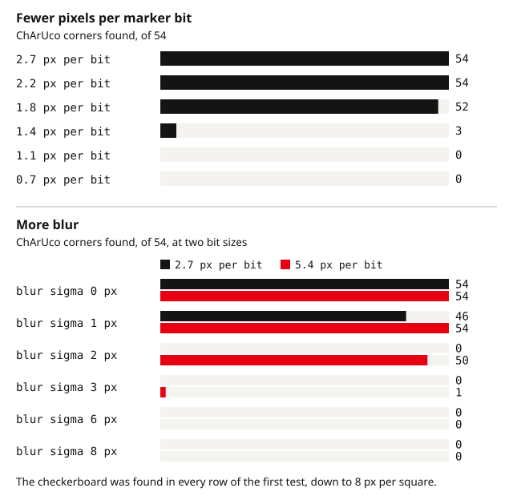

Detection failures come in two kinds. Either the image does not carry the pattern well enough (too small, blurred, washed out, glaring), or the detector is looking for a different board than the one in front of the camera. The counts the detector returns tell you which one you have.

This guide walks through both kinds for ChArUco, checkerboard and AprilGrid targets in OpenCV 4.x, with the limits we measured on synthetic images, and gives a script that prints the numbers you need to decide what to fix.

## Read the counts first

A ChArUco detector returns two things: the ArUco markers it decoded and the chessboard corners it interpolated from them. Treat them as two separate tests:

| Markers | Corners | Meaning |
|---|---|---|
| 0 | 0 | Image problem, wrong dictionary, wrong border bits, mirrored or inverted image |
| Many | 0 | Board definition mismatch: column count, row/column order, or legacy layout |
| Some | Some | Image is marginal: bits too small, blur, tilt, glare or low contrast |
| All | All | Detection is fine; look elsewhere if the calibration is poor |

For a plain checkerboard there is only one flag, so the diagnosis comes from trying a second detector and from looking at the drawn corners.

## 1. Run the diagnostic script

Run this on one failing image. It reports the marker and corner counts, estimates the marker size on the sensor, and saves an overlay you can look at:

```python
import cv2
import numpy as np

d = cv2.aruco.getPredefinedDictionary(cv2.aruco.DICT_6X6_250)
board = cv2.aruco.CharucoBoard((10, 7), 25.0, 18.0, d)  # (cols, rows), square, marker
detector = cv2.aruco.CharucoDetector(board)

gray = cv2.imread("frame.png", cv2.IMREAD_GRAYSCALE)
ch_corners, ch_ids, mk_corners, mk_ids = detector.detectBoard(gray)

n_mk = 0 if mk_ids is None else len(mk_ids)
n_ch = 0 if ch_ids is None else len(ch_ids)
print(f"image {gray.shape[1]}x{gray.shape[0]}  markers {n_mk}/{len(board.getIds())}"
      f"  corners {n_ch}/{len(board.getChessboardCorners())}")

if n_mk:
    sides = [np.linalg.norm(c[0][0] - c[0][1]) for c in mk_corners]
    bits = 6 + 2  # 6x6 dictionary plus one border bit on each side
    print(f"marker side {np.median(sides):.1f} px  ->  {np.median(sides) / bits:.2f} px per bit")
    x, y, w, h = cv2.boundingRect(np.concatenate(mk_corners).reshape(-1, 2).astype(np.float32))
    roi = gray[y:y + h, x:x + w]
    print(f"gray levels on the board: black {np.percentile(roi, 5):.0f}  white {np.percentile(roi, 95):.0f}")

vis = cv2.cvtColor(gray, cv2.COLOR_GRAY2BGR)
if n_mk:
    cv2.aruco.drawDetectedMarkers(vis, mk_corners, mk_ids)
if n_ch:
    cv2.aruco.drawDetectedCornersCharuco(vis, ch_corners, ch_ids, (0, 0, 255))
cv2.imwrite("frame_detected.png", vis)
```

The pixels-per-bit number is the one to watch. Everything in the next section is, in the end, a way of pushing it under the detector's limit.

## 2. Image problems: what the synthetic data shows

We rendered a 10 × 7 ChArUco board (25 mm squares, 18 mm markers, DICT_6X6_250) and the matching checkerboard through a 1280 × 960 camera with mild barrel distortion, degraded the images one factor at a time, and ran the OpenCV 4.14 detectors with default parameters. The script is linked at the end.

### Too few pixels

| Pixels per square | Pixels per bit | ChArUco corners (of 54) | Markers (of 35) | Checkerboard |
|---|---|---|---|---|
| 30 | 2.7 | 54 | 35 | found |
| 24 | 2.2 | 54 | 35 | found |
| 20 | 1.8 | 52 | 34 | found |
| 16 | 1.4 | 3 | 6 | found |
| 12 | 1.1 | 0 | 0 | found |
| 8 | 0.7 | 0 | 0 | found |

The marker bits are the limit. ChArUco is complete down to about 2 px per bit and collapses below 1.5 px; the checkerboard detector was still finding every corner at 8 px per square. AprilTag 36h11 tags behaved the same way: 32 of 36 tags at 2 px per bit, 18 at 1.5 px, none at 1 px.

Relaxed detector parameters (`minMarkerPerimeterRate`, smaller adaptive-threshold windows, `perspectiveRemovePixelPerCell`) and 2× cubic upscaling recovered nothing at 12 px per square. Once the bits are gone, no setting brings them back.

**Fix:** move closer, use a larger board, or use a dictionary with fewer bits (4×4 gives 6 cells across instead of 8). The [target size guide](/guides/calibration-target-size/) and the [FOV calculator](/tools/fov/) turn a required bit size into a board size.

### Blur

| Blur sigma (px) | 2.7 px/bit: corners | 5.4 px/bit: corners | Checkerboard (either) |
|---|---|---|---|
| 0 | 54 | 54 | found |
| 1 | 46 | 54 | found |
| 2 | 0 | 50 | found |
| 3 | 0 | 1 | found |
| 6 | 0 | 0 | found |
| 8 | 0 | 0 | lost (SB) |

Blur scales with bit size: markers survive a Gaussian blur of roughly a third of a bit and fail at about half. The checkerboard tolerates blur more than five times larger. Defocus, motion blur and a cheap lens at full aperture all count.



**Fix:** refocus at the working distance, shorten the exposure (add light rather than gain), hold the board still, and stop the lens down one or two steps.

### Tilt

Tilt foreshortens the bits in one direction. In our runs, corners started dropping once the foreshortened bit size fell under about 1.5 px. At 2.7 px per bit that happened at 55–60° of tilt; at 5.4 px per bit the board was still complete at 60° and lost a third of its corners at 75°.

**Fix:** keep tilt under about 45° unless the markers are large, and remember that a view at 60° needs roughly twice the pixels per bit of a frontal view. For calibration, 45° is enough to pin the focal length.

### Exposure and contrast

| Black level | White level | Span | ChArUco corners | Checkerboard |
|---|---|---|---|---|
| 12 | 182 | 170 | 54 | found |
| 104 | 138 | 34 | 54 | found |
| 117 | 134 | 17 | 50 | found |
| 123 | 132 | 9 | 5 | found |
| 168 | 252 | 84 (overexposed) | 15 | found |
| 3 | 88 | 85 (underexposed) | 0 | found |

The adaptive threshold copes with a flat image surprisingly well: 17 gray levels of span still gave 50 corners. What hurts is clipping. Once the white squares saturate at 255 or the black squares sit near 0, the marker cells near the clipped end lose their edges and decoding fails.

**Fix:** lock auto-exposure, then set it so the white squares read about 180–220 and the black squares stay above 20. Check the 5th and 95th percentiles the script prints, not the average.

### Glare and hot spots

| Saturated spot radius | ChArUco corners | Checkerboard (classic) | Checkerboard (SB) |
|---|---|---|---|
| 60 px | 47 | lost | lost |
| 100 px | 41 | lost | lost |
| 150 px | 33 | found | lost |
| 300 px (soft) | 1 | found | found |

A small saturated reflection breaks the checkerboard completely, because the detector needs every inner corner; ChArUco only loses the corners under the spot. A very large, soft gradient does the opposite: the checkerboard's adaptive threshold copes, and ChArUco runs out of readable markers.

**Fix:** move the light or the board so the specular reflection falls outside the frame, use diffuse light from two sides, and prefer a matte board surface. A glossy print under a point light is the most common cause.

### Partly out of frame

With the board running off two image edges, ChArUco returned 28 of 54 corners and the checkerboard detector returned nothing. That is expected: a checkerboard must be fully visible with a white margin around it, and a view where the board touches the edge is only usable with a coded pattern.

The checkerboard detector also needs that white margin. In our test, a board with no border against a dark background was not found by `findChessboardCorners`, while `findChessboardCornersSB` still found it.

## 3. Definition problems: markers found, no corners

These failures produce exactly the same image on every frame, so no amount of lighting work helps. Each line below is one test on a clean, sharp image of the 10 × 7 board.

| Detector configured as | Markers | Corners |
|---|---|---|
| 10 × 7, DICT_6X6_250 (correct) | 35 | 54 |
| DICT_6X6_1000 (superset) | 35 | 54 |
| DICT_5X5_250, DICT_4X4_250, DICT_7X7_250 | 0 | 0 |
| (7, 10): rows and columns swapped | 35 | 0 |
| 9 × 7 or 11 × 7: wrong column count | 35 | 0 |
| 10 × 8: one row too many | 35 | 54 |
| Square 30 mm or marker 15 mm instead of 25 / 18 | 35 | 54 |
| Legacy layout, 10 × 8 board, flag not set | 40 | 0 |
| Print has 2 border bits, detector expects 1 | 0 | 0 |
| Image mirrored | 0 | 0 |
| Image inverted (white markers on black) | 0 | 0 |

### Wrong dictionary family

A dictionary with a different bit count decodes nothing. A larger dictionary of the same family works, because the first N markers are shared. If you do not know what was printed, sweep:

```python
import cv2

gray = cv2.imread("frame.png", cv2.IMREAD_GRAYSCALE)
names = [n for n in dir(cv2.aruco) if n.startswith("DICT_")]
for name in names:
    d = cv2.aruco.getPredefinedDictionary(getattr(cv2.aruco, name))
    corners, ids, _ = cv2.aruco.ArucoDetector(d).detectMarkers(gray)
    if ids is not None and len(ids) >= 4:
        print(f"{name}: {len(ids)} markers, ids {sorted(int(i) for i in ids.ravel())[:8]}...")
```

Pick the smallest dictionary that decodes all markers with ids that run from 0 upward without gaps. Boards from the [ChArUco generator](/tools/generator/charuco/) state the dictionary in the file name and in the exported `.opencv.json`.

### Columns, rows and their order

OpenCV's `CharucoBoard` takes `(columns, rows)`. Swapping them, or getting the column count wrong by one, still decodes every marker, because the marker IDs are valid; it then places those IDs at the wrong positions on the board and interpolates no corners. One row too many is harmless.

Square and marker sizes do not affect detection at all. If detection is fine but the calibrated distances are off by a constant factor, that is where to look.

### The legacy layout

OpenCV 4.6 changed where the first marker sits. For a board with an **even** number of rows the two layouts differ; for an odd number of rows they are identical, which is why this bug comes and goes between board sizes. The symptom is every marker found and zero corners.

```python
import cv2

d = cv2.aruco.getPredefinedDictionary(cv2.aruco.DICT_6X6_250)
gray = cv2.imread("frame.png", cv2.IMREAD_GRAYSCALE)
for legacy in (False, True):
    board = cv2.aruco.CharucoBoard((10, 8), 25.0, 18.0, d)
    board.setLegacyPattern(legacy)
    _, ch_ids, _, mk_ids = cv2.aruco.CharucoDetector(board).detectBoard(gray)
    print(f"legacy={legacy}: markers {0 if mk_ids is None else len(mk_ids)}"
          f"  corners {0 if ch_ids is None else len(ch_ids)}")
```

Boards made with OpenCV 4.5 or earlier, and many older online generators, use the legacy layout. If the legacy flag fixes the corner count, keep it set for that board and write it next to the board file so the next person does not repeat the search.

### Border bits, mirrored and inverted images

Markers printed with a two-bit black border need `markerBorderBits = 2`. A mirrored image decodes nothing, because ArUco codes are not mirror-symmetric; flip it back with `cv2.flip(img, 1)`. A negative board, white markers on black, needs `detectInvertedMarker = True`:

```python
import cv2

d = cv2.aruco.getPredefinedDictionary(cv2.aruco.DICT_6X6_250)
board = cv2.aruco.CharucoBoard((10, 7), 25.0, 18.0, d)
gray = cv2.imread("frame.png", cv2.IMREAD_GRAYSCALE)

params = cv2.aruco.DetectorParameters()
params.markerBorderBits = 2          # printed with a thick border
params.detectInvertedMarker = True   # white markers on a black board
detector = cv2.aruco.CharucoDetector(board)
detector.setDetectorParameters(params)
_, ch_ids, _, mk_ids = detector.detectBoard(gray)
print(0 if mk_ids is None else len(mk_ids), 0 if ch_ids is None else len(ch_ids))
```

## 4. Checkerboard-specific checks

The pattern size is the number of **inner corners**, `(columns − 1, rows − 1)` for a board counted in squares. Passing the square count fails outright. Passing the counts in the wrong order may still return corners, numbered differently from your object points, so look at the drawn numbering.

Run both detectors. `findChessboardCornersSB` is more robust to a missing white margin and gives more accurate corners; the classic detector sometimes copes with glare the SB detector rejects. If they disagree, the drawn result tells you which one to trust:

```python
import cv2

gray = cv2.imread("frame.png", cv2.IMREAD_GRAYSCALE)
pattern = (9, 6)  # inner corners of a 10 x 7 board

ok_sb, c_sb = cv2.findChessboardCornersSB(gray, pattern, flags=cv2.CALIB_CB_NORMALIZE_IMAGE)
ok_cl, c_cl = cv2.findChessboardCorners(
    gray, pattern, flags=cv2.CALIB_CB_ADAPTIVE_THRESH | cv2.CALIB_CB_NORMALIZE_IMAGE)
print(f"SB: {ok_sb}  classic: {ok_cl}")

vis = cv2.cvtColor(gray, cv2.COLOR_GRAY2BGR)
if ok_sb:
    cv2.drawChessboardCorners(vis, pattern, c_sb, ok_sb)
elif ok_cl:
    cv2.drawChessboardCorners(vis, pattern, c_cl, ok_cl)
cv2.imwrite("frame_chess.png", vis)
```

A checkerboard with an even number of squares in both directions is symmetric under a 180° rotation, so the corner order can flip between frames. Use a board with one odd and one even square count, such as 10 × 7 or the 9 × 6 default of the [checkerboard generator](/tools/generator/checkerboard/).

## 5. AprilGrid checks

Kalibr's AprilGrid uses the AprilTag 36h11 family, and the bit-size limits above apply. A 36h11 tag has 8 cells across including its border; in our test the tags decoded fully at 3 px per cell, mostly at 2 px, and not at 1 px. Kalibr's detector differs from OpenCV's, but it reads the same bits.

Check the YAML against the print: `tagCols` and `tagRows` count tags, `tagSize` is the tag edge in meters, and `tagSpacing` is the gap between tags divided by the tag size. A grid from a different generator may also start at another tag ID, so compare the decoded IDs with what Kalibr expects.

The [Kalibr guide](/guides/kalibr-camera-imu-calibration/) covers the file in detail.

For a quick OpenCV sanity check of an AprilGrid image, run the dictionary sweep above; `DICT_APRILTAG_36h11` should decode every visible tag.

## 6. Check it before you calibrate

Run the diagnostic on every image and reject frames where the ChArUco corner count is below about a third of the board, or where the checkerboard is not found. Then look at the bit size and gray-level lines the script prints:

- pixels per bit at or above 3 in the frontal view;
- white squares between about 180 and 220, black squares above about 20, nothing clipped;
- the sharpest frames you can get, with the board held still.

The browser [detection check](/tools/check/) runs the same OpenCV detectors on a photo without uploading it, and the [quality analyzer](/tools/quality/) flags blur and exposure across a whole set.

## Common problems

| Symptom | Likely cause | Fix |
|---|---|---|
| 0 markers, 0 corners, image looks fine | Wrong dictionary family, border bits, or mirrored image | Dictionary sweep; set `markerBorderBits`; flip the image |
| All markers, 0 corners | Column count, (cols, rows) order, or legacy layout | Check the board definition; try `setLegacyPattern(True)` |
| Corners vanish in tilted views only | Foreshortened bits under ~1.5 px | Larger markers or less tilt; 3 px per bit frontal |
| Corners vanish in some frames of a sequence | Motion blur or exposure hunting | Lock exposure and focus; hold the board still |
| Checkerboard lost, ChArUco on the same board fine | Board touches the image edge or a glare spot | Use ChArUco for edge views; move the light |
| Checkerboard found only by one detector | Missing white margin (classic) or glare (SB) | Trust the one whose drawn corners sit on real corners |
| Detection fine, calibration scale wrong | Square or marker size entered wrong | Measure the print; sizes do not affect detection |
| Works at 1280 px, fails at 640 px | Bits dropped under 2 px | Calibrate at the full resolution or use a larger board |

## Next steps

- [Camera calibration with OpenCV](/guides/opencv-camera-calibration/) — the full pipeline once every frame detects.

- [How big should your target be?](/guides/calibration-target-size/) — turn the pixels-per-bit requirement into a board size.

- [ChArUco vs checkerboard vs AprilGrid](/guides/charuco-vs-checkerboard-vs-aprilgrid/) — when the robustness trade-offs above should change your pattern.

- Several boards in one scene: [give each board its own marker IDs](/guides/multi-board-marker-ids/) so the detector cannot confuse them.
