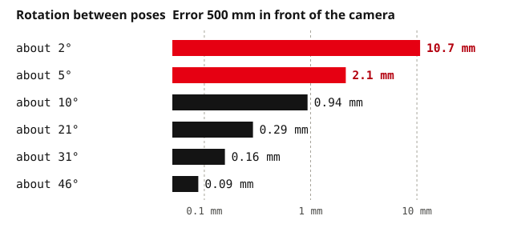
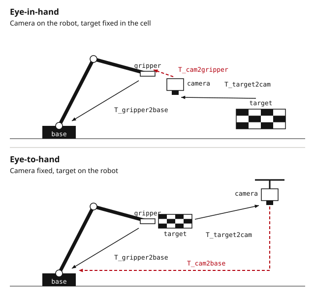

Hand-eye calibration finds the fixed transform between a camera and a robot. We simulated a camera on a robot flange looking at a ChArUco board and ran `cv2.calibrateHandEye` 200 times for each way of doing it.



Twenty poses each time. The only thing that changes from bar to bar is how far the robot turns between one pose and the next.

Everything in the test sections is simulation, not a real robot. The last section says what that leaves out.

## The short answer

- **Rotation between poses decides the result.** About 2° gave 10.7 mm of error at the work point, 31° gave 0.16 mm.
- **Rotate about more than one axis.** Rotation about one axis only, or translation only, gave no usable result with any of the five methods.
- **15 to 20 poses is enough.** 20 poses gave 0.16 mm, 50 poses 0.09 mm. Three poses gave 0.95 mm.
- **Use Park or Horaud.** Tsai matches them when the rotations are large and fails without raising an error when they are small.
- **The residual does not see a wrong camera calibration.** Focal length off by 0.5 %: residual 0.29 mm, real error 2.5 mm.

"Error" on this page is how far off a point 500 mm in front of the camera lands when it is carried into the robot's frame with the calibrated transform. The numbers are medians of 200 runs.

## The two arrangements

**Eye-in-hand.** The camera is mounted on the robot flange or gripper and the calibration target sits still in the cell. The unknown is the camera pose relative to the gripper, `T_cam2gripper`.

**Eye-to-hand.** The camera is fixed (on a stand or the ceiling) and the target is mounted on the gripper. The unknown is the camera pose relative to the robot base, `T_cam2base`.



Both are solved by the same function. For every robot pose you record two things: the flange pose from the controller, `T_gripper2base`, and the board pose seen by the camera, `T_target2cam`.

## The test

- **Cell.** Camera on the flange, 82 mm out and 60 mm to the side. A 250 × 175 mm ChArUco board with 54 inner corners lies in the cell, 420 to 580 mm from the camera.
- **Camera.** 1920 × 1440 px, focal length 2250 px, radial distortion k1 = −0.12. Each corner gets 0.1 px of noise per axis; the board pose comes from `solvePnP`.
- **Robot.** The reported flange pose is off by 0.05 mm and 0.01° per axis. A second, rougher robot is off by 0.5 mm and 0.05°.
- **Poses.** 20 per run unless stated. The camera views the board from up to 30° off its normal and is rolled up to 30° about its own axis, which puts about 31° between poses.
- **Solver.** `cv2.calibrateHandEye` with `CALIB_HAND_EYE_PARK` unless stated, OpenCV 5.1.

The corner noise is on the cautious side. In our rendered-image tests OpenCV's ChArUco corners were off by 0.02 to 0.04 px at the median.

## How much rotation

| Rotation between poses | Rotation error | Translation error | Error at 500 mm | Worst tenth of runs |
|---|---|---|---|---|
| about 2° | 0.77° | 12.2 mm | 10.7 mm | 23.5 mm |
| about 5° | 0.27° | 3.1 mm | 2.1 mm | 5.3 mm |
| about 10° | 0.13° | 1.4 mm | 0.94 mm | 2.1 mm |
| about 21° | 0.05° | 0.51 mm | 0.29 mm | 0.77 mm |
| about 31° | 0.02° | 0.26 mm | 0.16 mm | 0.30 mm |
| about 46° | 0.01° | 0.15 mm | 0.09 mm | 0.17 mm |

Every step up in rotation pays. Going from 5° to 31° between poses did more than going from 3 poses to 50.

The solver gets the camera's position on the flange from how the camera moves when the flange turns. With small turns that movement is small, and the 0.05 mm of robot error and the noise in the board pose are large next to it.

## How many poses

| Poses | Robot good to 0.05 mm | Worst tenth of runs | Robot good to 0.5 mm |
|---|---|---|---|
| 3 | 0.95 mm | 4.8 mm | 3.2 mm |
| 4 | 0.53 mm | 2.1 mm | 2.0 mm |
| 6 | 0.35 mm | 0.99 mm | 1.3 mm |
| 10 | 0.25 mm | 0.53 mm | 0.94 mm |
| 15 | 0.19 mm | 0.39 mm | 0.75 mm |
| 20 | 0.16 mm | 0.31 mm | 0.64 mm |
| 30 | 0.13 mm | 0.25 mm | 0.48 mm |
| 50 | 0.09 mm | 0.22 mm | 0.36 mm |

Three poses is the fewest `calibrateHandEye` accepts. It works on the median and fails often: one run in ten was off by 4.8 mm or more.

From 15 poses on, each extra pose buys little. The rougher robot is between three and four times worse at every count, so the robot's own error sets the scale and more poses only chip at it.

## Which method

`calibrateHandEye` has five methods. Same data, error at 500 mm:

| Method | About 31° between poses | About 10° | About 5° |
|---|---|---|---|
| `CALIB_HAND_EYE_TSAI` | 0.16 mm | 1.3 mm | 123 mm |
| `CALIB_HAND_EYE_PARK` | 0.16 mm | 0.94 mm | 2.1 mm |
| `CALIB_HAND_EYE_HORAUD` | 0.16 mm | 0.94 mm | 2.1 mm |
| `CALIB_HAND_EYE_ANDREFF` | 0.43 mm | 1.7 mm | 3.1 mm |
| `CALIB_HAND_EYE_DANIILIDIS` | 0.20 mm | 1.3 mm | 3.3 mm |

With large rotations Tsai, Park and Horaud are the same. Park and Horaud stay the best as the rotations shrink.

Tsai at about 5° is the one to know about. In all 200 runs OpenCV wrote "Hand-eye calibration failed! Not enough informative motions" to its error log and returned a matrix anyway, the same one every time, 14.65° and 123 mm off. No exception is raised.

With rotation about more than one axis, no method returned NaN in any run.

## Motions that cannot work

Two sets of 20 poses gave no usable result with any method:

- **Rotation about one axis only.** The camera tilts back and forth about a single axis of the board, about 17° between poses. The best method, Andreff, was off by 133 mm. Park returned NaN or a matrix that is not a rotation in 187 of 200 runs.
- **Translation only.** The camera slides around with its orientation fixed. Andreff was off by 328 mm. Park failed in 99 of 200 runs.

The position of the camera along the one rotation axis cannot be found from such motion, whatever the number of poses.

## What the camera side adds

The board pose comes from the camera, so the camera's errors go straight in.

| Change | Error at 500 mm |
|---|---|
| Corner noise 0.03 px | 0.09 mm |
| Corner noise 0.1 px | 0.16 mm |
| Corner noise 0.3 px | 0.41 mm |
| Corner noise 1 px | 1.3 mm |

Corner noise matters less than rotation. A wrong camera model matters more, and the next section shows why it is hard to see.

## What the residual shows, and what it hides

The usual check: with the result in hand, work out where each pose puts the fixed board in the robot's base frame. The spread of those positions is the residual.

| Case | Residual, mean | Real error at 500 mm |
|---|---|---|
| Everything right | 0.18 mm | 0.15 mm |
| Focal length 0.5 % too long | 0.29 mm | 2.5 mm |
| Square size entered 1 % too large | 0.82 mm | 5.0 mm |
| Lens distortion left out | 4.1 mm | 6.2 mm |
| Robot good to 0.5 mm | 1.0 mm | 0.64 mm |

A focal length that is 0.5 % off moves the result by 2.5 mm and the residual by 0.1 mm. The board is consistently in the wrong place, and consistency is all the residual measures.

It also runs the other way. The rougher robot has more than three times the residual of the good one with the focal length 0.5 % off, and a quarter of its error.

What the residual does catch is one bad pose. We moved one robot reading in 20 by 2, 5 or 20 mm:

| One reading off by | Error at 500 mm | Largest residual | Bad pose had the largest residual | Error after dropping it |
|---|---|---|---|---|
| 2 mm | 0.30 mm | 1.8 mm | 200 of 200 runs | 0.16 mm |
| 5 mm | 0.67 mm | 4.5 mm | 200 of 200 runs | 0.16 mm |
| 20 mm | 2.7 mm | 18.2 mm | 200 of 200 runs | 0.16 mm |

So use the residual to find a bad pose, and something physical to judge accuracy: touch a known point with the tool, or measure a gauge of known length.

## Eye-to-hand

For a fixed camera the same solver is fed the inverse robot poses. We ran the same cell with the roles swapped.

| Robot | Eye-in-hand | Eye-to-hand |
|---|---|---|
| Good to 0.05 mm | 0.16 mm | 0.21 mm |
| Good to 0.5 mm | 0.64 mm | 0.86 mm |

A little worse, same order. Everything above about rotation and pose count applies to both.

## The code

The blocks below are one script. We ran it as printed on 15 rendered images of a ChArUco board for each arrangement. Eye-in-hand came out 0.01° and 0.13 mm from the truth, eye-to-hand 0.01° and 0.33 mm.

**Robot poses.** Most controllers report the flange pose as position plus Euler angles or a quaternion. Convert to a 4 × 4 matrix, with everything in meters or everything in millimeters. Check the axis order in the controller manual.

```python
import json
import cv2
import numpy as np
from scipy.spatial.transform import Rotation

def pose_matrix(xyz_mm, rpy_deg, order="xyz"):
    """Controller pose -> 4x4 T_gripper2base in meters. Check `order` against your manual."""
    T = np.eye(4)
    T[:3, :3] = Rotation.from_euler(order, rpy_deg, degrees=True).as_matrix()
    T[:3, 3] = np.asarray(xyz_mm, float) / 1000.0
    return T
```

**Camera and board.** Load the camera calibration and set up the board exactly as printed. The [camera calibration guide](/calibacademy/opencv-camera-calibration/) covers the first; measure a few squares with calipers for the second.

```python
fs = cv2.FileStorage("camera.yaml", cv2.FILE_STORAGE_READ)
K = fs.getNode("K").mat()
dist = fs.getNode("dist").mat()
fs.release()

d = cv2.aruco.getPredefinedDictionary(cv2.aruco.DICT_6X6_250)
board = cv2.aruco.CharucoBoard((10, 7), 0.030, 0.022, d)  # (cols, rows), square, marker, meters
detector = cv2.aruco.CharucoDetector(board)
```

**Board pose in each image.**

```python
def target_pose(gray):
    corners, ids, _, _ = detector.detectBoard(gray)
    if ids is None or len(ids) < 6:
        return None
    obj, img = board.matchImagePoints(corners, ids)
    ok, rvec, tvec = cv2.solvePnP(obj, img, K, dist, flags=cv2.SOLVEPNP_IPPE)
    if not ok:
        return None
    R, _ = cv2.Rodrigues(rvec)
    return R, tvec.ravel()
```

**The four lists the solver takes,** aligned pose by pose:

```python
R_g2b, t_g2b, R_t2c, t_t2c = [], [], [], []
for rec in json.load(open("poses.json")):
    gray = cv2.imread(rec["image"], cv2.IMREAD_GRAYSCALE)
    pose = target_pose(gray)
    if pose is None:
        print("skipping", rec["image"])
        continue
    T = pose_matrix(rec["xyz_mm"], rec["rpy_deg"])
    R_g2b.append(T[:3, :3]); t_g2b.append(T[:3, 3])
    R_t2c.append(pose[0]);   t_t2c.append(pose[1])
print(len(R_g2b), "poses")
```

**Eye-in-hand.** Pass the robot poses as recorded. The result is the camera in the gripper frame.

```python
R, t = cv2.calibrateHandEye(R_g2b, t_g2b, R_t2c, t_t2c,
                            method=cv2.CALIB_HAND_EYE_PARK)
T_cam2gripper = np.eye(4)
T_cam2gripper[:3, :3] = R
T_cam2gripper[:3, 3] = t.ravel()
print(T_cam2gripper)
```

A point seen by the camera maps into the base frame with `T_gripper2base @ T_cam2gripper @ p_cam`, using the robot pose at the moment of the image.

**Eye-to-hand.** Feed the inverse robot pose, base-to-gripper. The result is the camera in the base frame, and a point maps with `T_cam2base @ p_cam`.

```python
R_b2g = [R.T for R in R_g2b]
t_b2g = [-R.T @ t for R, t in zip(R_g2b, t_g2b)]

R, t = cv2.calibrateHandEye(R_b2g, t_b2g, R_t2c, t_t2c,
                            method=cv2.CALIB_HAND_EYE_PARK)
T_cam2base = np.eye(4)
T_cam2base[:3, :3] = R
T_cam2base[:3, 3] = t.ravel()
```

**The residual,** for eye-in-hand. For eye-to-hand use `np.linalg.inv(Tg) @ T_cam2base @ Tt`.

```python
X = T_cam2gripper
spread = []
for Rg, tg, Rt, tt in zip(R_g2b, t_g2b, R_t2c, t_t2c):
    Tg = np.eye(4); Tg[:3, :3] = Rg; Tg[:3, 3] = tg
    Tt = np.eye(4); Tt[:3, :3] = Rt; Tt[:3, 3] = tt
    spread.append((Tg @ X @ Tt)[:3, 3])
spread = np.array(spread)
dev = np.linalg.norm(spread - spread.mean(axis=0), axis=1) * 1000
print("target position spread, mm: mean %.2f max %.2f" % (dev.mean(), dev.max()))
```

**Save it** with the camera calibration it was computed with. It holds for that camera, that lens setting and that mounting.

```python
fs = cv2.FileStorage("hand_eye.yaml", cv2.FILE_STORAGE_WRITE)
fs.write("T_cam2gripper", T_cam2gripper)   # or T_cam2base
fs.write("K", K)
fs.write("dist", dist)
fs.release()
```

The board has to stay put for all of this: clamped in the cell for eye-in-hand, bolted to the flange for eye-to-hand. The [hand-eye calibration kit](/targets/hand-eye-calibration-kit/) has a flange adapter for the second case.

## Software versions

`calibrateHandEye` arrived in OpenCV 4.1. The ChArUco code above uses the `CharucoDetector` API from OpenCV 4.7 onward.

The 5.0.0 Python wheel does not have `cv2.calibrateHandEye` or `cv2.calibrateRobotWorldHandEye`, only the `CALIB_HAND_EYE_*` constants. The 5.1.0 wheel has both functions. We checked 4.6, 4.11, 4.12, 5.0.0 and 5.1.0.

## What we got wrong

The earlier version of this page had no measurements beyond one run. Five things in it do not hold:

- **"Aim for 30° to 45° between poses."** Right, but it gave no reason and no cost. The cost of 10° instead of 31° is six times the error.
- **"Daniilidis and Andreff can fail and return NaN."** Neither did, on any of our data. The NaN we saw came from Park, on poses rotated about one axis. The method that fails without saying so is Tsai, at small rotations.
- **"Pin opencv-contrib-python below 5."** Only 5.0.0 lacks the function. 5.1 has it.
- **"Rotation errors around 0.1° and translation errors of 1 to 3 mm are typical."** We had not measured that. With a robot good to 0.05 mm we get 0.03° and 0.29 mm, with one good to 0.5 mm, 0.06° and 0.66 mm.
- **"Methods that disagree point to bad data."** Partly. Disagreement does show up when the rotations are too small, because Tsai gives up first. A wrong camera calibration moves all methods together.

The page also pointed to HALCON and ROS tools for the same workflow. We have not run those and took the pointers out.

## Try it yourself

This script builds a small cell in numbers, no images, and calibrates it 200 times with poses turned by up to 3, 10 and 30°. It needs numpy and opencv-python 4.1 or later, but not 5.0.

```python
import numpy as np, cv2

def T(rvec_deg, t):                                   # 4x4 pose from a rotation vector in degrees and a translation in mm
    M = np.eye(4); M[:3, :3] = cv2.Rodrigues(np.radians(np.array(rvec_deg, float)))[0]; M[:3, 3] = t; return M

X_true = T([4, -7, 12], [35, -48, 82])                # camera in the flange frame: what calibration should find
board_in_base = T([178, 3, 25], [620, -90, 15])       # the board lying in the cell

def calibrate(max_turn_deg, rng, poses=20):
    R_g2b, t_g2b, R_t2c, t_t2c = [], [], [], []
    for _ in range(poses):
        # where the camera sees the board: about 500 mm away, turned by up to max_turn_deg about a random axis
        board_in_cam = T(rng.uniform(-max_turn_deg, max_turn_deg, 3), [rng.uniform(-60, 60), rng.uniform(-40, 40), rng.uniform(420, 580)])
        flange_in_base = board_in_base @ np.linalg.inv(board_in_cam) @ np.linalg.inv(X_true)
        # what gets recorded: the robot is off by 0.05 mm, the camera's board pose by 0.1 mm and 0.02 degrees
        seen = T(rng.normal(0, 0.02, 3), rng.normal(0, 0.1, 3)) @ board_in_cam
        R_g2b.append(flange_in_base[:3, :3]); t_g2b.append(flange_in_base[:3, 3] + rng.normal(0, 0.05, 3))
        R_t2c.append(seen[:3, :3]); t_t2c.append(seen[:3, 3])
    R, t = cv2.calibrateHandEye(R_g2b, t_g2b, R_t2c, t_t2c, method=cv2.CALIB_HAND_EYE_PARK)
    X = np.eye(4); X[:3, :3] = R; X[:3, 3] = t.ravel()
    p = np.array([0, 0, 500, 1.0])                    # a point 500 mm in front of the camera
    return np.linalg.norm((X @ p - X_true @ p)[:3])

for turn in (3, 10, 30):
    errors = [calibrate(turn, np.random.default_rng(seed)) for seed in range(200)]
    print(f"poses turned up to {turn:2d} degrees: point 500 mm ahead is off by {np.median(errors):5.2f} mm (median of 200 runs), {np.percentile(errors, 90):5.2f} mm in the worst tenth")
```

With OpenCV 4.12 and 5.1 it prints:

```text
poses turned up to  3 degrees: point 500 mm ahead is off by  1.29 mm (median of 200 runs),  2.18 mm in the worst tenth
poses turned up to 10 degrees: point 500 mm ahead is off by  0.35 mm (median of 200 runs),  0.54 mm in the worst tenth
poses turned up to 30 degrees: point 500 mm ahead is off by  0.12 mm (median of 200 runs),  0.20 mm in the worst tenth
```

Change `method=` to `cv2.CALIB_HAND_EYE_TSAI` and the first line jumps, with an error message from OpenCV for each run.

## What this test is not

- **Simulation.** The robot's error here is random and the same everywhere. A real arm's error depends on its pose, its load and its temperature, and part of it repeats.
- **Points, not images.** The board pose comes from corner positions with added noise. Only the code section ran on rendered images, and only 15 for each arrangement.
- **One cell.** One camera, one board, one working distance of about 500 mm. The millimeters scale with distance and with the robot.
- **No timing.** Robot pose and image are taken at the same instant here. On a real cell, wait for the robot to settle.
- **One wrong thing at a time.** The camera errors were added singly. A real setup can have several.
- **Not run on a robot.** No number on this page comes from hardware.

The scripts and the saved results are in our repository under `docs/content/experiments/hand-eye/`.
