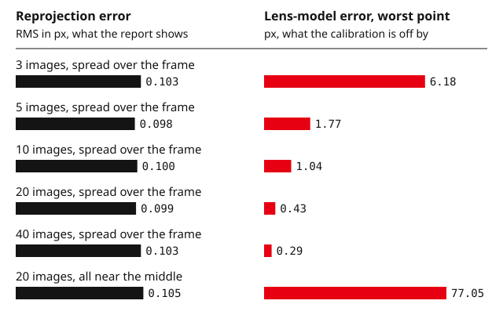

We rendered a ChArUco board in front of a camera with a known lens, calibrated from 3, 4, 5 and up to 60 of the images, and compared each result with the truth. Twenty sessions per count. Then we did it again with images that all look alike.



The left bars are what the calibration report shows. They do not move. The right bars are how wrong the camera model is, which no report shows.

All of this is simulation with one camera and one board. The last section says what that leaves out.

## The short answer

With the board spread over the frame and tilted 10 to 40°, ten images left the lens model off by about 1 px at the worst point of the image. Twenty images brought that under 0.5 px, thirty to 0.3 px. From thirty to sixty nothing changed.

The RMS reprojection error was 0.10 px in every case, from three images up, so it cannot tell you when to stop. Neither can a set of held-out images, if they look like the calibration images.

Sixty images of the board held in the middle of the frame, nearly square to the camera, gave a lens model that was wrong by 32 px at the image corners. Three spread-out images did better.

With fewer than ten images, fixing the third radial term (`CALIB_FIX_K3`) and the tangential terms (`CALIB_ZERO_TANGENT_DIST`) cut the worst error by a third to a half. From twenty images on it made no difference.

## The test

- **Camera.** 1280 × 960 px, focal length 1500 px, one radial distortion term (k1 = −0.12), no noise in the model. The true lens is simple, which matters for the parameter section below.
- **Board.** A 10 × 7 ChArUco board, 30 mm squares, 22 mm markers, DICT_6X6_250. In the shop it is the [ChArUco board](/targets/charuco-composite/).
- **Images.** Every pixel is traced through the true lens onto the board, 0.8 px blur and 2 gray levels of noise are added. Corners come from OpenCV's `CharucoDetector`; across the pool the worst corner was 0.57 px from the truth; in half the views all corners were within 0.2 px, in 90 % within 0.3 px.
- **Views.** 400 "spread" views: the whole board in the image, its long side 28 to 50 % of the image width when seen square-on, tilted 10 to 40° about a random axis, anywhere in the frame. 120 "middle" views: near the center, tilted 0 to 8°.
- **Sessions.** For each count, 20 sessions draw that many views at random from the pool and run `calibrateCamera` with default flags. 60 spread views are never drawn; they are the held-out set.

Because the true camera is known, we can measure what a real session cannot: where the true lens and the solved lens put the same ray, across the whole image, after rotating one camera to best match the other. mrcal calls this [model differencing](https://mrcal.secretsauce.net/differencing.html).

The numbers below are medians over the 20 sessions. "Worse than 1 px" counts the sessions whose worst-point error was above 1 px. "Focal length, middle sessions" is the range of the 6th to the 15th of the 20 values; the true value is 1500.

## The numbers

| Images | RMS (px) | Model error, mean (px) | Model error, worst (px) | Worse than 1 px | Focal length, middle sessions |
|---|---|---|---|---|---|
| 3 | 0.103 | 2.12 | 6.18 | 19 of 20 | 1495 to 1505 |
| 4 | 0.087 | 1.27 | 2.90 | 19 of 20 | 1497 to 1504 |
| 5 | 0.098 | 0.68 | 1.77 | 15 of 20 | 1497 to 1501 |
| 6 | 0.100 | 0.63 | 1.79 | 16 of 20 | 1498 to 1501 |
| 8 | 0.104 | 0.47 | 1.25 | 15 of 20 | 1498 to 1501 |
| 10 | 0.100 | 0.29 | 1.04 | 10 of 20 | 1499 to 1501 |
| 12 | 0.099 | 0.29 | 0.95 | 8 of 20 | 1500 to 1501 |
| 15 | 0.100 | 0.33 | 0.66 | 5 of 20 | 1499 to 1501 |
| 20 | 0.099 | 0.16 | 0.43 | 1 of 20 | 1500 to 1501 |
| 30 | 0.102 | 0.14 | 0.32 | 0 of 20 | 1500 to 1501 |
| 40 | 0.103 | 0.08 | 0.29 | 1 of 20 | 1500 to 1500 |
| 60 | 0.102 | 0.09 | 0.31 | 0 of 20 | 1500 to 1500 |

Read the first column against the fourth. Three images give a model that is 6 px wrong at the image corners. Ten images give 1 px, and half the sessions are still above that. Twenty give under half a pixel, and from thirty on the number stops moving.

The focal length settles sooner than the distortion. At ten images the middle sessions are within 1 px of the truth; the worst-point error is still 1 px because the distortion at the image corners is not pinned down yet.

The RMS column is flat. With 3 images it is 0.103 px, with 60 it is 0.102 px. The model behind the first is twenty times worse than the model behind the second.

## Why the RMS does not move

The RMS is measured at the corners the solver saw. With three images there are at most 162 corners and 9 unknowns in the camera, plus 6 per view. The model has room to bend toward every corner, and it does: the fit looks as good as with sixty images.

Where no corner was seen, the model is unconstrained, and the distortion terms run free. That is where the 6 px are. A real session has the same blind spots: the image corners that the board never reached, and the readers of the report have no way to see them.

Held-out images do not fix this if they are taken the same way. We reprojected the 60 held-out views with every solved camera: 0.112 px at 5 images, 0.110 px at 60. The check was blind to the difference, because the held-out boards sit where the calibration boards sat.

## Fewer parameters while there are few images

OpenCV's default model has five distortion parameters: k1, k2, p1, p2 and k3. With few images the solver fits k3 to noise: in four of the 20 three-image sessions |k3| came out above 1, where the true value is 0. The same sessions, solved with `CALIB_FIX_K3 | CALIB_ZERO_TANGENT_DIST`:

| Images | Worst model error, default (px) | Worst model error, k3 and tangential fixed (px) | Worse than 1 px, default | Worse than 1 px, fixed |
|---|---|---|---|---|
| 3 | 6.18 | 2.80 | 19 of 20 | 19 of 20 |
| 4 | 2.90 | 2.18 | 19 of 20 | 14 of 20 |
| 6 | 1.79 | 1.19 | 16 of 20 | 12 of 20 |
| 8 | 1.25 | 0.89 | 15 of 20 | 9 of 20 |
| 10 | 1.04 | 0.69 | 10 of 20 | 7 of 20 |
| 12 | 0.95 | 0.50 | 8 of 20 | 4 of 20 |
| 20 | 0.43 | 0.40 | 1 of 20 | 1 of 20 |
| 60 | 0.31 | 0.21 | 0 of 20 | 0 of 20 |

Up to twelve images the simpler model is better by a third to a half. From twenty on the two are the same within noise.

One caution: our true lens has only k1, so the simpler model is the right one here. A lens with real higher-order distortion needs the terms, and then the answer is more images. The [reprojection-error guide](/calibacademy/reprojection-error/) shows how to tell from the residuals.

## More of the same image does not help

The 120 "middle" views have the board near the image center, tilted at most 8°. This is what a calibration looks like when the board is held up in front of the camera and photographed many times without moving it much.

| Images, all near the middle | RMS (px) | Model error, worst (px) | Held-out RMS on spread views (px) |
|---|---|---|---|
| 10 | 0.102 | 54.94 | 0.638 |
| 20 | 0.105 | 77.05 | 0.895 |
| 60 | 0.102 | 32.13 | 0.386 |

Sixty of these images are worse than three spread-out ones. The RMS is 0.10 px, like every other row on this page. Here the held-out check does work: spread views reprojected with these cameras show 0.4 to 0.9 px instead of 0.11, because they go where the calibration boards never went.

Going from 20 to 60 middle images helped a little, from 77 to 32 px worst. That is still a model nobody could use. The image count is not the lever; the places the board was seen are.

## A check you can run

Calibrate on all your images, then on random halves, and look at how far the cameras disagree. The script below does that for a ChArUco board; edit the board line for yours. It needs numpy and opencv-contrib-python 4.7 or later.

```python
import sys, glob, numpy as np, cv2
folder = sys.argv[1]
board = cv2.aruco.CharucoBoard((10, 7), 30.0, 22.0, cv2.aruco.getPredefinedDictionary(cv2.aruco.DICT_6X6_250))
det = cv2.aruco.CharucoDetector(board)
obj_all = board.getChessboardCorners().astype(np.float32)

views = []
for f in sorted(glob.glob(folder + "/*.png") + glob.glob(folder + "/*.jpg")):
    img = cv2.imread(f, cv2.IMREAD_GRAYSCALE)
    cc, ci, _, _ = det.detectBoard(img)
    if ci is not None and len(ci) >= 6:
        views.append((obj_all[ci.ravel()], cc.reshape(-1, 2).astype(np.float32)))
size = img.shape[1], img.shape[0]
print(f"{len(views)} images with corners")

def calibrate(subset):
    rms, K, d, _, _ = cv2.calibrateCamera([views[i][0] for i in subset], [views[i][1] for i in subset], size, None, None)
    return rms, K, d

def map_difference(K1, d1, K2, d2):
    """Worst pixel distance between two cameras' undistortion maps, after the best rotation between them is removed."""
    xs, ys = np.meshgrid(np.arange(20, size[0], 40, dtype=np.float64), np.arange(20, size[1], 40, dtype=np.float64))
    px = np.stack([xs.ravel(), ys.ravel()], 1)
    rays = cv2.convertPointsToHomogeneous(cv2.undistortPoints(px.reshape(-1, 1, 2), K1, d1)).reshape(-1, 3)
    r = np.zeros(3)                                      # Gauss-Newton on the rotation only; it is tiny
    for _ in range(20):
        q, J = cv2.projectPoints(rays, r, np.zeros(3), K2, d2)
        res = (q.reshape(-1, 2) - px).ravel()
        r -= np.linalg.lstsq(J[:, 0:3], res, rcond=None)[0]
    q, _ = cv2.projectPoints(rays, r, np.zeros(3), K2, d2)
    return np.linalg.norm(q.reshape(-1, 2) - px, axis=1).max()

rms, K, d = calibrate(range(len(views)))
print(f"all {len(views)} images: RMS {rms:.3f} px, fx {K[0,0]:.1f}, cx {K[0,2]:.1f}, cy {K[1,2]:.1f}")
rng = np.random.default_rng(0)
fx, moved = [], []
for _ in range(10):
    half = rng.choice(len(views), len(views) // 2, replace=False)
    _, Kh, dh = calibrate(half)
    fx.append(Kh[0, 0]); moved.append(map_difference(K, d, Kh, dh))
print(f"10 random halves: fx {min(fx):.1f} to {max(fx):.1f}, undistortion map moved by up to {max(moved):.2f} px")
print("If the halves disagree by more than you can accept, take more images, in the places the current ones do not cover.")
```

On 24 of our spread-out rendered images it printed:

```text
24 images with corners
all 24 images: RMS 0.109 px, fx 1499.7, cx 638.0, cy 480.5
10 random halves: fx 1498.1 to 1501.6, undistortion map moved by up to 2.54 px
If the halves disagree by more than you can accept, take more images, in the places the current ones do not cover.
```

On the first 8 of them:

```text
8 images with corners
all 8 images: RMS 0.117 px, fx 1502.5, cx 639.2, cy 480.2
10 random halves: fx 1498.6 to 1508.7, undistortion map moved by up to 4.91 px
If the halves disagree by more than you can accept, take more images, in the places the current ones do not cover.
```

The two RMS values are 0.109 and 0.117 px and say nothing. The halves do: with 8 images they disagree on the focal length by 10 px and on the map by 5 px; with 24, by 3.5 px and 2.5 px.

The 2.5 px is larger than the 0.95 px median for 12 images in the table above because it is the worst of ten halves, and the worst half has k3 running off at an image corner. That is the point of the check: it finds the tail, not the median.

## What we expected and did not find

- **That the RMS would rise with few images.** It did not. 0.103 px at three images, 0.102 at sixty. We knew it was measured only at the seen corners; we did not expect it to be this blind.
- **That held-out images would show the gain from more images.** They did not, for images taken the same way. They showed poor coverage, and nothing else.
- **That sixty images would always beat ten.** Sixty images near the middle of the frame were wrong by 32 px at the corners; ten spread-out images were wrong by 1 px.

## What to do

- Take 20 to 30 images, each adding a place or an angle the others do not have: the four image corners, the edges, tilts of 20 to 40° about both axes, two distances. The [camera calibration guide](/calibacademy/opencv-camera-calibration/) has the view plan.
- Run the halves check above. When the halves agree to within what you need, stop.
- If you must work with fewer than ten images, fix k3 and the tangential terms, and say so in the report.
- Do not read the RMS as a vote of confidence. It is the same with three images as with sixty.

## What this test is not

- **Simulation.** Rendered images, one lens, flat board, even light. A real session adds focus changes, glare and a board that is not quite still. The counts above are where the gain from more images stopped for a clean setup; a noisy one may need more.
- **One lens, a simple one.** The true distortion has a single radial term. A wide-angle or fisheye lens needs more terms and probably more images to pin them down. We did not test that.
- **One board and one detector.** A 10 × 7 ChArUco board at 28 to 50 % of the image width. A larger board or a finer pattern gives more corners per image, which may move the curve.
- **Twenty sessions per count.** Enough to see 6 px against 0.3 px. Not enough to rank 0.29 against 0.31.

The scripts and the saved results are in our repository under `docs/content/experiments/image-count/`.
