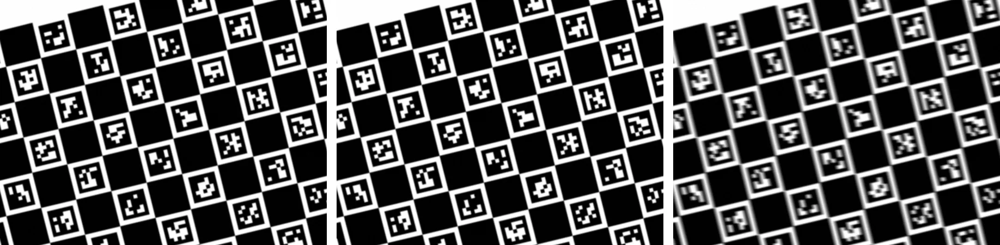
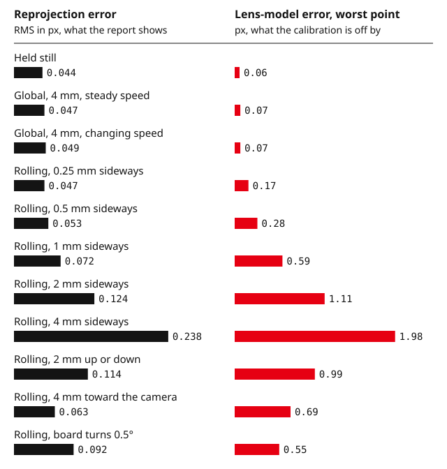

Here are three crops from calibration images of the same board. In one the board was still. In one it moved 2 mm while a rolling shutter read out the frame. In one it moved 4 mm during a global-shutter exposure.



The right one is the smeared one, and it is harmless. The middle one moved during the readout. It looks as sharp as the left one, and two images like it shifted our principal point by 2 px.

We did not expect that. We set out to show that blurred images hurt a calibration, and at first we could not make them hurt. This page is the test, including the parts that went wrong.

## The short answer

With a global shutter, 4 mm of board motion during the exposure, in two of 24 images, changed nothing we could separate from noise.

With a rolling shutter, 0.25 mm of motion between the top and the bottom row was harmless. At 1 mm the principal point was off by 1.1 px. At 2 mm it was off by 2.2 px and the lens model was wrong by up to 1.1 px, with an RMS of 0.12 px that most people would accept.

Taking the two images out brought every result back to the still session.

All of this comes from rendered images with a known camera. No real camera was involved. What that leaves open is listed [further down](#what-this-test-is-not).

## The test

The camera is 1280 × 960 px with a focal length of 1500 px and mild distortion. The board is a ChArUco with 11 × 8 squares of 30 mm, about 0.6 m away. One session is 24 images with a little defocus and sensor noise.

In images 7 and 18 the board moves. The other 22 are still. Corners are found with OpenCV's ChArUco detector and the camera is solved with `calibrateCamera`. Every row below is the median of 20 sessions with different board poses.

For a global shutter, the image is the average of the board over the exposure. For a rolling shutter, each row shows the board where it was when that row was read. At this distance 1 mm is about 2.4 px, so "2 mm" means the bottom of the frame is 5 px behind the top.

Because the true camera is known, we can measure what a real session cannot: how far the solved lens model is from the true one.

We compare where the two models put the same ray, across the whole image, after rotating one camera to best match the other. mrcal calls this [model differencing](https://mrcal.secretsauce.net/differencing.html).

## The numbers

| Two of the 24 images | RMS (px) | Model error, mean (px) | Model error, worst (px) | Principal point off (px) | Both top the chart |
|---|---|---|---|---|---|
| held still | 0.044 | 0.03 | 0.06 | 0.1 | 0 of 20 |
| global, 4 mm, steady speed | 0.047 | 0.04 | 0.07 | 0.2 | 1 of 20 |
| global, 4 mm, changing speed | 0.049 | 0.04 | 0.07 | 0.2 | 4 of 20 |
| rolling, 0.25 mm sideways | 0.047 | 0.05 | 0.17 | 0.4 | 2 of 20 |
| rolling, 0.5 mm sideways | 0.053 | 0.11 | 0.28 | 0.6 | 12 of 20 |
| rolling, 1 mm sideways | 0.072 | 0.22 | 0.59 | 1.1 | 18 of 20 |
| rolling, 2 mm sideways | 0.124 | 0.42 | 1.11 | 2.2 | 20 of 20 |
| rolling, 4 mm sideways | 0.238 | 0.79 | 1.98 | 4.5 | 20 of 20 |
| rolling, 2 mm up or down | 0.114 | 0.41 | 0.99 | 1.7 | 17 of 20 |
| rolling, 4 mm toward the camera | 0.063 | 0.27 | 0.69 | 1.4 | 11 of 20 |
| rolling, board turns 0.5° | 0.092 | 0.19 | 0.55 | 2.9 | 20 of 20 |

"Global" and "rolling" are the shutter. "Model error" is the lens-model error described above. The last column asks whether the error report gives the two images away: in how many of the 20 sessions were they the two tallest bars in the per-view error chart.



Read the 2 mm row. An RMS of 0.124 px looks like a good calibration. The model behind it is off by 0.4 px on average and 1.1 px at the worst point of the image, more than ten times the still session.

## Why the smeared image is harmless

During a global-shutter exposure every pixel sees the same motion. The corner is smeared along a short line, and the detector finds the middle of that line. All corners shift together, by the same amount.

A board that is shifted as a whole is just a board in a slightly different place. The solver gives that view a slightly different pose and the camera model is untouched.

The price of blur is paid at detection. Four of our 40 smeared images were not detected, and those images are simply missing. How much blur the detectors take is in the [detection guide](/calibacademy/corner-detection-troubleshooting/).

## Why the sharp one is not

With a rolling shutter each row is exposed briefly, so nothing smears. But the rows are read one after another, and a board that drifts sideways lands a little further over in each row. The image is sheared.

A sheared picture of a flat board is still a consistent picture of a flat board. No single corner looks out of place. There is just no rigid pose that explains it with the true camera.

So the solver does what it is built to do and looks for a camera that explains all 24 images at once. It moves the principal point and the focal length a little, which spreads the damage over every view. Part of the shear ends up in the model, and only the rest shows as error.

## Does the error report show it?

Often, and less often than we hoped.

At 2 mm the two images were the two tallest bars in all 20 sessions. At 0.5 mm, where the worst model error is already four times the still value, they were in only 12 of 20.

The usual rule, drop any view above three times the median error, caught 37 of the 40 moving images at 2 mm, 24 of 40 at 1 mm and 10 of 40 at 0.5 mm. It never flagged a still image, so when it fires, believe it.

Motion toward the camera hides best. Four millimeters of it moved the principal point by 1.4 px, and the two images topped the chart in only 11 of 20 sessions.

The worst case is a session where every image moves. With up to 1 mm in all 24 images, the RMS was 0.118 px and the principal point was off by 2.5 px. There are no clean images left to compare against, and nothing to drop.

A cheap check that does work: leave out the two views with the highest error, solve again, and compare the principal point. In our sessions it went back to the still value whenever the two were the moving ones. If it barely changes, those views were not your problem.

## How fast is 2 mm?

It depends on how long the sensor takes to read a frame, and that number is rarely on the data sheet. Figures between 5 and 30 ms are commonly quoted for rolling-shutter sensors.

At 30 ms, 0.25 mm is 8 mm per second and 2 mm is 67 mm per second. At 10 ms, 2 mm is 200 mm per second.

So a board on a stand, or held and allowed to settle, is very likely fine. A board that is being carried to its next position is not.

That matches a [report on the OpenCV forum](https://forum.opencv.org/t/question-about-camera-calibration-findchessboardcorners-given-different-orientation/13060). The board was moved fast by hand, "no significantly blur was observed", and the focal length came out at twice its value.

Moving the board slowly fixed it.

We have not measured how much a hand-held board really moves. That is the largest gap in this page.

## What we got wrong on the way

Our first attempt was blur. We smeared two images by 7, then 11, then 15 px. Nothing moved. At 15 px the images failed detection and dropped out, which made the session cleaner.

The second attempt averaged two board positions in one image. Nothing again. Only when each row got its own board position did the calibration shift.

Our first write-up of that result said the focal length was off by 0.6 px. That undersold it. At 2 mm the focal length is off by 1.5 px and the principal point by 2.2 px.

We also worried that the effect was an artifact of rendering the readout in 12 bands. It is not: 48, 240 and 960 bands all give an RMS of 0.111 px against 0.117 px for 12.

## What to do

- Stop the board for every view. On a stand or a tripod if you can.
- With a rolling shutter, do not pick frames from a video of a moving board unless you select the ones where it rested.
- A short exposure fixes blur. It does nothing for readout shear.
- Look at the per-view errors, then solve again without the two worst views. If the principal point moves by a pixel, find out what happened in those two.
- If you need the result to hold below half a pixel, use a global-shutter camera or fix the board and move nothing during capture.

A question has sat on [MATLAB Answers](https://www.mathworks.com/matlabcentral/answers/320286-what-is-the-scientific-reason-for-removing-high-reprojection-error-images-from-the-stereo-calibratio) since 2017: why remove an image that is sharp and correctly detected, just because its error is high?

This is one reason. Sharp is not the same as still.

## Try it yourself

This script needs only `numpy` and `opencv-python`. It skips the images and works on corner positions, with a plain 10 × 7 checkerboard, so it runs in a few seconds. Views 7 and 18 move 2 mm during the readout.

```python
"""What a board that moves during a rolling-shutter readout does to an OpenCV calibration.

No images: corner positions are projected through a known camera, so the result can be
compared with the truth. Needs numpy and opencv-python.
"""
import numpy as np
import cv2

W, H = 1280, 960
K_TRUE = np.array([[1500.0, 0, 640], [0, 1500.0, 480], [0, 0, 1]])
DIST_TRUE = np.array([-0.12, 0.10, 0.0005, -0.0003, 0.0])
SQUARE = 30.0                                  # mm
grid = np.mgrid[0:10, 0:7].T.reshape(-1, 2)    # 10 x 7 inner corners
BOARD = np.c_[grid * SQUARE, np.zeros(len(grid))].astype(np.float32)


def random_pose(rng):
    """A board about 0.5 to 0.9 m away, tilted up to 35 degrees, somewhere in the image."""
    z = rng.uniform(500, 900)
    rvec = np.deg2rad([rng.uniform(-35, 35), rng.uniform(-35, 35), rng.uniform(-20, 20)])
    centre = np.array([rng.uniform(-0.15, 0.15) * z, rng.uniform(-0.1, 0.1) * z, z])
    R, _ = cv2.Rodrigues(rvec)
    return rvec, centre - R @ np.array([135.0, 90.0, 0.0])


def observe(rvec, tvec, rng, shift_mm=0.0, noise_px=0.05):
    """Corner positions in the image. With shift_mm, the board moves sideways by that much
    between the first and the last image row: each corner is seen where the board was
    when its own row was read out."""
    px, _ = cv2.projectPoints(BOARD, rvec, tvec, K_TRUE, DIST_TRUE)
    px = px.reshape(-1, 2)
    if shift_mm:
        for _ in range(3):                     # the row a corner lands on depends on the shift
            when = px[:, 1] / H - 0.5          # -0.5 at the top row, +0.5 at the bottom row
            R, _ = cv2.Rodrigues(rvec)
            cam = BOARD @ R.T + tvec           # corners in the camera frame, in mm
            cam[:, 0] += shift_mm * when       # sideways, by a different amount for each row
            px, _ = cv2.projectPoints(cam.astype(np.float32), np.zeros(3), np.zeros(3), K_TRUE, DIST_TRUE)
            px = px.reshape(-1, 2)
    return (px + rng.normal(0, noise_px, px.shape)).astype(np.float32)


def per_view_rms(obj, img, K, dist, rvecs, tvecs):
    """Reprojection error of each view, in pixels (root mean square over its corners)."""
    out = []
    for o, i, r, t in zip(obj, img, rvecs, tvecs):
        proj, _ = cv2.projectPoints(o, r, t, K, dist)
        out.append(float(np.sqrt(np.mean(np.sum((proj.reshape(-1, 2) - i) ** 2, axis=1)))))
    return np.array(out)


def calibrate(img_points):
    obj = [BOARD for _ in img_points]
    rms, K, dist, rvecs, tvecs = cv2.calibrateCamera(obj, img_points, (W, H), None, None)
    return rms, K, per_view_rms(obj, img_points, K, dist, rvecs, tvecs)


if __name__ == "__main__":
    rng = np.random.default_rng(1)
    poses = [random_pose(rng) for _ in range(24)]
    moving = {6: 2.0, 17: -2.0}                # views 7 and 18: 2 mm during the readout
    views = [observe(r, t, rng, moving.get(i, 0.0)) for i, (r, t) in enumerate(poses)]

    rms, K, per_view = calibrate(views)
    print(f"all 24 views:   RMS {rms:.3f} px, fx {K[0, 0]:.1f}, cx {K[0, 2]:.1f}, cy {K[1, 2]:.1f}")
    print("per view:", " ".join(f"{e:.2f}" for e in per_view))

    suspects = np.flatnonzero(per_view > 3 * np.median(per_view))
    print("views above 3x the median:", (suspects + 1).tolist())

    kept = [v for i, v in enumerate(views) if i not in suspects]
    rms, K, _ = calibrate(kept)
    print(f"without them:   RMS {rms:.3f} px, fx {K[0, 0]:.1f}, cx {K[0, 2]:.1f}, cy {K[1, 2]:.1f}")
    print("true camera:    fx 1500.0, cx 640.0, cy 480.0")
```

On our machine, with OpenCV 5.1.0, it prints:

```text
all 24 views:   RMS 0.167 px, fx 1497.9, cx 646.1, cy 483.3
per view: 0.08 0.07 0.08 0.08 0.07 0.08 0.72 0.08 0.10 0.08 0.08 0.08 0.07 0.07 0.08 0.07 0.08 0.13 0.07 0.07 0.08 0.08 0.07 0.08
views above 3x the median: [7]
without them:   RMS 0.074 px, fx 1499.6, cx 640.0, cy 480.2
true camera:    fx 1500.0, cx 640.0, cy 480.0
```

Two things about this run. View 18 moved exactly as far as view 7 and stays under the rule, at 0.13 px. And this seed is a bad one: the principal point is off by 7 px, where the median over 200 seeds is 1.3 px and nine in ten stay under 3.3 px.

Change the seed, the 2.0, or the views that move, and watch `cx`. Other versions of OpenCV may print slightly different digits.

## What this test is not

It is a simulation. The images are rendered and the motion is a constant speed in one direction. A real rolling shutter on a real hand-held board will be messier, and we have not yet repeated the test with a camera.

It is one camera: 1280 × 960 px, a 46° horizontal field of view, mild distortion. A wide-angle or fisheye lens was not tested. Neither was a higher resolution, where the same millimeter covers more pixels.

It is mostly one board. A plain 10 × 7 checkerboard in six sessions showed the same damage, with the two images at the top of the chart in only 3 of 6. A larger ChArUco at 1.3 m did too. Both samples are small.

It is two moving images out of 24. More moving images, or motion that changes direction during the readout, were not tried beyond the all-images case above.

The thresholds are therefore estimates. The direction of the result is the part we would stand behind: readout motion is invisible in the image, it biases the camera model, and blur does not.
