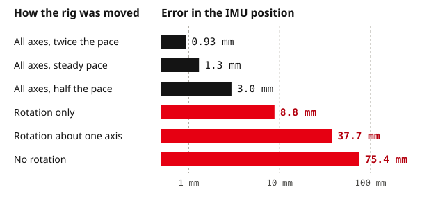
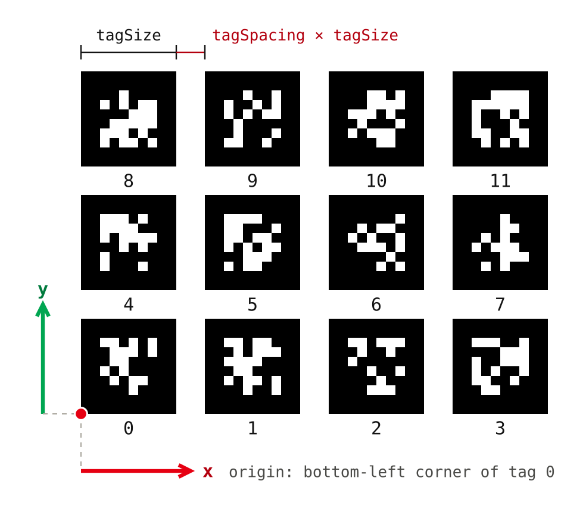

Kalibr's camera-IMU calibration gives the rigid transform between a camera and an inertial unit and the time offset between their clocks. This page covers what goes into it and which parts of the recording decide the result.



The IMU sits 69 mm from the camera in this test. Without rotation its position is simply not found.

**We did not run Kalibr for this page.** The facts about Kalibr come from reading its source and documentation. The numbers come from simulated recordings solved with a small estimator of our own. The last section says what that leaves out.

## The short answer

- **Rotate about all three axes, and translate too.** All of it: 1.3 mm. Rotation about one axis: 37.7 mm. Rotation with no translation: 8.8 mm.
- **Move at a firm pace.** Half the pace more than doubled the error, to 3.0 mm. Twice the pace brought it to 0.93 mm.
- **A minute is enough.** 20 s gave 2.2 mm, 60 s gave 1.3 mm, 120 s gave 0.96 mm.
- **Let the time offset be estimated.** A 20 ms offset that is ignored cost 13.2 mm and 0.52°. Estimated, it was found to 0.05 ms.
- **Bad IMU timestamps are worse than bad camera timestamps.** IMU samples delivered in bursts of ten: 6.2 mm, and a time offset wrong by 22.5 ms.
- **Trim the pick-up.** A jolt in the first second: 3.1 mm. With that second cut: 1.4 mm.

The millimeters are the error in the IMU's position relative to the camera, median of 30 simulated recordings.

## How we checked

**Kalibr's files and options.** Read from Kalibr's source at commit `1f60227` and from its wiki. A script in our repository pulls each fact out of those files, and a test compares this page with what it found.

**What the recording has to contain.** A simulated rig: a camera at 20 Hz and an IMU at 200 Hz, 69 mm apart, moved by hand for 60 s in front of a grid 0.55 m away. The IMU has the noise of the example values below, and the camera stamps lag by 4 ms.

At the steady pace the rig swings up to 18° about each axis and 7 cm along each, turning at about 44°/s and accelerating at about 0.7 m/s².

**The estimator.** Ours, not Kalibr's. It fits splines to the camera poses and then solves for the camera-IMU transform, the time offset, the IMU biases and gravity. Kalibr solves everything in one step. The comparisons between cases are what carry over, more than the millimeters.

## How to move the rig

| Motion | Rotation error | IMU position error |
|---|---|---|
| All axes, twice the pace | 0.03° | 0.93 mm |
| All axes, steady pace | 0.03° | 1.3 mm |
| All axes, half the pace | 0.03° | 3.0 mm |
| Rotation only, no translation | 0.07° | 8.8 mm |
| Rotation about one axis, translation along all | 0.14° | 37.7 mm |
| Translation only, no rotation | 0.14° | 75.4 mm |

The rotation between camera and IMU comes out in every case. It is found by matching the turning the gyroscope feels with the turning the camera sees.

The position is different. The accelerometer only feels where the IMU sits when the rig turns: an IMU off to one side is swung around. No turning, no signal. Turning about one axis leaves the position along that axis open.

Kalibr's documentation says the same in fewer words: "try to excite all IMU axes (rotation and translation)".

| Recording length | IMU position error |
|---|---|
| 20 s | 2.2 mm |
| 60 s | 1.3 mm |
| 120 s | 0.96 mm |

## Time offset and timestamps

The camera stamps lag by 4 ms in every recording. Kalibr defines the offset so that `t_imu = t_cam + timeshift_cam_imu`.

| Case | Offset found | Rotation error | IMU position error |
|---|---|---|---|
| Offset of 4 ms, estimated | 4.0 ms | 0.03° | 1.3 mm |
| Offset of 20 ms, estimated | 20.0 ms | 0.02° | 1.2 mm |
| Offset of 4 ms, fixed at zero | not estimated | 0.08° | 1.8 mm |
| Offset of 20 ms, fixed at zero | not estimated | 0.52° | 13.2 mm |
| Camera stamped on arrival, 0 to 15 ms late | −3.6 ms | 0.03° | 1.3 mm |
| IMU delivered in bursts of ten samples | 26.5 ms | 0.03° | 6.2 mm |

An estimated offset costs nothing, whatever its size. An ignored one costs in proportion.

Camera frames stamped late by a random 0 to 15 ms did not hurt the transform. The offset moved by 7.6 ms, the average delay. It is then the offset of that driver on that day, not a property of the hardware.

IMU bursts are the damaging case. Ten samples arrive together and share a stamp, so the IMU signal is smeared over 50 ms.

In Kalibr the offset is estimated unless you pass `--no-time-calibration`. Its option `--timeoffset-padding`, default 0.03 s, is described as the "maximum range in which the timeoffset may change during estimation".

## Jolts, corner noise and the size of the grid

| Case | IMU position error |
|---|---|
| Steady pace, nothing wrong | 1.3 mm |
| A jolt in the first second, kept | 3.1 mm |
| A jolt in the first second, cut | 1.4 mm |
| Corner noise 0.3 px instead of 0.1 px | 4.3 mm |
| Grid entered 1 % too large | 1.6 mm |

Picking the rig up produces accelerations that no smooth path fits. `--bag-from-to 5 110` cuts the start and end of a bag.

Corner noise matters: three times the noise, a little over three times the error. Sharp tags need a short exposure, which is why Kalibr's documentation asks for good light and low shutter times.

A wrong grid size matters less than we expected: 1.6 mm is close to the 1.3 mm of the recordings with nothing wrong. The accelerometer measures real meters, so the IMU position does not simply scale with the grid.

## IMU noise values

Kalibr wants four numbers for the IMU. Its documentation says to read them from an Allan deviation plot: the white noise at an averaging time of 1 s, the random walk where the fitted rising line crosses 3 s.

We simulated a gyroscope standing still with known values, 40 recordings of each length, and read the numbers back.

| Recording | White noise, worst error of 40 | Random walk within 20 % |
|---|---|---|
| 6 minutes | 8.0 % | 24 of 40 |
| 15 minutes | 4.3 % | 31 of 40 |
| 30 minutes | 3.3 % | 37 of 40 |
| 1 hour | 1.9 % | 40 of 40 |
| 2 hours | 2.3 % | 40 of 40 |
| 5 hours | 1.0 % | 40 of 40 |

The white noise is there after a few minutes. The random walk needs an hour.

One trap: the random walk is read from the fitted line, not from the curve. At 3 s the curve itself is still dominated by white noise, and in our simulation it stood 4.2 times above the true value.

A real sensor is harder than this one. Kalibr's documentation notes that its model leaves out scale errors and temperature drift, and adds: "for lowest-cost sensors, increasing the noise model parameters by a factor of 10x or more may be necessary".

## The workflow

**1. Target file.** `tagSize` is the black outer edge of one tag in meters. `tagSpacing` is the gap between tags divided by the tag size.

```yaml
target_type: 'aprilgrid'
tagCols: 6
tagRows: 6
tagSize: 0.030        # meters, outer edge of the black square
tagSpacing: 0.3       # gap / tagSize
```



Kalibr places each tag by its ID: the lowest ID at the bottom left, then left to right, then upward. The [AprilGrid generator](/tools/generator/aprilgrid/) writes this file for the grid you print, and the [AprilGrid board](/targets/aprilgrid-composite/) ships to a stated tag size.

**2. IMU file.** Topic, rate and the four noise values, in continuous-time units. These are the example values of Kalibr's documentation and of our simulation.

```yaml
rostopic: /imu0
update_rate: 200.0                  # Hz

accelerometer_noise_density: 1.86e-03   # m/s²/√Hz
accelerometer_random_walk:   4.33e-04   # m/s³/√Hz
gyroscope_noise_density:     1.87e-04   # rad/s/√Hz
gyroscope_random_walk:       2.66e-05   # rad/s²/√Hz
```

**3. Camera first.** Record the grid at many angles and distances and calibrate the camera alone. Kalibr's documentation suggests about 4 Hz for this recording, since more frames add little.

```bash
rosbag record -O static.bag /cam0/image_raw

rosrun kalibr kalibr_calibrate_cameras \
  --bag static.bag --topics /cam0/image_raw \
  --models pinhole-radtan --target aprilgrid.yaml
```

The models are `pinhole-radtan`, `pinhole-equi`, `pinhole-fov`, `omni-none`, `omni-radtan`, `eucm-none` and `ds-none`. The run writes `static-camchain.yaml`, `static-results-cam.txt` and `static-report-cam.pdf`.

**4. The moving recording.** Now the grid stays still and the rig moves. Kalibr's documentation reports good results with a camera at 20 Hz and an IMU at 200 Hz, and asks to avoid shocks when the rig is picked up.

```bash
rosbag record -O dynamic.bag /cam0/image_raw /imu0
```

**5. Run it.**

```bash
rosrun kalibr kalibr_calibrate_imu_camera \
  --bag dynamic.bag \
  --cams static-camchain.yaml \
  --imu imu.yaml \
  --target aprilgrid.yaml
```

It writes `dynamic-camchain-imucam.yaml`, `dynamic-imu.yaml`, `dynamic-results-imucam.txt` and `dynamic-report-imucam.pdf` next to the bag.

**6. Read the result.** `T_cam_imu` takes IMU coordinates to camera coordinates. This is the transform of our simulation in Kalibr's format:

```yaml
cam0:
  T_cam_imu:
  - [-0.0149, -0.9993, -0.0345, -0.0215]
  - [0.9995, -0.0140, -0.0267, -0.0647]
  - [0.0262, -0.0349, 0.9990, 0.0096]
  - [0.0000, 0.0000, 0.0000, 1.0000]
  timeshift_cam_imu: 0.0040
  camera_model: pinhole
```

Run the calibration on two separate recordings. If the two results differ by much more than the numbers in the tables above, look at the recordings before the software.

**7. Use it.** OpenVINS (`T_imu_cam`) and VINS-Fusion (`body_T_cam0`) take the camera pose in the IMU frame, the inverse of what Kalibr writes. VINS-Fusion defines its `td` the same way round as Kalibr: image clock plus `td` is IMU clock.

```python
import sys
import numpy as np, yaml

chain = yaml.safe_load(open(sys.argv[1]))
T_cam_imu = np.array(chain["cam0"]["T_cam_imu"])
T_imu_cam = np.linalg.inv(T_cam_imu)
np.set_printoptions(precision=4, suppress=True)
print("camera in IMU frame:\n", T_imu_cam)
print("time offset (s):", chain["cam0"]["timeshift_cam_imu"])
```

On the file above it prints:

```text
camera in IMU frame:
 [[-0.0149  0.9996  0.0262  0.0641]
 [-0.9993 -0.014  -0.0349 -0.0221]
 [-0.0345 -0.0267  0.9991 -0.0121]
 [ 0.      0.      0.      1.    ]]
time offset (s): 0.004
```

## Check your IMU timestamps

Before calibrating, look at the gaps between IMU stamps. Export them one per line, in seconds, and run this. It needs numpy.

```python
import sys
import numpy as np

t = np.loadtxt(sys.argv[1])               # one timestamp per line, seconds
dt = np.diff(t) * 1000
print("IMU dt ms: median %.2f  min %.2f  max %.2f" % (np.median(dt), dt.min(), dt.max()))
print("gaps > 2x nominal:", int((dt > 2 * np.median(dt)).sum()), "of", len(dt))
print("samples with the same stamp as the one before:", int((dt == 0).sum()))
```

A steady 200 Hz stream of 60 s prints:

```text
IMU dt ms: median 5.00  min 4.89  max 5.11
gaps > 2x nominal: 0 of 11999
samples with the same stamp as the one before: 0
```

The same stream delivered in bursts of ten, each burst stamped on arrival:

```text
IMU dt ms: median 0.00  min 0.00  max 50.08
gaps > 2x nominal: 1199 of 11999
samples with the same stamp as the one before: 10800
```

The second stream is the one that cost 6.2 mm and 22.5 ms above. Fix the driver before calibrating.

## What we got wrong

The earlier version of this page was written from documentation and memory, with nothing run or checked. Six things in it were wrong or unfounded:

- **The output file names.** It said `camchain-static.yaml` and `camchain-imucam-dynamic.yaml`. Kalibr puts the bag name first: `static-camchain.yaml`, `dynamic-camchain-imucam.yaml`.
- **The option `--cam`.** It is `--cams`.
- **"A 1 % error in tagSize is a 1 % error in every distance Kalibr estimates."** Not for the IMU position. In our simulation a grid 1 % too large gave 1.6 mm of error, against 1.3 mm with the right size.
- **"Random walk at τ = 3 s on the +½ slope."** True of the fitted line. Read from the curve at 3 s, the value is 4.2 times too high.
- **"Record the IMU stationary for a few hours."** One hour was enough for the simulated sensor.
- **Numbers with no source.** "0.1 to 0.3 px is normal", "a few milliseconds is common on USB cameras", "60 to 120 s". We took out the first two and measured the third.

The sample `T_cam_imu` on the old page was not a result of anything. The one above is the transform our simulation uses.

## What this test is not

- **Not Kalibr.** No number on this page was produced by Kalibr. Its estimator works differently from ours, and its failure cases may differ.
- **Simulation.** A smooth motion, a clean grid, an IMU with exactly the noise it claims. A real low-cost IMU has scale errors and temperature drift on top.
- **Poses, not images.** Camera poses come from grid points with added noise. Motion blur and rolling shutter are not in it.
- **One rig.** One camera, one IMU, 69 mm apart, one grid distance.
- **Facts as of one commit.** Kalibr's options and file names were read at commit `1f60227`. Other versions may differ.
- **Downstream frameworks read, not run.** The OpenVINS and VINS-Fusion conventions come from their example configuration files.

The scripts and the saved results are in our repository under `docs/content/experiments/camera-imu/`.
