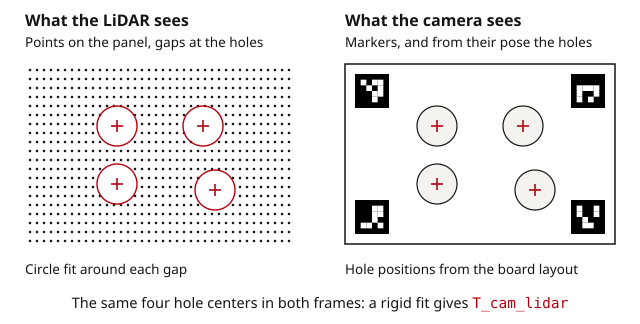

A camera and a LiDAR only become one sensor once you know the rigid transform between them. With it you can color the cloud, project detections into 3D, or fuse the two in a perception stack. This guide shows a target-based method you can run with OpenCV and NumPy, and how to check the result.

## How the problem is set up

The unknown is `T_cam_lidar`: a 4 × 4 transform that maps LiDAR coordinates into camera coordinates, `p_cam = T_cam_lidar · p_lidar`. To solve for it you need points whose position is known in **both** frames.

A LiDAR cannot see printed markers, and a camera cannot see depth edges. The usual answer is a target with features for each sensor at known relative positions: printed markers for the camera, and holes cut through the panel for the LiDAR, which sees them as sharp gaps in an otherwise flat plane.

Each placement of the target then gives you the hole centers in the LiDAR frame (from the cloud) and in the camera frame (from the marker pose and the known layout). A rigid fit across all placements gives `T_cam_lidar`.



## 1. The target

What matters in the target:

- **Flat and rigid.** The LiDAR side fits a plane, so a bowed panel moves the hole centers. Honeycomb or composite panels stay flat at 600 × 400 mm and larger.

- **Holes big enough to resolve.** A hole needs several LiDAR returns missing across it at the furthest distance you will use. With 0.2° angular resolution at 5 m, points are about 17 mm apart, so a 120 mm hole leaves a clear gap; a 40 mm hole does not.

- **An asymmetric hole layout.** Four holes on a symmetric rectangle match the layout equally well rotated by 180°, and the fit silently picks the wrong one in some views. Offset at least one hole.

- **Markers the camera can read at range.** Large ArUco or AprilTag markers, several of them, so the pose is still stable when the board fills a small part of the frame.

The [LiDAR–camera target](/targets/lidar-camera-target/) is built this way: markers on a honeycomb panel, holes at datasheet positions, sized to your sensors.

For a first experiment, cut holes in a foam board, glue markers from the [ArUco generator](/tools/generator/aruco/) next to them, and measure the hole positions with a tape.

## 2. Calibrate the camera first

The hole positions in the camera frame come from the marker pose, which depends on the intrinsics. Calibrate the camera at its working focus following the [OpenCV guide](/guides/opencv-camera-calibration/) and keep the result with this calibration.

## 3. Record the placements

Place the target where both sensors see it, and record a camera frame and a cloud with the target still. For a spinning LiDAR, one full revolution is enough; for solid-state and non-repetitive scanners, accumulate one to two seconds so the plane is dense.

Spread the placements:

- six to ten positions covering the shared field of view, including the edges

- distances from about 1.5 m out to the far end of the range you care about

- the board tilted up to about 30° in different directions, never edge-on

Keep the sensor rig still while recording each placement, and crop the cloud to the region around the target before processing; the code below assumes the input points are mostly the panel.

## 4. Hole centers from the point cloud

Fit a plane, flatten the points into plane coordinates, find the empty blobs, then refine each center with a circle fit on the points around the gap:

```python
import itertools
import cv2
import numpy as np

def fit_plane(pts):
    """Least-squares plane through pts. Returns centroid, unit normal."""
    c = pts.mean(axis=0)
    _, _, vt = np.linalg.svd(pts - c, full_matrices=False)
    return c, vt[2]

def plane_basis(n):
    a = np.array([1.0, 0, 0]) if abs(n[0]) < 0.9 else np.array([0, 1.0, 0])
    u = np.cross(n, a); u /= np.linalg.norm(u)
    return u, np.cross(n, u)

def find_holes(pts, hole_radius, cell=0.01, n_holes=4):
    """3D centers of circular holes in a planar cloud (same frame as pts)."""
    c, n = fit_plane(pts)
    u, v = plane_basis(n)
    d = pts - c
    xy = np.stack([d @ u, d @ v], axis=1)
    lo = xy.min(axis=0) - cell; hi = xy.max(axis=0) + cell
    size = np.ceil((hi - lo) / cell).astype(int)
    occ = np.zeros(size[::-1], np.uint8)
    ij = ((xy - lo) / cell).astype(int)
    occ[ij[:, 1], ij[:, 0]] = 255
    occ = cv2.morphologyEx(occ, cv2.MORPH_CLOSE, np.ones((3, 3), np.uint8))
    num, lab, stats, cent = cv2.connectedComponentsWithStats((occ == 0).astype(np.uint8), connectivity=4)
    area = np.pi * (hole_radius / cell) ** 2
    centers = []
    for k in range(1, num):
        x, y, w, h, a = stats[k]
        touches = x == 0 or y == 0 or x + w >= size[0] or y + h >= size[1]
        if touches or not (0.4 * area < a < 1.6 * area):
            continue
        c0 = cent[k] * cell + lo
        r = np.linalg.norm(xy - c0, axis=1)
        ring = xy[(r > hole_radius * 0.8) & (r < hole_radius * 1.6)]
        if len(ring) < 8:
            continue
        A = np.column_stack([ring[:, 0], ring[:, 1], np.ones(len(ring))])
        D, E, F = np.linalg.lstsq(A, -(ring ** 2).sum(axis=1), rcond=None)[0]
        centers.append(c + (-D / 2) * u + (-E / 2) * v)
    return np.array(centers[:n_holes])
```

`cell` should be about the point spacing on the panel at the furthest placement; 10 mm suits most scanning LiDARs within 10 m. Blobs that touch the border are the panel edge, not holes.

## 5. Match the holes to the board layout

The detected centers come out in no particular order. With an asymmetric layout, trying every permutation and keeping the one with the smallest rigid-fit residual is reliable:

```python
def kabsch(P, Q):
    """Rigid T with Q ≈ R P + t for matched Nx3 arrays. Returns 4x4."""
    pc, qc = P.mean(axis=0), Q.mean(axis=0)
    U, _, Vt = np.linalg.svd((P - pc).T @ (Q - qc))
    S = np.diag([1, 1, np.sign(np.linalg.det(Vt.T @ U.T))])
    R = Vt.T @ S @ U.T
    T = np.eye(4); T[:3, :3] = R; T[:3, 3] = qc - R @ pc
    return T

def match_holes(centres_lidar, holes_board):
    best = None
    for perm in itertools.permutations(range(len(holes_board))):
        P = holes_board[list(perm)]
        T = kabsch(P, centres_lidar)
        res = np.linalg.norm((T[:3, :3] @ P.T).T + T[:3, 3] - centres_lidar, axis=1).max()
        if best is None or res < best[0]:
            best = (res, T, list(perm))
    return best   # (max residual in meters, T_lidar_board, order)
```

`holes_board` is the hole layout from the target datasheet, in meters in the board frame. A residual above about 5 mm means a hole was mis-detected; drop that placement.

## 6. Marker pose from the image

Detect the markers and solve the board pose in the camera frame, using the marker corner positions from the same datasheet (or from your own measurement):

```python
d = cv2.aruco.getPredefinedDictionary(cv2.aruco.DICT_5X5_100)
board = cv2.aruco.Board(marker_corners_board, d, marker_ids)   # corners in meters, board frame
detector = cv2.aruco.ArucoDetector(d)

def board_pose(gray, K, dist):
    corners, ids, _ = detector.detectMarkers(gray)
    if ids is None or len(ids) < 2:
        return None
    obj, img = board.matchImagePoints(corners, ids)
    ok, rvec, tvec = cv2.solvePnP(obj, img, K, dist, flags=cv2.SOLVEPNP_IPPE)
    if not ok:
        return None
    T = np.eye(4); T[:3, :3] = cv2.Rodrigues(rvec)[0]; T[:3, 3] = tvec.ravel()
    return T   # T_cam_board
```

## 7. Solve for T_cam_lidar

For each placement, express the hole centers in the camera frame through the marker pose, pair them with the centers found in the cloud, and fit one rigid transform over all placements:

```python
P_lidar, P_cam = [], []
for gray, cloud in placements:
    T_cam_board = board_pose(gray, K, dist)
    centers = find_holes(cloud, HOLE_RADIUS)
    if T_cam_board is None or len(centers) != len(HOLES_BOARD):
        continue
    res, _, order = match_holes(centers, HOLES_BOARD)
    if res > 0.005:
        continue
    hb = HOLES_BOARD[order]
    P_cam.append((T_cam_board[:3, :3] @ hb.T).T + T_cam_board[:3, 3])
    P_lidar.append(centers)

P_lidar, P_cam = np.vstack(P_lidar), np.vstack(P_cam)
T_cam_lidar = kabsch(P_lidar, P_cam)
resid = np.linalg.norm((T_cam_lidar[:3, :3] @ P_lidar.T).T + T_cam_lidar[:3, 3] - P_cam, axis=1)
print(T_cam_lidar)
print("fit residual mm: mean %.1f max %.1f" % (resid.mean() * 1000, resid.max() * 1000))
```

This pipeline was run end to end on synthetic data: rendered marker images through the ArUco detector and simulated scans of a 600 × 400 mm four-hole panel with 4 mm range noise. Ten placements between 1.5 and 4 m recovered the transform within 0.1° and 10 mm, with a fit residual of about 7 mm.

## 8. Check it

**Residual.** The fit residual should be at the level of your LiDAR noise, a few millimeters for a good scanner. A placement with a much larger residual than the rest is a bad detection; remove it and refit.

**Projection.** Transform the cloud into the camera frame, project with the intrinsics, and draw the points over the image colored by range. Look at vertical edges (poles, door frames, the target edge itself) at near and far range: the depth discontinuity in the cloud should sit on the edge in the image. A misalignment that grows with distance is a rotation error; one that is constant is a translation error.

```python
def project_cloud(cloud, T_cam_lidar, K, dist, image):
    pc = (T_cam_lidar[:3, :3] @ cloud.T).T + T_cam_lidar[:3, 3]
    pc = pc[pc[:, 2] > 0.5]
    uv, _ = cv2.projectPoints(pc, np.zeros(3), np.zeros(3), K, dist)
    out = image.copy()
    for (u, v), z in zip(uv.reshape(-1, 2), pc[:, 2]):
        if 0 <= u < out.shape[1] and 0 <= v < out.shape[0]:
            c = int(255 * min(z / 30.0, 1.0))
            cv2.circle(out, (int(u), int(v)), 1, (255 - c, 0, c), -1)
    return out
```

**Hold-out placement.** Keep one placement out of the fit and measure the residual on it. That is the number to report.

Repeat the calibration after remounting either sensor, after a lens change, and on a schedule if the rig lives on a vehicle.

## Other approaches

**Plane-only with a checkerboard.** The LiDAR gives the board plane, the camera gives the board pose, and the constraints that the plane normals and distances agree are stacked over many views. No holes needed, but it takes more placements and is weaker on translation along the plane.

**Targetless.** Methods such as edge alignment or mutual information between image and cloud refine an existing calibration in natural scenes. They are good for drift checks in the field, less so for the first calibration.

**Toolboxes.** MATLAB's Lidar Toolbox, Autoware's calibration tools and several ROS packages implement the plane or edge methods. The target geometry from the datasheet drops into any of them.

## Common problems

| Symptom | Likely cause | Fix |
|---|---|---|
| Fewer holes found than expected | `cell` too small for the point spacing, or hole too small at that range | Increase `cell`; use a larger hole or a closer placement |
| Hole match residual > 5 mm in one view | Hole edge clipped by a bracket, or a false blob | Inspect the occupancy image; drop the view |
| Fit residual small, projection off at range | Few placements near the edges of the field of view | Add placements at the edges and at distance |
| Fit residual small, projection off everywhere | Wrong direction of transform when applying it | Check `p_cam = T_cam_lidar · p_lidar`, invert if needed |
| Results differ between runs | Target moved during capture, or rig not still | Record only when both are static; accumulate scans |
| Symmetric layout matched rotated | Hole pattern has a 180° symmetry | Use an asymmetric layout, or add a fifth hole |

## Next steps

- Robot-mounted rigs also need [hand-eye calibration](/guides/hand-eye-calibration-opencv/) to bring the sensor frame into the robot base.

- If an IMU is on the rig, [calibrate camera–IMU with Kalibr](/guides/kalibr-camera-imu-calibration/) and chain the transforms.

- For radar, the same idea applies with a corner reflector instead of holes; see the [radar–camera target](/targets/radar-camera-target/).
