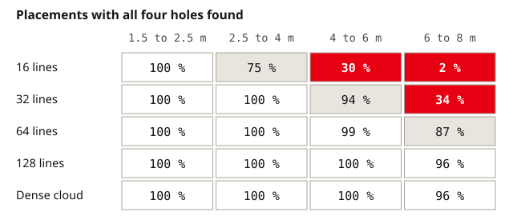
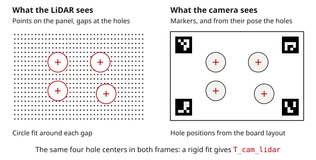

A camera and a LiDAR become one sensor once you know the rigid transform between them. This page takes one method, a panel with holes for the LiDAR and markers for the camera, and tests it in simulation on five LiDAR scan patterns.



The panel is 600 × 400 mm with four holes of 120 mm. Whether the LiDAR finds them depends on how far apart its scan lines are at that distance.

Everything on this page is simulation: simulated scans, and camera images that are either simulated corner points or rendered pictures. The last section says what that leaves out.

## The short answer

- **Follow the scan lines.** Where the points on a line stop and start again, the beam went through a hole. A method that grids the cloud and looks for empty patches fails on a spinning LiDAR with few lines.
- **Line spacing sets the range.** 16 lines: every placement usable to 2.5 m, 30 % at 4 to 6 m. 64 lines: 99 % at 4 to 6 m.
- **Once the holes are found, the LiDAR hardly matters.** 16, 32, 64, 128 lines and a dense cloud all landed between 13 and 19 mm at 20 m.
- **Six to ten placements.** Three gave 32 mm at 20 m, six gave 14 mm, twenty gave 9 mm.
- **The camera side sets the accuracy.** Marker corners good to 0.1 px: 7 mm at 20 m. Good to 1 px: 35 mm.
- **A range offset in the LiDAR goes straight into the result.** 20 mm of offset, 19.7 mm of translation error.

"At 20 m" is how far off a LiDAR point 20 m ahead lands in the camera frame. The numbers are medians of 100 simulated calibrations.

## How the problem is set up

The unknown is `T_cam_lidar`: a 4 × 4 transform that maps LiDAR coordinates into camera coordinates, `p_cam = T_cam_lidar · p_lidar`. To solve for it you need points whose position is known in both frames.

A LiDAR does not see printed markers reliably, and a camera does not see depth. A panel with both kinds of feature at known positions bridges the two: printed markers for the camera, holes for the LiDAR.



Each placement of the panel gives the four hole centers in the LiDAR frame, from the cloud, and in the camera frame, from the marker pose and the panel's drawing. One rigid fit over all placements gives `T_cam_lidar`.

## The test

- **Panel.** 600 × 400 mm, four holes of 120 mm, one of them 36 mm off the rectangle the other three define. Four 80 mm markers in the corners.
- **LiDAR.** Scan lines evenly spaced over about 30° of elevation: 16 lines 2° apart, 32 lines 1°, 64 lines 0.5°, 128 lines 0.25°. A return every 0.2° along a line, 4 mm of range noise.
- **Dense cloud.** A point about every 0.1° in both directions, with no line structure. It stands for scans accumulated from a non-repetitive scanner.
- **Camera.** 1920 × 1440 px, 69° across, 12 cm above the LiDAR. Marker corners carry 0.3 px of noise and the panel pose comes from `solvePnP`.
- **Placements.** Ten per calibration, 1.5 to 4 m away, tilted up to 30°, with all markers in the image and the whole panel inside the LiDAR's vertical field.

## Finding the holes

A spinning LiDAR does not cover a surface evenly. It draws lines across it, and between the lines there is nothing. Looking for "empty areas" finds the space between lines.

What works is to walk along each line. On the panel the returns come at a steady step. Where the step suddenly jumps, the beam went through a hole, and the two ends of that gap lie on the hole's rim.

Collect those rim points from all lines, then turn and shift the known hole layout until every rim point lies on one of its circles.

```python
import cv2
import numpy as np
from scipy.optimize import least_squares

def fit_plane(pts):
    """Least-squares plane through pts. Returns the centroid and two in-plane axes u, v with u x v pointing away from the sensor."""
    c = pts.mean(axis=0)
    n = np.linalg.svd(pts - c, full_matrices=False)[2][2]
    if n @ c < 0:
        n = -n
    a = np.array([0.0, 0, 1]) if abs(n[2]) < 0.9 else np.array([1.0, 0, 0])
    u = np.cross(a, n); u /= np.linalg.norm(u)
    return c, u, np.cross(n, u)

def strips(xy, width=0.015):
    """For a cloud with no scan lines (accumulated, non-repetitive): cut the panel into strips and use those as lines."""
    return np.floor(xy[:, 1] / width).astype(int)

def rim_points(xy, line, hole_radius):
    """Walk along every scan line. Where the points stop and start again, the beam went through a hole:
    the two ends of the gap lie on the rim of that hole."""
    rim = []
    for l in np.unique(line):
        p = xy[line == l]
        if len(p) < 4:
            continue
        d = p - p.mean(axis=0)
        along = d @ np.linalg.svd(d, full_matrices=False)[2][0]
        p = p[np.argsort(along)]
        step = np.linalg.norm(np.diff(p, axis=0), axis=1)
        usual = np.median(step)
        for i in np.where(step > max(3 * usual, 0.5 * hole_radius))[0]:
            e = (p[i + 1] - p[i]) / step[i]
            rim += [p[i] + e * usual / 2, p[i + 1] - e * usual / 2]   # the rim is half a step past the last return
    return np.array(rim).reshape(-1, 2)
```

The scan line of each point is the `ring` field most spinning LiDAR drivers publish. A dense cloud has no lines, so `strips` cuts it into 15 mm bands and treats each band as one.

```python
def fit_layout(rim, holes_xy, hole_radius):
    """Turn and shift the known hole layout until every rim point lies on one of its circles.
    Returns the 2x2 rotation, the shift, the median distance of the rim points from the circles,
    and how many rim points each hole got."""
    def residual(x):
        c, s = np.cos(x[0]), np.sin(x[0])
        centres = holes_xy @ np.array([[c, s], [-s, c]]) + x[1:]
        return np.min(np.linalg.norm(rim[:, None, :] - centres[None, :, :], axis=2), axis=1) - hole_radius
    best = None
    for start in np.radians(np.arange(0, 360, 10)):
        c, s = np.cos(start), np.sin(start)
        x0 = np.r_[start, rim.mean(axis=0) - (holes_xy @ np.array([[c, s], [-s, c]])).mean(axis=0)]
        sol = least_squares(residual, x0, loss="soft_l1", f_scale=0.01)
        if best is None or sol.cost < best.cost:
            best = sol
    c, s = np.cos(best.x[0]), np.sin(best.x[0])
    centres = holes_xy @ np.array([[c, s], [-s, c]]) + best.x[1:]
    d = np.abs(np.linalg.norm(rim[:, None, :] - centres[None, :, :], axis=2) - hole_radius)
    on_rim = (d < 0.015).sum(axis=0)                     # rim points on each hole
    return np.array([[c, -s], [s, c]]), best.x[1:], float(np.median(d.min(axis=1))), on_rim

def find_holes(pts, holes_board, hole_radius, line=None):
    """Hole centres in the sensor frame, in the order of holes_board, and the median misfit of the rim points (m).
    Returns (None, inf) when some hole has no scan line across it.
    `line` is the scan line of each point (the ring index of a spinning LiDAR); leave it out for a dense cloud."""
    c, u, v = fit_plane(pts)
    xy = np.stack([(pts - c) @ u, (pts - c) @ v], axis=1)
    rim = rim_points(xy, strips(xy) if line is None else line, hole_radius)
    if len(rim) < 8:
        return None, np.inf
    R, t, misfit, on_rim = fit_layout(rim, holes_board[:, :2], hole_radius)
    if on_rim.min() < 2:                                 # a hole no scan line crossed: the layout could sit anywhere
        return None, np.inf
    centres = holes_board[:, :2] @ R.T + t
    return c + centres[:, :1] * u + centres[:, 1:] * v, misfit
```

`holes_board` is the hole layout from the panel's drawing, in meters, x to the right and y down as you face the panel. The centers come back in that order, so no matching step is needed. A placement where some hole was not crossed by any line is refused.

Two hundred placements per cell: how many gave all four centers, and how far off the worst of the four was, at the median.

| LiDAR | 1.5 to 2.5 m | 2.5 to 4 m | 4 to 6 m | 6 to 8 m |
|---|---|---|---|---|
| 16 lines | 200, 1.9 mm | 150, 3.4 mm | 59, 6.5 mm | 4, 5.1 mm |
| 32 lines | 200, 1.3 mm | 199, 2.5 mm | 188, 5.4 mm | 68, 7.2 mm |
| 64 lines | 200, 0.9 mm | 200, 1.8 mm | 198, 3.5 mm | 174, 6.6 mm |
| 128 lines | 200, 0.6 mm | 200, 1.2 mm | 200, 2.4 mm | 192, 4.4 mm |
| Dense cloud | 200, 0.7 mm | 200, 1.3 mm | 200, 2.2 mm | 192, 3.5 mm |

At 4 m, lines 2° apart are 140 mm apart on the panel, more than a hole is wide. That is where the 16-line pattern starts to lose placements.

A few accepted placements were wrong by more than 20 mm: 6 of the 3,424 in the table, all beyond 4 m. So look at each placement's residual after the fit, as shown further down.

## How big the holes need to be

The same test with smaller holes on the same panel. Each cell: placements of 200 with all four holes found, at 1.5 to 2.5 m and at 2.5 to 4 m.

| Hole diameter | 16 lines | 64 lines | Dense cloud |
|---|---|---|---|
| 40 mm | 11 and 1 | 198 and 107 | 65 and 118 |
| 80 mm | 167 and 29 | 200 and 200 | 200 and 199 |
| 120 mm | 200 and 150 | 200 and 200 | 200 and 200 |

The hole has to be wider than the gap between two scan lines, with room to spare. The dense cloud does badly at 40 mm because its points are scattered, and a hole that small is hard to tell from a chance gap.

## How many placements, and where

All with the 64-line pattern.

| Placements | Rotation error | Translation error | Error at 20 m |
|---|---|---|---|
| 3 | 0.13° | 6.1 mm | 32 mm |
| 6 | 0.06° | 3.1 mm | 14 mm |
| 10 | 0.05° | 2.8 mm | 14 mm |
| 20 | 0.03° | 1.8 mm | 9 mm |

| Where the ten placements are | Rotation error | Translation error | Error at 20 m |
|---|---|---|---|
| 1.5 to 4 m, across the view, tilted up to 30° | 0.05° | 2.8 mm | 14 mm |
| Near only, 1.5 to 2.5 m | 0.05° | 1.9 mm | 15 mm |
| Far only, 3 to 4 m | 0.10° | 6.9 mm | 28 mm |
| 1.5 to 8 m | 0.07° | 6.3 mm | 15 mm |
| Only in the middle of the view | 0.05° | 1.6 mm | 9 mm |
| Always facing the sensors, tilt under 5° | 0.05° | 2.9 mm | 14 mm |

Close placements are worth more than far ones: both sensors measure the panel better up close. Tilting the panel made no difference. Keeping it in the middle of the view was no worse than spreading it out.

## What moves the result

| LiDAR pattern, ten placements | Placements used | Rotation error | Translation error | Error at 20 m |
|---|---|---|---|---|
| 16 lines | 8 | 0.09° | 3.0 mm | 19 mm |
| 32 lines | 10 | 0.06° | 2.8 mm | 14 mm |
| 64 lines | 10 | 0.05° | 2.8 mm | 14 mm |
| 128 lines | 10 | 0.04° | 2.5 mm | 13 mm |
| Dense cloud | 10 | 0.05° | 2.8 mm | 14 mm |

Eight times the lines buys almost nothing. The rest of the error comes from elsewhere:

| Change, 64 lines | Rotation error | Translation error | Error at 20 m |
|---|---|---|---|
| Nothing | 0.05° | 2.8 mm | 14 mm |
| Marker corners good to 0.1 px | 0.03° | 1.1 mm | 7 mm |
| Marker corners good to 1 px | 0.12° | 7.8 mm | 35 mm |
| Focal length 0.5 % too long | 0.08° | 14.9 mm | 28 mm |
| Range noise 10 mm | 0.06° | 2.9 mm | 14 mm |
| Range noise 20 mm | 0.09° | 4.1 mm | 20 mm |
| Range offset of 20 mm | 0.08° | 19.7 mm | 30 mm |
| Panel bowed by 3 mm | 0.05° | 3.4 mm | 13 mm |

Range noise averages out over the hundreds of points on the panel. A range offset does not: every point is 20 mm too far, and the translation takes all of it.

The camera side decides most of it. That means a good camera calibration, markers large in the image, and sharp focus at the panel's distance.

## What the residual tells you

Two residuals are worth computing. The fit residual is the distance left between the two sets of hole centers after the fit. The held-out residual is the same for a placement that was not used in the fit.

| Case | Fit residual | Held-out residual | Real translation error |
|---|---|---|---|
| Nothing wrong | 2.7 mm | 2.8 mm | 2.8 mm |
| Range offset of 20 mm | 6.4 mm | 7.7 mm | 19.7 mm |
| Focal length 0.5 % too long | 4.1 mm | 3.8 mm | 14.9 mm |
| Symmetric hole layout | 169 mm | 305 mm | 2.7 mm |

With nothing wrong, the two residuals agree with the real error. A range offset or a wrong focal length raises them a little and the error a lot. So a residual of 6 mm against an expected 3 mm is a reason to check the sensors, not a 6 mm error.

The symmetric layout is the opposite case. Four holes on a rectangle fit equally well turned by 180°, and the fit came back turned around in 108 of 200 placements.

The transform survived, because the middle of the panel is in the same place either way. The residual did not, and with it goes the means to spot a bad placement.

## The rest of the code

**Marker pose.** `marker_corners_board` holds the four corners of each marker in meters in the panel's frame, in the order OpenCV returns them.

```python
d = cv2.aruco.getPredefinedDictionary(cv2.aruco.DICT_5X5_100)
board = cv2.aruco.Board(marker_corners_board, d, marker_ids)   # corners in meters, board frame
params = cv2.aruco.DetectorParameters()
params.cornerRefinementMethod = cv2.aruco.CORNER_REFINE_APRILTAG   # the default is no refinement at all
detector = cv2.aruco.ArucoDetector(d, params)

def board_pose(gray, K, dist):
    corners, ids, _ = detector.detectMarkers(gray)
    if ids is None or len(ids) < 2:
        return None
    obj, img = board.matchImagePoints(corners, ids)
    ok, rvec, tvec = cv2.solvePnP(obj, img, K, dist, flags=cv2.SOLVEPNP_IPPE)
    if not ok:
        return None
    T = np.eye(4); T[:3, :3] = cv2.Rodrigues(rvec)[0]; T[:3, 3] = tvec.ravel()
    return T   # T_cam_board
```

The corner refinement line is worth having. On ten sets of ten rendered placements, the default detector left the calibration between 5 and 34 mm off at 20 m. With AprilTag refinement the same images gave 5 to 18 mm, and the median translation error fell from 2.7 mm to 1.1 mm.

**The fit.** One rigid transform over the hole centers of all placements. Each `cloud` is cropped to the panel and carries the scan line of each point in its fourth column.

```python
def kabsch(P, Q):
    """Rigid T with Q ≈ R P + t for matched Nx3 arrays. Returns 4x4."""
    pc, qc = P.mean(axis=0), Q.mean(axis=0)
    U, _, Vt = np.linalg.svd((P - pc).T @ (Q - qc))
    S = np.diag([1, 1, np.sign(np.linalg.det(Vt.T @ U.T))])
    R = Vt.T @ S @ U.T
    T = np.eye(4); T[:3, :3] = R; T[:3, 3] = qc - R @ pc
    return T
```

```python
P_lidar, P_cam = [], []
for gray, cloud in placements:
    T_cam_board = board_pose(gray, K, dist)
    centres, misfit = find_holes(cloud[:, :3], HOLES_BOARD, HOLE_RADIUS, line=cloud[:, 3])
    if T_cam_board is None or centres is None or misfit > 0.01:
        continue
    P_cam.append((T_cam_board[:3, :3] @ HOLES_BOARD.T).T + T_cam_board[:3, 3])
    P_lidar.append(centres)

print(len(P_lidar), "of", len(placements), "placements used")
P_lidar, P_cam = np.vstack(P_lidar), np.vstack(P_cam)
T_cam_lidar = kabsch(P_lidar, P_cam)
resid = np.linalg.norm((T_cam_lidar[:3, :3] @ P_lidar.T).T + T_cam_lidar[:3, 3] - P_cam, axis=1)
np.set_printoptions(precision=4, suppress=True)
print(T_cam_lidar)
print("fit residual mm: mean %.1f max %.1f" % (resid.mean() * 1000, resid.max() * 1000))
```

We ran these blocks as one script on ten rendered images and ten simulated 64-line scans. It printed:

```text
10 of 10 placements used
[[-0.0143 -0.9998  0.011   0.0235]
 [-0.0211 -0.0107 -0.9997  0.121 ]
 [ 0.9997 -0.0145 -0.0209 -0.0496]
 [ 0.      0.      0.      1.    ]]
fit residual mm: mean 2.4 max 9.2
```

That is 0.03° and 3.7 mm from the transform the simulation was built with, or 8 mm at 20 m.

**Look at it.** Project the cloud into the image with the result. Points should stop at the panel's edge and leave the holes empty.

```python
def project_cloud(cloud, T_cam_lidar, K, dist, image):
    pc = (T_cam_lidar[:3, :3] @ cloud.T).T + T_cam_lidar[:3, 3]
    pc = pc[pc[:, 2] > 0.5]
    uv, _ = cv2.projectPoints(pc, np.zeros(3), np.zeros(3), K, dist)
    out = cv2.cvtColor(image, cv2.COLOR_GRAY2BGR)
    for u, v in uv.reshape(-1, 2):
        if 0 <= u < out.shape[1] and 0 <= v < out.shape[0]:
            cv2.circle(out, (int(u), int(v)), 2, (0, 0, 255), -1)
    return out
```

The [LiDAR-camera target](/targets/lidar-camera-target/) is a panel of this kind: markers and holes at positions given on its drawing. For a first try, cut holes in a rigid board, add markers from the [ArUco generator](/tools/generator/aruco/), and measure where everything is.

## What we got wrong

The earlier version of this page printed a different hole finder and said it had been run end to end. Five things did not hold up:

- **The hole finder.** It gridded the cloud and looked for empty patches. On the 16-line pattern it found the four holes in 0 of 200 placements. On 32 lines, in 33 of 200 at 1.5 to 2.5 m and in none at 2.5 to 4 m. Where it worked, on dense clouds, the centers were off by about 6 mm against 0.7 mm now.
- **"A 120 mm hole leaves a clear gap at 5 m with 0.2° resolution."** Along a line, yes. The spacing between lines is what limits it, and the page did not mention it.
- **"Spread the placements to the edges of the view" and "tilt the board up to 30°."** Neither helped here. Close placements and more of them did.
- **"A symmetric layout makes the fit silently pick the wrong one."** It does, but the transform hardly moves. The residual is what breaks.
- **"A few tenths of a degree and one to two centimeters are typical."** We had not measured that. The simulation gives 0.05° and 2.8 mm. A real rig will be worse than that, by an amount this page cannot give.

The paragraphs on plane-only methods, targetless methods and other toolboxes are gone. We have not tested any of them.

## Try it yourself

This script simulates one scan of the panel by a 32-line LiDAR at 3 m and finds the holes in it. Save the functions above as `pipeline.py` next to it. It needs numpy, scipy and opencv-python.

```python
import numpy as np
from pipeline import find_holes

HOLES = np.array([[0.17, 0.12, 0], [0.43, 0.12, 0], [0.17, 0.28, 0], [0.40, 0.30, 0]])   # hole centres on the panel, m
RADIUS, PANEL = 0.060, (0.60, 0.40)
rng = np.random.default_rng(0)

# the panel 3 m in front of the LiDAR (x forward, y left, z up), turned 20 degrees about the vertical
c, s = np.cos(np.radians(20)), np.sin(np.radians(20))
R = np.array([[s, 0, c], [-c, 0, s], [0, -1, 0]])          # panel x runs to the right, y down, z away from the LiDAR
origin = np.array([3.0, 0.25, 0.22])                       # the panel's top-left corner

points, ring = [], []
for k, elevation in enumerate(np.radians(np.arange(-16, 16, 1.0))):          # 32 lines, 1 degree apart
    for azimuth in np.radians(np.arange(-15, 15, 0.2)):                      # a return every 0.2 degrees
        ray = np.array([np.cos(elevation) * np.cos(azimuth), np.cos(elevation) * np.sin(azimuth), np.sin(elevation)])
        distance = (origin @ R[:, 2]) / (ray @ R[:, 2])
        x, y, _ = (ray * distance - origin) @ R                              # where the beam meets the panel plane
        on_panel = 0 < x < PANEL[0] and 0 < y < PANEL[1]
        in_hole = (np.hypot(HOLES[:, 0] - x, HOLES[:, 1] - y) < RADIUS).any()
        if on_panel and not in_hole:
            points.append(ray * (distance + rng.normal(0, 0.004))); ring.append(k)   # 4 mm of range noise

found, misfit = find_holes(np.array(points), HOLES, RADIUS, line=np.array(ring))
truth = HOLES @ R.T + origin
print(len(points), "points on", len(set(ring)), "lines")
for f, t in zip(found, truth):
    print("hole at", np.round(t, 3), " found", np.round(f, 3), " off by %.1f mm" % (1000 * np.linalg.norm(f - t)))
print("rim misfit %.1f mm" % (1000 * misfit))
```

It prints:

```text
327 points on 8 lines
hole at [3.058 0.09  0.1  ]  found [3.058 0.09  0.102]  off by 2.0 mm
hole at [ 3.147 -0.154  0.1  ]  found [ 3.147 -0.154  0.101]  off by 1.4 mm
hole at [ 3.058  0.09  -0.06 ]  found [ 3.058  0.091 -0.058]  off by 2.1 mm
hole at [ 3.137 -0.126 -0.08 ]  found [ 3.137 -0.125 -0.079]  off by 1.6 mm
rim misfit 3.2 mm
```

Eight lines cross the panel, 327 points in all, and the four centers come out within about 2 mm.

## What this test is not

- **Simulation.** No LiDAR and no camera were used.
- **Beams with no width.** A real beam is a spot some centimeters wide at these distances. At a hole's rim it gives a mixed or missing return, which blurs the rim. This is the largest thing left out.
- **No range offset unless stated.** Real sensors have one, and it may depend on the surface and the angle.
- **A cropped cloud.** The points given to the hole finder are the panel's only. Cutting the panel out of a full scan is a step of its own.
- **Evenly spaced lines.** Some sensors pack their lines unevenly. What counts is the spacing where the panel is.
- **A still rig.** No motion during a scan, and camera and LiDAR see the same instant.
- **One camera, one panel.** 69° across at 1920 px, markers of 80 mm, holes of 40 to 120 mm.

The scripts and the saved results are in our repository under `docs/content/experiments/lidar-camera/`.
