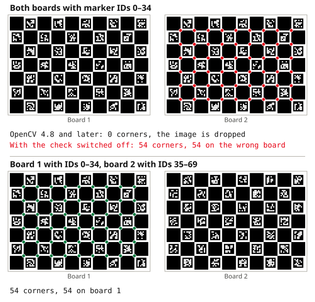
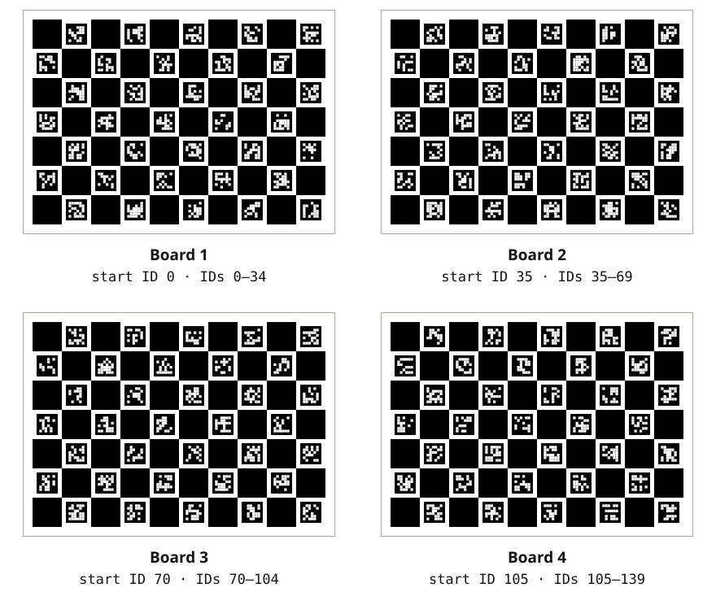

We put two ChArUco boards side by side in front of a simulated camera, gave them the same marker IDs or separate ones, and ran OpenCV's ChArUco detector and calibration. Twenty sessions of 20 images each, in eight OpenCV versions.



The figure is the whole story in one picture. Asked for board 1, OpenCV either returns nothing or returns board 2. With separate IDs it returns board 1.

Everything on this page comes from rendered images, not from a real camera. The last section says what that leaves out.

## The short answer

No, every board in view needs its own marker IDs. What goes wrong with repeated IDs depends on the OpenCV version:

- **OpenCV 4.8 and later** return no ChArUco corners for an image in which any board marker appears twice. All 198 such images in our test were lost, including one with a single repeated marker. There is no error message.
- **OpenCV 4.7 and earlier** return the corners, and many of them belong to the other board. In our sessions 16.5 of 20 images had corners in the wrong place, some 787 px from where they belong.

The rule for numbering is simple: each board starts where the last one ended. A 10 × 7 ChArUco board has 35 markers, so board 1 uses IDs 0 to 34, board 2 uses 35 to 69, and so on.

| Rig | Board views used | Views with wrong corners | Reprojection error (px) | Model, mean (px) | Model, worst pixel (px) | Worst session (px) |
|---|---|---|---|---|---|---|
| Separate IDs, board 1 | 20 | 0 | 0.091 | 0.279 | 0.556 | 2.26 |
| Separate IDs, both boards | 39 | 0 | 0.093 | 0.162 | 0.367 | 0.86 |
| Same IDs, OpenCV 4.8 and later | 0 | 0 | no solution | no solution | no solution | no solution |
| Same IDs, check switched off | 20 | 16.5 | 104 | 263 | 645 | 92101 |

Each cell is the median of 20 sessions, except the last column, which is the worst of the 20.

## The question

Large fields of view, multi-camera rigs and cells with several cameras often use more than one board. Printing the same board twice is the easy way to get two. The question is whether the detector can tell the copies apart.

An earlier version of this page said that with repeated IDs "calibration fails silently or produces incorrect results". We had not measured it. This version does, and the answer turned out to depend on the OpenCV version.

## The test

- **Camera.** 1280 × 960 px, focal length 1500 px, radial distortion k1 = −0.12.
- **Boards.** Two 10 × 7 ChArUco boards, 30 mm squares, 22 mm markers, DICT_6X6_250. Board 2 sits 60 mm to the right of board 1, in the same plane.
- **Views.** The camera is 750 to 1050 mm from the boards, tilted 10 to 40°. At least 60 % of board 1 and at least 10 % of board 2 are in each image. Blur of 0.8 px and noise of 2 gray levels are added.
- **Session.** 20 images, solved with `calibrateCamera` and the standard OpenCV model. 20 sessions.
- **Model error.** The true camera and the solved one are compared pixel by pixel after the best rotation between them is removed.

## Same IDs in OpenCV 4.8 and later

Since 4.8, `CharucoDetector` checks each corner it found against the markers around it. If a marker with one of the corner's two marker IDs sits farther away than some other marker, the board is declared wrong and all corners are dropped. A repeated ID always trips it.

We let board 2 slide into view next to board 1 in 300 random images. In the 102 images where no marker of board 2 was decoded, board 1 was found every time. In the 198 images with at least one repeated ID, it was found in none. The fewest repeats was one.

The detector does not raise an error. It writes "ChArUco board is built incorrectly" to OpenCV's debug log, which is off by default. The markers themselves are still returned, so the image looks detected if you only count markers.

From OpenCV 4.12 the check can be switched off with `CharucoParameters.checkMarkers = False`. In 4.8 to 4.11 it is always on.

## Same IDs in OpenCV 4.7 and earlier

Without the check, the detector places each corner from the markers that carry its IDs. With two copies of each marker in view it has two candidates for each, and the corners come out on board 1, on board 2 or between them.

We passed the same two rendered images to each version. One has both boards fully in view, the other only part of board 2. OpenCV 4.6 has no `CharucoDetector`, so there we used `detectMarkers` and `interpolateCornersCharuco`.

| OpenCV | Both boards in view | Board 2 partly in view |
|---|---|---|
| 4.6 | 54 corners: 22 on board 1, 19 on board 2, 13 between | 54 corners: 47 on board 1, 3 on board 2, 4 between |
| 4.7 | 54 corners: 22 on board 1, 19 on board 2, 13 between | 54 corners: 47 on board 1, 3 on board 2, 4 between |
| 4.8, 4.9, 4.10, 4.11 | no corners | no corners |
| 4.12, 5.1 | no corners | no corners |
| 4.12, 5.1, check switched off | 54 corners: 18 on board 1, 20 on board 2, 16 between | 54 corners: 54 on board 1 |

The sessions in the first table used OpenCV 5.1 with the check switched off to stand in for 4.7 and earlier. Of 20 images, a median of 16.5 had corners more than 2 px from where they belong.

That calibration does not fail quietly. The reprojection error came out at 104 px, more than a thousand times the 0.091 px of the clean rig. Anyone who looks at that number sees that something is wrong. With 4.8 and later there is no such number to look at, because there is nothing left to solve.

## Using both boards helps

With separate IDs the second board is free data. Each image gives two board views, one per board, and both can go into one `calibrateCamera` call as separate views.

Board 1 alone gave a model within 0.556 px at the worst pixel. Both boards together gave 0.367 px, and the worst session dropped from 2.26 px to 0.86 px. Board 2 adds a second set of points to most images, in another part of the frame.

## How many boards a dictionary holds



A ChArUco board has one marker on every white square: rows × columns / 2, rounded down. The dictionary has to hold all the boards' markers together. DICT_6X6_250 holds 7 boards of 35.

A bigger dictionary holds more, but OpenCV decodes its markers less readily. We rendered one board at growing distances, 12 images per step, and counted the markers decoded at each marker size in pixels.

| Dictionary | Markers | Boards of 35 | Bits corrected | 18.9 px | 16.5 px | 14.7 px | 13.2 px |
|---|---|---|---|---|---|---|---|
| DICT_4X4_50 | 50 | 1 | 1 | 100 % | 98 % | 87 % | 66 % |
| DICT_5X5_100 | 100 | 2 | 3 | 99 % | 93 % | 73 % | 37 % |
| DICT_6X6_250 | 250 | 7 | 5 | 100 % | 89 % | 49 % | 17 % |
| DICT_5X5_1000 | 1000 | 28 | 2 | 99 % | 93 % | 73 % | 37 % |
| DICT_6X6_1000 | 1000 | 28 | 4 | 99 % | 71 % | 29 % | 5 % |
| DICT_7X7_1000 | 1000 | 28 | 6 | 81 % | 29 % | 5 % | 1 % |

The pixel columns are the width of one marker in the image. "Bits corrected" is how many wrong bits OpenCV accepts in a marker before it gives up on it.

DICT_6X6_250 is the first 250 markers of DICT_6X6_1000, so a board with IDs 0 to 34 prints the same picture with either. The difference in the table comes only from the detector: with the bigger dictionary it accepts fewer wrong bits.

Fewer, larger cells decode from farther away. DICT_5X5_1000 holds as many boards as DICT_6X6_1000 and decoded as well as DICT_5X5_100. It corrects only 2 bits, though, so a smudge or a reflection is more likely to read as another marker.

In our clean images no dictionary misread a single marker, so this test cannot say what the extra bits buy in a real scene.

## Kalibr

Kalibr reads one AprilGrid per calibration. We did not run Kalibr; what follows is from [its source](https://github.com/ethz-asl/kalibr/blob/1f60227442d25e36365ef5f72cd80b9666d73467/aslam_cv/aslam_cameras_april/src/GridCalibrationTargetAprilgrid.cpp#L131-L190).

- Each tag's place on the grid is taken from its ID, so the grid's IDs have to start at 0.
- A tag with an ID beyond the grid, 36 or higher on a 6 × 6 grid, is dropped as a false detection.
- When the same ID appears twice in an image, Kalibr stops with "Found apriltag not belonging to calibration board".

So a second AprilGrid in view is harmless only when its IDs start after the first grid's last ID. Kalibr then ignores it. A grid that starts at 36 cannot be the calibration target in Kalibr; our generator does not offer a Kalibr file for it.

## What we got wrong

The earlier version of this page made four claims that do not hold:

- **"Calibration fails silently or produces incorrect results."** Neither, quite. OpenCV 4.8 and later drop the image without saying so. OpenCV 4.7 and earlier give a result, but with a reprojection error of about 100 px that nobody would accept.
- **"In OpenCV 4.6+, use `board.setIds()`."** The other way round. `setIds` exists in 4.6 and earlier. From 4.7 the method is gone and the IDs go into the `CharucoBoard` constructor.
- **"Create a separate Kalibr YAML per board."** Kalibr cannot calibrate against a board whose IDs do not start at 0, and it ignores such a board in view.
- **"For larger rigs, use DICT_7X7_1000."** It holds 28 boards of 35, but in our test it needed the biggest markers of all six dictionaries.

The page also said the generator's set export contains the config files for every board. It contains the board PDFs and one `set-manifest.json`.

## What to do

- Give every board in view its own ID range, starting where the last board ended.
- Up to 7 boards of 35 markers: DICT_6X6_250. For more, weigh DICT_6X6_1000 against DICT_5X5_1000 using the table above, and make the markers big enough in the image.
- Detect each board with its own `CharucoDetector` on the same image and put every board's corners into calibration as separate views.
- If markers are found but no corners come back, count repeated IDs among the returned markers. One is enough to lose the image.
- For Kalibr, number the calibration grid from 0. Any other grid in view should start after its last ID.

In OpenCV 4.7 and later the IDs go into the constructor:

```python
import cv2
import numpy as np

dictionary = cv2.aruco.getPredefinedDictionary(cv2.aruco.DICT_6X6_250)
board1 = cv2.aruco.CharucoBoard((10, 7), 0.030, 0.022, dictionary, np.arange(0, 35))
board2 = cv2.aruco.CharucoBoard((10, 7), 0.030, 0.022, dictionary, np.arange(35, 70))
```

In OpenCV 4.6 and earlier, build the board with `cv2.aruco.CharucoBoard_create(10, 7, 0.030, 0.022, dictionary)` and then call `board2.setIds(np.arange(35, 70))`.

Calibrating with both boards, each board view on its own:

```python
detectors = [(b, cv2.aruco.CharucoDetector(b)) for b in (board1, board2)]
object_points, image_points = [], []
for image in images:
    for board, detector in detectors:
        corners, ids, _, marker_ids = detector.detectBoard(image)
        if ids is None or len(ids) < 6 or board.checkCharucoCornersCollinear(ids):
            continue
        object_points.append(board.getChessboardCorners()[ids.ravel()])
        image_points.append(corners)
rms, K, dist, _, _ = cv2.calibrateCamera(object_points, image_points, image_size, None, None)
```

In the [pattern generator](/tools/generator/), set "Number of boards" for a ChArUco board, an ArUco grid or an AprilGrid. Each board starts where the last ended, and you can change any start ID.

"Export set" downloads the board PDFs, each with its start ID in the file name and its ID range in the footer, and a `set-manifest.json` with every range.

## Try it yourself

This script draws two boards side by side, once with the same IDs and once with separate ones, and asks `CharucoDetector` for board 1 with the check on and off. It needs numpy and opencv-python 4.12 or later.

```python
import numpy as np, cv2

aruco = cv2.aruco
dictionary = aruco.getPredefinedDictionary(aruco.DICT_6X6_250)

def board(first_id):
    ids = np.arange(first_id, first_id + 35)                # a 10 x 7 board has 35 markers
    return aruco.CharucoBoard((10, 7), 30, 22, dictionary, ids)

def picture(b1, b2):
    a = b1.generateImage((640, 460), marginSize=20)
    b = b2.generateImage((640, 460), marginSize=20)
    img = np.hstack([a, np.full((460, 60), 255, np.uint8), b])
    return cv2.copyMakeBorder(img, 40, 40, 40, 40, cv2.BORDER_CONSTANT, value=255)

for name, second in [("same IDs", 0), ("IDs 35-69", 35)]:
    b1 = board(0)
    img = picture(b1, board(second))
    for check in (True, False):
        params = aruco.CharucoParameters()
        params.checkMarkers = check
        corners, ids, _, marker_ids = aruco.CharucoDetector(b1, params).detectBoard(img)
        n = 0 if ids is None else len(ids)
        print(f"{name:10s}  checkMarkers={check!s:5s}  markers found {len(marker_ids):2d}  board 1 corners {n:2d}", end="")
        if n:
            # where the corners should be: inner corners of the left board, in pixels
            sq = 600 / 10
            truth = (b1.getChessboardCorners()[:, :2] / 30 * sq + 40 + 20)[ids.ravel()]
            off = np.linalg.norm(corners.reshape(-1, 2) - truth, axis=1)
            bad = off > 2
            print(f"  more than 2 px off: {int(bad.sum()):2d}" + (f", up to {off.max():.0f} px" if bad.any() else ""), end="")
        print()
```

With OpenCV 4.12 and 5.1 it prints:

```text
same IDs    checkMarkers=True   markers found 70  board 1 corners  0
same IDs    checkMarkers=False  markers found 70  board 1 corners 54  more than 2 px off: 54, up to 700 px
IDs 35-69   checkMarkers=True   markers found 70  board 1 corners 54  more than 2 px off:  0
IDs 35-69   checkMarkers=False  markers found 70  board 1 corners 54  more than 2 px off:  0
```

All 70 markers are found in every run. Only the corners tell the two rigs apart.

## What this test is not

- **Simulation.** Rendered images with one lens, even light and flat boards. A real scene adds glare, dirt and clutter, which may cause misread markers that our clean images never had.
- **OpenCV only.** We ran OpenCV 4.6 to 5.1. Kalibr we read but did not run. Other detectors, such as the AprilTag library or vendor tools, may handle repeated IDs differently.
- **Two boards in one plane.** We did not test boards at angles to each other, and we did not measure camera-to-camera calibration in a multi-camera rig.
- **One blur and noise level for decoding.** The pixel sizes in the dictionary table move with focus, contrast and the detector settings.

The scripts and the saved results are in our repository under `docs/content/experiments/multi-board/`.
