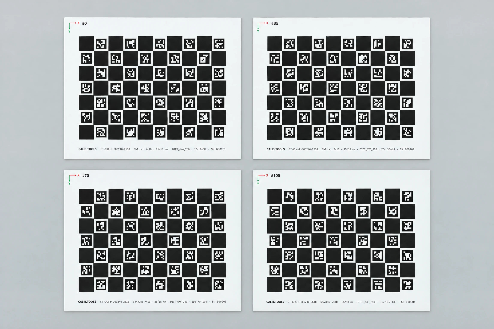

## Why boards in one rig need distinct ID ranges

When you use multiple calibration boards simultaneously — for example, in a multi-camera rig or a large-volume calibration setup — every ArUco marker or AprilTag across all boards must have a unique ID.

If two boards share the same IDs, the detector cannot tell which board a marker belongs to, and your calibration will fail silently or produce incorrect results.

This is especially important for stereo and multi-camera setups where all cameras may see multiple boards at the same time.

## How to compute ID ranges

For a **ChArUco** board with R rows and C columns, the number of markers is `floor(R × C / 2)`. For an **AprilGrid**, every cell is a tag, so the count is `R × C`.

Board 1 starts at ID 0. Board 2 starts at `markersPerBoard`. Board 3 starts at `2 × markersPerBoard`, and so on.

**Example:** A 7×10 ChArUco board has 35 markers.

| Board | Start ID | ID Range |
|-------|----------|----------|
| 1     | 0        | 0–34     |
| 2     | 35       | 35–69    |
| 3     | 70       | 70–104   |

Make sure your chosen dictionary has enough markers. DICT_6X6_250 supports up to 250 markers (7 boards of 35). For larger rigs, use DICT_7X7_1000.

## Configuring in OpenCV

```python
import cv2
import numpy as np

dictionary = cv2.aruco.getPredefinedDictionary(cv2.aruco.DICT_6X6_250)

# Board 1: default IDs 0-34
board1 = cv2.aruco.CharucoBoard((10, 7), 0.025, 0.018, dictionary)

# Board 2: IDs starting at 35
board2 = cv2.aruco.CharucoBoard((10, 7), 0.025, 0.018, dictionary)
board2.setIds(np.arange(35, 70))

# Board 3: IDs starting at 70
board3 = cv2.aruco.CharucoBoard((10, 7), 0.025, 0.018, dictionary)
board3.setIds(np.arange(70, 105))
```

In OpenCV 4.6+, use `board.setIds()`. In older versions, pass the IDs array to the constructor.

## Configuring in Kalibr

Kalibr's AprilGrid configuration uses the start ID in the target YAML. Create a separate YAML file per board:

```yaml
# board1.yaml
target_type: 'aprilgrid'
tagRows: 6
tagCols: 6
tagSize: 0.030000
tagSpacing: 0.300000

# board2.yaml — same geometry, different start ID
target_type: 'aprilgrid'
tagRows: 6
tagCols: 6
tagSize: 0.030000
tagSpacing: 0.300000
# Start at tag 36 (6×6 = 36 tags per board)
```

Kalibr doesn't have a native `tagStartId` field — you need to print the board with the correct IDs using the generator.

## Using the set mode in our generator

In the [pattern generator](/tools/generator/), set "Number of boards" to your rig size. The generator assigns consecutive ID ranges automatically and lets you override per board. "Export set" downloads a zip with:

- Individual board PDFs (filenames include the start ID)
- `set-manifest.json` with the complete ID mapping
- All config files per board

Each board's PDF carries its own ID range in the footer and corner badge.
