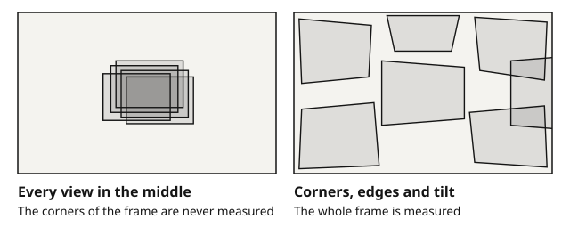

Camera calibration finds the numbers that describe how your camera maps the 3D world onto pixels. OpenCV does the maths; the quality of the result depends almost entirely on the target and the images you give it.

This guide walks through the whole job in OpenCV with Python: choosing and sizing a target, capturing images, detecting corners, calibrating and checking the result.

## What calibration gives you

`cv2.calibrateCamera` returns three things:

- **Camera matrix** `K` — focal lengths `fx`, `fy` and principal point `cx`, `cy`, all in pixels.

- **Distortion coefficients** — by default `k1, k2, p1, p2, k3`: radial (barrel or pincushion) and tangential distortion.

- **Pose per image** — rotation and translation of the board in each view, plus the RMS reprojection error over all views.

With `K` and the distortion coefficients you can undistort images, measure in millimeters, estimate object poses with `solvePnP`, and feed stereo calibration.

## 1. Choose a pattern

For most OpenCV work, use a **ChArUco** board. The ArUco markers tell the detector which corner is which, so a view still counts when part of the board is outside the image. That lets you put corners right at the image edge, where distortion is strongest.

A plain **checkerboard** gives the same corner accuracy but needs every inner corner visible in every view. For camera–IMU calibration with Kalibr, use an **AprilGrid**. The [pattern comparison](/guides/charuco-vs-checkerboard-vs-aprilgrid/) covers the trade-offs.

## 2. Size the board

A board that fills about half to two thirds of the frame at your working distance is a good start: big enough for sharp corners, small enough to tilt and move into the image corners.

Each square should span at least 20 pixels or so, and for ChArUco each marker bit at least 3 pixels so the IDs decode. The [FOV calculator](/tools/fov/) works this out from your sensor, lens and distance, and recommends a board.

## 3. Make or get the target

Generate the pattern with the free [ChArUco generator](/tools/generator/charuco/) or [checkerboard generator](/tools/generator/checkerboard/). Print at 100 % ("actual size"), then measure the 100 mm scale bar and one square with a ruler or calliper.

Use the **measured** square size in your code. Glue the print to something flat and stiff; a bent target adds error that no amount of images will remove.

For repeatable results, especially below 0.2 px, use a rigid board made to known dimensions, such as an [aluminum composite](/targets/charuco-composite/) or [ceramic](/targets/charuco-ceramic/) ChArUco target.

## 4. Capture good images

The images decide the result. Before you start, fix the camera settings you will use in production:

- **Focus and zoom fixed** — turn autofocus off. Any change afterwards invalidates the calibration.

- **Full resolution** — calibrate at the resolution you will run at, or rescale `K` correctly.

- **Sharp, evenly lit images** — short exposure, no motion blur, no glare on the board.

Then take 15 to 30 views and vary them deliberately:

- Move the board into all four image corners and along the edges, not only the center.

- Tilt it up to about 45° around both axes. Tilt is what pins down the focal length.

- Change the distance a little between views.

- For ChArUco, let the board run off the image edge in some views.



## 5. Detect the corners

For a **ChArUco** board (OpenCV 4.7 and later), set up the board with the same geometry you printed. The board size is (columns, rows) in squares; sizes are in meters or millimeters, as long as you stay consistent:

```python
import glob
import cv2
import numpy as np

d = cv2.aruco.getPredefinedDictionary(cv2.aruco.DICT_6X6_250)
board = cv2.aruco.CharucoBoard((10, 7), 0.025, 0.018, d)
detector = cv2.aruco.CharucoDetector(board)
```

Then collect object and image points from every image:

```python
obj_all, img_all = [], []
for path in sorted(glob.glob("images/*.png")):
    gray = cv2.imread(path, cv2.IMREAD_GRAYSCALE)
    corners, ids, _, _ = detector.detectBoard(gray)
    if ids is None or len(ids) < 8:
        continue  # too few corners in this view
    obj, img = board.matchImagePoints(corners, ids)
    obj_all.append(obj)
    img_all.append(img)
```

For a **checkerboard**, the pattern size is the number of inner corners, (columns − 1, rows − 1). `findChessboardCornersSB` is more accurate and more robust than the older `findChessboardCorners`:

```python
cols, rows, square = 10, 7, 0.025
pattern = (cols - 1, rows - 1)
objp = np.zeros((pattern[0] * pattern[1], 3), np.float32)
objp[:, :2] = np.mgrid[0:pattern[0], 0:pattern[1]].T.reshape(-1, 2) * square
```

```python
ok, corners = cv2.findChessboardCornersSB(gray, pattern)
if ok:
    obj_all.append(objp)
    img_all.append(corners)
```

## 6. Calibrate

```python
size = gray.shape[::-1]  # (width, height)
rms, K, dist, rvecs, tvecs = cv2.calibrateCamera(
    obj_all, img_all, size, None, None)
print("RMS reprojection error:", rms)
print("K =\n", K)
print("dist =", dist.ravel())
```

If strong distortion leaves residual error, try `cv2.CALIB_RATIONAL_MODEL` (eight coefficients). Add flags one at a time and keep them only if the per-view error drops on images you did not calibrate with.

## 7. Check the result

The overall RMS is an average and can hide problems. Look at the error per view:

```python
for i, (o, p) in enumerate(zip(obj_all, img_all)):
    proj, _ = cv2.projectPoints(o, rvecs[i], tvecs[i], K, dist)
    diff = p.reshape(-1, 2) - proj.reshape(-1, 2)
    err = np.sqrt((diff ** 2).sum(axis=1).mean())
    print(i, round(float(err), 3))
```

Then run a few sanity checks:

- **A few views much worse than the rest** — usually blur or a bad detection. Remove them and calibrate again.

- **Principal point** — `cx`, `cy` should sit near the image center, typically within a few percent of the width.

- **fx and fy** — nearly equal for square pixels.

- **Straight lines** — undistort an image of a straight edge and check it is straight right out to the corners.

With a rigid board and a sharp lens, an RMS well under 0.5 px is common. Above 1 px, look for blur, a bent or mis-measured target, or poor coverage of the image corners.

## 8. Save and use the calibration

Save the results with `cv2.FileStorage` so other tools, including C++, can read them:

```python
fs = cv2.FileStorage("camera.yaml", cv2.FILE_STORAGE_WRITE)
fs.write("K", K)
fs.write("dist", dist)
fs.write("image_size", np.array(size))
fs.release()
```

To undistort a video stream, build the maps once with `cv2.getOptimalNewCameraMatrix` and `cv2.initUndistortRectifyMap`, then call `cv2.remap` on each frame.

## When calibrateCamera returns bad results

A calibration that runs without an error can still be wrong. Work through these in order; each one is quick to check.

1. **Coverage.** Plot where the detected corners fall in the image. If the corners of the frame are empty, the distortion there is a guess. Add views at the edges and corners, tilted.

2. **Sharpness.** Open the images at 100 %. Motion blur and glare move the detected corners; drop those views.

3. **The board.** Measure one printed square and compare it with the size in your code. Lay a straightedge across the board: in [our test with a printed board](/guides/printed-target-costs-half-a-pixel/) a bow of 1 mm made the focal length 2.2 % short.

4. **Per-view error.** Compute the reprojection error of each view. One view at three times the others is a bad view; remove it and calibrate again.

5. **The model.** Stay with the five standard distortion coefficients unless the error grows toward the image edge with good coverage. More terms fit the same corners and extrapolate worse.

The [reprojection error guide](/guides/reprojection-error/) shows how to do checks 4 and 5, and what a low RMS can hide.

## Common problems

| Symptom | Likely cause | Fix |
|---|---|---|
| No corners found | Wrong board size, or columns and rows swapped | Board size is (columns, rows) in squares for ChArUco, inner corners for a checkerboard |
| ChArUco markers found but no corners | Board made with the pre-4.6 layout | Call `board.setLegacyPattern(True)`; see the [detection troubleshooting guide](/guides/corner-detection-troubleshooting/) |
| RMS above 1 px | Blur, glare, bent target, few corner views | Re-shoot sharper views that cover the image corners |
| Good RMS, wrong distances | Square size mis-entered or printer scaling | Measure the printed square and use that value |
| Calibration drifts between sessions | Focus or zoom moved | Lock the lens, recalibrate after any change |

## Next steps

- [Pick the right pattern](/guides/charuco-vs-checkerboard-vs-aprilgrid/) for stereo, multi-camera or camera–IMU work.

- [Run several boards in one rig](/guides/multi-board-marker-ids/) without marker ID clashes.

- Check your images with the [detection check](/tools/check/) and [quality analyzer](/tools/quality/) before calibrating.
