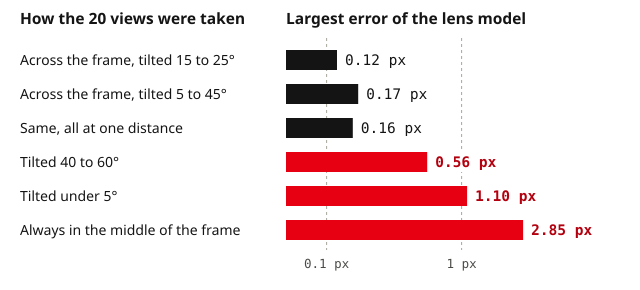
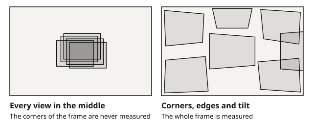

Camera calibration finds the numbers that describe how your camera maps the world onto pixels. This page gives a complete script for OpenCV in Python, and tests the usual advice on how to take the images.



Each bar is the median of 20 sessions of 20 views. The error is how far the solved camera model is from the true one at its worst pixel.

The numbers on this page come from rendered images of a board seen through a camera we defined, so the true answer is known. No real camera was used. The last section says what that leaves out.

## The short answer

- **The script is under forty lines** and is printed below. On 20 rendered views it recovered the focal length within 0.002 % and the lens model within 0.20 px everywhere.
- **Put the board in every part of the frame.** With the board always in the middle, the model was 2.85 px off at the image corners. The RMS did not show it: 0.022 px against 0.026 px.
- **Tilt the board, about 15 to 25°.** Tilted under 5°, the focal length error rose from 0.007 % to 0.108 %. Tilted 40 to 60°, the corners got worse and the model was 0.56 px off.
- **Changing the distance did not matter here.** 0.16 px at one distance, 0.17 px with distance varied.
- **About twenty views.** That number comes from our [test of image count](/calibacademy/how-many-calibration-images/).
- **More distortion terms did not help**, and with poor coverage they made the result worse.

## What calibration gives you

`cv2.calibrateCamera` returns three things:

- **Camera matrix** `K`: focal lengths `fx`, `fy` and principal point `cx`, `cy`, all in pixels.

- **Distortion coefficients**: by default `k1, k2, p1, p2, k3`: radial (barrel or pincushion) and tangential distortion.

- **Pose per image**: rotation and translation of the board in each view, plus the RMS reprojection error over all views.

With `K` and the distortion coefficients you can undistort images, measure in millimeters, estimate object poses with `solvePnP`, and feed stereo calibration.

## 1. Choose a pattern

For most OpenCV work, use a **ChArUco** board. The ArUco markers tell the detector which corner is which, so a view still counts when part of the board is outside the image.

A plain **checkerboard** needs every inner corner visible in every view. For camera–IMU calibration with Kalibr, use an **AprilGrid**. The [pattern comparison](/calibacademy/charuco-vs-checkerboard-vs-aprilgrid/) has the test behind this.

## 2. Size the board

Each marker bit should be 3 px or more in the image so the IDs decode. A board about 60 % of the frame width is a starting point. What decides the result is whether corners reach every part of the frame across the whole set.

Both numbers come from our [test of board size](/calibacademy/calibration-target-size/). The [FOV calculator](/tools/fov/) works out the pixel sizes from your sensor, lens and distance.

## 3. Make or get the target

Generate the pattern with the [ChArUco generator](/tools/generator/charuco/) or [checkerboard generator](/tools/generator/checkerboard/). Print at 100 % ("actual size"), then measure the 100 mm scale bar and one square with a ruler or caliper.

Use the **measured** square size in your code. Glue the print to something flat and stiff. In [our test with a printed board](/calibacademy/printed-target-costs-half-a-pixel/) a bow of 1 mm made the focal length 2.2 % short.

For repeatable results use a rigid board made to known dimensions, such as an [aluminum composite](/targets/charuco-composite/) or [ceramic](/targets/charuco-ceramic/) ChArUco target.

## 4. Take the images

Fix the camera settings you will use later: focus and zoom locked, autofocus off, full resolution. Keep the board still while the frame is taken. With a rolling shutter a moving board gives a sharp but sheared image; see [how still the board has to be](/calibacademy/how-still-calibration-board/).

Then take about twenty views. We tested what to vary. Each row is 20 sessions of 20 views of a 10 × 7 ChArUco board at about half the frame width. "Lens model error" is the largest difference between the solved and the true camera model over the image:

| How the views were taken | RMS, px | Focal length error | Lens model error |
|---|---|---|---|
| Across the frame, tilted 5 to 45°, distance varied | 0.026 | 0.007 % | 0.17 px |
| Tilted 15 to 25° | 0.020 | 0.005 % | 0.12 px |
| All at one distance | 0.024 | 0.011 % | 0.16 px |
| Tilted 40 to 60° | 0.120 | 0.022 % | 0.56 px |
| Tilted under 5° | 0.019 | 0.108 % | 1.10 px |
| Tilted under 5°, all at one distance | 0.019 | 0.082 % | 0.90 px |
| Board always in the middle of the frame | 0.022 | 0.006 % | 2.85 px |

Three things follow:

- **Coverage first.** The board in the middle gives a fine focal length and a lens model that is wrong where it never looked.
- **Tilt, but not steeply.** A board that faces the camera in every view leaves the focal length poorly fixed. Past 40° the corners are found less exactly, 7 of the 400 views were not found at all, and the RMS shows it.
- **RMS does not rank these.** The two worst sets for the lens model have a lower RMS than the first row.



## 5. The script

For a ChArUco board, with OpenCV 4.7 or later. Set up the board with the geometry you printed: squares across and down, then square and marker size.

```python
import glob
import cv2
import numpy as np

d = cv2.aruco.getPredefinedDictionary(cv2.aruco.DICT_6X6_250)
board = cv2.aruco.CharucoBoard((10, 7), 0.025, 0.018, d)   # squares across, squares down, square and marker size in meters
detector = cv2.aruco.CharucoDetector(board)

obj_all, img_all = [], []
for path in sorted(glob.glob("images/*.png")):
    gray = cv2.imread(path, cv2.IMREAD_GRAYSCALE)
    corners, ids, _, _ = detector.detectBoard(gray)
    if ids is None or len(ids) < 8:
        continue  # too few corners in this view
    obj, img = board.matchImagePoints(corners, ids)
    obj_all.append(obj)
    img_all.append(img)
print(len(obj_all), "views used")

size = gray.shape[::-1]  # (width, height)
rms, K, dist, rvecs, tvecs = cv2.calibrateCamera(obj_all, img_all, size, None, None)
np.set_printoptions(precision=4, suppress=True)
print("RMS reprojection error: %.3f px" % rms)
print("K =\n", K)
print("dist =", dist.ravel())

per_view = []
for o, p, r, t in zip(obj_all, img_all, rvecs, tvecs):
    proj, _ = cv2.projectPoints(o, r, t, K, dist)
    diff = p.reshape(-1, 2) - proj.reshape(-1, 2)
    per_view.append(float(np.sqrt((diff ** 2).sum(axis=1).mean())))
print("per-view error, px:", np.round(per_view, 2))
print("worst view: %.2f px, median view: %.2f px" % (max(per_view), np.median(per_view)))

fs = cv2.FileStorage("camera.yaml", cv2.FILE_STORAGE_WRITE)
fs.write("K", K)
fs.write("dist", dist)
fs.write("image_size", np.array(size))
fs.release()
```

We rendered 20 views of that board, tilted 5 to 45° across the frame, saved them to `images/` and ran the script. It printed:

```text
20 views used
RMS reprojection error: 0.023 px
K =
 [[2249.9451    0.      959.905 ]
 [   0.     2249.9404  720.0243]
 [   0.        0.        1.    ]]
dist = [-0.1202  0.0029  0.     -0.     -0.014 ]
per-view error, px: [0.02 0.02 0.02 0.02 0.02 0.02 0.02 0.02 0.04 0.02 0.02 0.02 0.03 0.02
 0.02 0.02 0.02 0.02 0.04 0.02]
worst view: 0.04 px, median view: 0.02 px
```

The images were made with a focal length of 2250 px, the principal point at (960, 720) and one distortion term, k1 = −0.12. The script's result is 0.002 % off in focal length and its lens model is within 0.20 px at every pixel.

## 6. With a checkerboard

The pattern size is the number of inner corners, (columns − 1, rows − 1), and the whole board has to be in every view.

```python
import glob
import cv2
import numpy as np

cols, rows, square = 10, 7, 0.025            # squares across, squares down, square size in meters
pattern = (cols - 1, rows - 1)               # inner corners
objp = np.zeros((pattern[0] * pattern[1], 3), np.float32)
objp[:, :2] = np.mgrid[0:pattern[0], 0:pattern[1]].T.reshape(-1, 2) * square
stop = (cv2.TERM_CRITERIA_EPS + cv2.TERM_CRITERIA_MAX_ITER, 30, 0.001)

obj_all, img_all = [], []
for path in sorted(glob.glob("images/*.png")):
    gray = cv2.imread(path, cv2.IMREAD_GRAYSCALE)
    ok, corners = cv2.findChessboardCorners(gray, pattern)
    if not ok:
        continue  # the whole board has to be in view
    corners = cv2.cornerSubPix(gray, corners, (5, 5), (-1, -1), stop)
    obj_all.append(objp)
    img_all.append(corners)
print(len(obj_all), "views used")

rms, K, dist, rvecs, tvecs = cv2.calibrateCamera(obj_all, img_all, gray.shape[::-1], None, None)
np.set_printoptions(precision=4, suppress=True)
print("RMS reprojection error: %.3f px" % rms)
print("K =\n", K)
print("dist =", dist.ravel())
fs = cv2.FileStorage("camera.yaml", cv2.FILE_STORAGE_WRITE)
fs.write("K", K)
fs.write("dist", dist)
fs.release()
```

On the same 20 views rendered as a checkerboard:

```text
20 views used
RMS reprojection error: 0.026 px
K =
 [[2249.3439    0.      959.8331]
 [   0.     2249.3536  720.0506]
 [   0.        0.        1.    ]]
dist = [-0.12   -0.0003  0.     -0.      0.0034]
```

That is 0.029 % off in focal length and within 0.30 px at every pixel.

OpenCV has two checkerboard detectors. We rendered 400 views both ways and compared the corners with their true positions:

| Detector | Views found, of 400 | Corner error, median | 95 % of corners within | Lens model error |
|---|---|---|---|---|
| ChArUco, `CharucoDetector` | 400 | 0.018 px | 0.046 px | 0.15 px |
| Checkerboard, `findChessboardCorners` + `cornerSubPix` | 400 | 0.023 px | 0.047 px | 0.15 px |
| Checkerboard, `findChessboardCornersSB` | 400 | 0.038 px | 0.134 px | 0.18 px |

The last column is the median of 20 sessions of 20 views. All three are good enough here. The older detector with `cornerSubPix` was the more exact of the two checkerboard ones on these images.

## 7. Check the result

The script prints the error of each view. One view well above the rest is a bad detection, glare, or a board that moved: remove it and run again. The [reprojection error guide](/calibacademy/reprojection-error/) goes further.

Two checks often suggested are that `cx`, `cy` sit near the image center and that `fx` and `fy` are nearly equal. They catch a result that is badly broken. They do not catch poor coverage:

| Session | Principal point off by, at most | fx and fy apart by, at most | Lens model error |
|---|---|---|---|
| Across the frame, tilted 5 to 45° | 0.4 px | 0.05 px | 0.17 px |
| Board always in the middle | 0.4 px | 0.03 px | 2.85 px |

So also look at where the corners fell. If parts of the frame have none, the model there is a guess.

## 8. More distortion terms?

`cv2.CALIB_RATIONAL_MODEL` adds three radial terms. `cv2.CALIB_FIX_K3 | cv2.CALIB_ZERO_TANGENT_DIST` removes three. The same corners, solved three ways:

| Session | Default, 5 terms | Rational, 8 terms | 2 terms |
|---|---|---|---|
| Across the frame, tilted 5 to 45° | 0.17 px | 0.17 px | 0.10 px |
| Board always in the middle | 2.85 px | 4.84 px | 0.29 px |

The simulated lens has one distortion term, so extra terms have nothing to fit but noise. With good coverage that costs little. With poor coverage the extra terms run off where there are no corners. A lens with strong distortion may need them; this test cannot say.

## Common problems

| Symptom | Likely cause | Fix |
|---|---|---|
| No corners found | Wrong board size, or columns and rows swapped | Board size is (columns, rows) in squares for ChArUco, inner corners for a checkerboard |
| ChArUco markers found but no corners | Board made with the pre-4.6 layout | Call `board.setLegacyPattern(True)`, in OpenCV 4.8 or later; see the [detection troubleshooting guide](/calibacademy/corner-detection-troubleshooting/) |
| Good RMS, wrong at the image corners | The board never went there | Add views at the edges and corners |
| Good RMS, wrong distances | Square size mis-entered or printer scaling | Measure the printed square and use that value |
| Calibration drifts between sessions | Focus or zoom moved | Lock the lens, recalibrate after any change |

## What we got wrong

The earlier version of this page had the same steps, with advice we had not tested. Run against a known camera, six points did not hold up:

- **"findChessboardCornersSB is more accurate and more robust."** On our images its corners were less exact: 0.038 px against 0.023 px at the median. We have not tested robustness.
- **"Tilt it up to about 45°."** 15 to 25° was best. From 40° on the result got worse.
- **"Change the distance a little between views."** It made no measurable difference.
- **"cx, cy near the center and fx, fy nearly equal" as checks.** Both held in sessions whose lens model was 2.85 px off.
- **"An RMS well under 0.5 px is common, above 1 px look for blur."** We had not measured either number, and RMS did not separate good sets from bad ones here.
- **"Call board.setLegacyPattern(True)."** That method exists from OpenCV 4.8. Version 4.7.0 does not have it.

The line on fisheye lenses "from roughly 120°" is gone. We have not tested a fisheye lens.

## What this test is not

- **Simulation.** Rendered images of a flat board, evenly lit, with 0.8 px of blur and a little noise. Real images have glare, uneven focus and a board that is not perfectly flat. Their RMS is higher than the 0.02 px here.
- **One lens, a simple one.** 46° across, one radial distortion term, principal point exactly at the center. The checks in step 7 and the extra terms in step 8 may behave differently on a wide or decentered lens.
- **One board at one size.** 10 × 7 squares of 25 mm at about half the frame width, always fully in view.
- **OpenCV 5.1.** We checked on 4.6.0, 4.7.0 and 4.8.0 only which of the functions named here exist.
- **Not run:** undistorting images with the result, and the two checkerboard detectors on blurred or unevenly lit images.

The scripts and the saved results are in our repository under `docs/content/experiments/opencv-steps/`.

## Next steps

- [Pick the right pattern](/calibacademy/charuco-vs-checkerboard-vs-aprilgrid/) for stereo, multi-camera or camera–IMU work.

- [Run several boards in one rig](/calibacademy/multi-board-marker-ids/) without marker ID clashes.

- Check your images with the [quality analyzer](/tools/quality/) before calibrating. For a ChArUco board, the [detection check](/tools/check/) shows which markers and corners are read in a photo.
