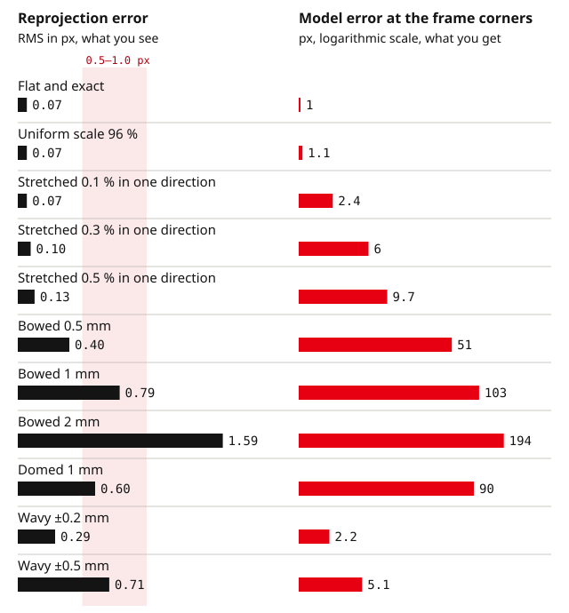

A printed target is the first calibration board almost everyone uses, and it often works. When it does not, the failure is quiet: the calibration converges, the reprojection error looks acceptable, and the focal length or the measured distances are off by a few percent.

This guide separates the three things that go wrong with a print (scale, stretch and shape), shows what each one does to an OpenCV calibration in a synthetic test, and gives the checks that tell you whether your print is good enough.

## The test

We simulated a 5 MP machine-vision camera (2448 × 2048 px, 12 mm lens, 3.45 µm pixels, moderate barrel distortion) looking at an A4 print: a 10 × 7 inner-corner grid with 24 mm squares, the corner layout of an 11 × 8 ChArUco board.

Twenty views per calibration, 550 to 950 mm away, tilted up to 40°, with 0.05 px detection noise. At 750 mm, one millimeter on the board is about 4.6 px in the image.

In each scenario the *real* board was deformed, and the calibration was run with the *nominal* flat board, which is what happens when you describe a print by the parameters of the file you sent to the printer.

Every number is the median of 30 random sets of views. "Edge error" is how far the fitted model is from the true one at the four frame corners, the same check we used in the [reprojection error guide](/guides/reprojection-error/).

| Real board | RMS (px) | Focal length | fy/fx | Edge error (px) | Distance |
|---|---|---|---|---|---|
| Flat and exact (reference) | 0.07 | 0.00 % | 0.000 % | 1.0 | 0.0 % |
| Uniform scale 96 % | 0.07 | 0.00 % | 0.000 % | 1.1 | +4.2 % |
| Stretched 0.1 % in one direction | 0.07 | −0.03 % | +0.10 % | 2.4 | 0.0 % |
| Stretched 0.3 % in one direction | 0.10 | −0.09 % | +0.30 % | 6.0 | −0.1 % |
| Stretched 0.5 % in one direction | 0.13 | −0.15 % | +0.50 % | 9.7 | −0.1 % |
| Bowed 0.5 mm | 0.40 | −1.1 % | −0.09 % | 51 | −1.2 % |
| Bowed 1 mm | 0.79 | −2.2 % | −0.18 % | 103 | −2.4 % |
| Bowed 2 mm | 1.59 | −4.4 % | −0.35 % | 194 | −4.8 % |
| Domed 1 mm | 0.60 | −2.0 % | −0.08 % | 90 | −2.2 % |
| Wavy ±0.2 mm (60 mm pitch) | 0.29 | 0.0 % | 0.000 % | 2.2 | 0.0 % |
| Wavy ±0.5 mm (60 mm pitch) | 0.71 | 0.0 % | 0.000 % | 5.1 | 0.0 % |

Bow is the sag at the center of the 216 mm corner span, with the sheet bent around one axis like a page that will not lie flat. Dome is the same sag in both directions. Wavy is the cockle a sheet gets from heavy ink and humidity.



Three different failures come out of this table.

## Scale: invisible in the calibration, visible in every measurement

Printing a PDF with "Fit to page" or "Shrink to printable area" switched on, which many print dialogs do by default, shrinks the page to keep it inside the printer's margins; a square that comes out at 94 to 96 % of its stated size is the usual sign.

Even at 100 %, the printed scale can be slightly off, so measure it.

A uniform scale error is invisible to the calibration. The intrinsics, the distortion and the reprojection error are identical to the reference, because a smaller board farther away looks exactly like a larger board closer in.

What changes is every distance the camera reports: with a 96 % print, the board came out 4.2 % farther away than it was. A stereo baseline, a hand-eye translation or a measurement in millimeters inherits the same error.

**Check:** measure across as many squares as your ruler or caliper allows, in both directions, and divide by the number of squares. Enter the measured square size, not the one in the file.

## Stretch: hidden in the aspect ratio

Paper changes size with humidity, and not equally in both directions. Typical coefficients are 0.03 to 0.06 % per percent of moisture change along the grain and 0.07 to 0.17 % across it, and a 10 % change in relative humidity moves the moisture content of paper by about 1 %.

A sheet printed in a dry office and used in a humid lab can therefore stretch a few tenths of a percent more in one direction than in the other. The printer adds its own one-direction error, because one axis is set by the print head and the other by the paper feed.

In the calibration, a one-direction stretch is absorbed almost entirely by the aspect ratio. A 0.3 % stretch came back as fy/fx = 1.0030 with RMS rising only from 0.07 to 0.10 px.

Unless you know your pixels are square and look at fy/fx, nothing tells you. The model is off by 6 px at the frame corners.

**Check:** measure both directions separately. If they differ, the board is no longer an OpenCV board with one square size; build the object points yourself with the two measured pitches (see below).

If your sensor has square pixels, an fy/fx far from 1 after calibration is a hint to remeasure the print.

## Shape: the 0.5 px

A bowed board is the one failure the reprojection error does see. The calibration fits a flat board to corners that are not flat, and the misfit shows up as residual: 0.5 mm of bow cost 0.4 px, 1 mm cost 0.8 px.

That is the 0.5 to 1.0 px band that the reprojection error guide marks as "something is wrong".

It is not only a cosmetic number. Part of the bow is absorbed by the focal length and the distortion, so the model is biased: a 1 mm bow made the focal length 2.2 % short and the model 103 px wrong at the frame corners.

Waviness behaves differently. A ±0.5 mm cockle raised the RMS to 0.7 px, but because it averages out over the board it barely moved the focal length.

Where do millimeters of bow come from? A sheet taped or glued to foam board or cardboard follows the backing, and the backing bows with humidity and with the paper pulling on one face. A sheet held in the hand or taped at the corners is not a plane at all.

Measure yours: lay a steel straightedge across the board in both directions and along the diagonals, and slide a feeler gauge or a stack of paper under it. A sheet of office paper is about 0.1 mm thick.

## Resolution changes the pixels, not the percentages

The same scenarios on a 1.3 MP camera with the same lens field of view (1280 × 1071 px):

| Real board | RMS, 5 MP | RMS, 1.3 MP | Focal length (both) |
|---|---|---|---|
| Flat and exact | 0.07 px | 0.07 px | 0.0 % |
| Bowed 0.5 mm | 0.40 px | 0.22 px | −1.1 % |
| Bowed 1 mm | 0.79 px | 0.42 px | −2.2 % |
| Wavy ±0.5 mm | 0.71 px | 0.37 px | 0.0 % |

The reprojection error scales with how many pixels a millimeter on the board covers. The focal length error does not.

A print that "looks fine" at 0.4 px on a low-resolution camera carries the same 2 % focal length bias as one that shows 0.8 px on a high-resolution camera. Judge a board by its geometry, not by the RMS one camera reports.

## Can the calibration fix the board?

OpenCV's `calibrateCameraRO` (the object-releasing method) estimates the board's real 3D shape together with the camera. We ran it on the same data:

| Real board | RMS, standard | Focal length, standard | RMS, RO | Focal length, RO | Edge error, RO |
|---|---|---|---|---|---|
| Flat and exact | 0.07 px | 0.00 % | 0.07 px | +0.01 % | 2.5 px |
| Bowed 2 mm | 1.61 px | −4.3 % | 0.07 px | +0.01 % | 2.5 px |
| Domed 2 mm | 1.20 px | −4.0 % | 0.07 px | +0.01 % | 2.5 px |
| Stretched 0.3 % | 0.10 px | −0.11 % | 0.07 px | +0.01 % | 2.5 px |
| Bowed 0 to 2 mm, different in every view | 0.84 px | −2.5 % | 0.44 px | −0.08 % | 108 px |

When the board keeps one shape, RO recovers the camera almost completely, at the cost of a slightly less certain model at the edges (2.5 px instead of 1.0 px, because it fits many more unknowns). When the sheet flexes from one image to the next, the bow is not a shape it can estimate.

The RMS halves and looks respectable, while the model is more than 100 px wrong at the frame corners. RO cannot fix a uniform scale error either: the overall size still comes from the square size you enter.

```python
import cv2

# obj_points: list of (N, 3) float32 nominal corners, one per view (same board, all corners seen)
# img_points: list of (N, 2) float32 detected corners
# fixed_point: index of a corner on the first row, usually the last one (cols - 1)
rms, K, dist, rvecs, tvecs, new_obj = cv2.calibrateCameraRO(
    obj_points, img_points, image_size, fixed_point, None, None)[:6]

new_obj = new_obj.reshape(-1, 3)                       # refined board corners, mm
sag = new_obj[:, 2].max() - new_obj[:, 2].min()
print(f"RMS {rms:.3f} px, estimated board out-of-plane range {sag:.2f} mm")
```

RO needs every corner in every view, so it suits a checkerboard better than a partly seen ChArUco board. The out-of-plane range it reports is also a quick way to find out how flat your board really is.

## Using a measured print

If you measured different pitches in the two directions, scale the nominal corners before you calibrate. This works for any board whose corners you can list, ChArUco included:

```python
import numpy as np
import cv2

d = cv2.aruco.getPredefinedDictionary(cv2.aruco.DICT_6X6_250)
board = cv2.aruco.CharucoBoard((11, 8), 24.0, 18.0, d)   # file parameters

# Measured on the print: 10 squares across = 239.4 mm, 7 squares down = 168.9 mm
sx, sy = 239.4 / 240.0, 168.9 / 168.0
corners = board.getChessboardCorners().copy()            # (70, 3), mm
corners[:, 0] *= sx
corners[:, 1] *= sy

# For each view, pick the detected corners by ID:
#   obj = corners[charuco_ids.ravel()]; img = charuco_corners.reshape(-1, 2)
```

## When a print is enough

A print is a reasonable target when:

- the camera has a modest resolution or a wide field of view, so a millimeter on the board is one or two pixels;
- you printed at 100 % with scaling off, measured the squares in both directions, and entered what you measured;
- the sheet is flat on a rigid, flat plate, such as float glass or a machined metal plate, and the straightedge shows no gap you can measure;
- you are testing a pipeline, not producing a calibration that will be used for measurement.

It is the wrong target when the focal length or distances feed a measurement, when you work at high resolution or close range, or when the board has to survive handling and humidity changes between sessions.

That is where a rigid board with a measured geometry takes the three failures above off your list.

Our [composite boards](/targets/collection/composite-boards/) are UV-printed on aluminum composite and measured before they ship; the [substrate guide](/guides/composite-ceramic-or-glass/) explains when ceramic or glass is worth the step up.

## Method

The test projects the deformed board through the true camera, adds Gaussian noise and calibrates with `cv2.calibrateCamera` and the standard five-parameter distortion model, OpenCV 5.0. Write to hello@calib.tools if you want the scripts.

Bow keeps the arc length of the sheet; a print that bows also gets very slightly shorter in projection, which is included.

The paper coefficients are typical values for machine-made paper from the dimensional-stability literature (coefficient of moisture expansion, valid from 0 to 65 % RH); the 94–96 % figure is the usual result of fit-to-page printing on A4 or Letter.

Your paper, printer and room will differ, which is why the checks above measure your print rather than assume it.
