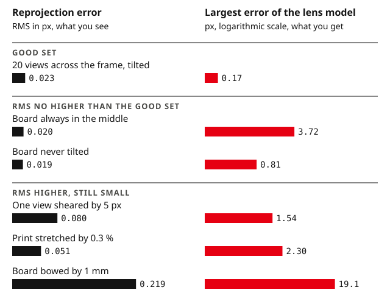

Every calibration tool reports a reprojection error. This page measures what that number reacts to and what it misses, on images where the true camera is known.



Left: the RMS the solver reports. Right: how far the solved camera model is from the true one at its worst pixel. Each bar is the median of 20 sessions of 20 views.

Everything here is rendered images of a ChArUco board seen through a camera we defined. No real camera was used. The last section says what that leaves out.

## The short answer

- **RMS measures the corners, not the camera.** It is how far the detected corners are from where the fitted model puts them.
- **Image quality sets its level.** Blur and noise raised it from 0.023 to as much as 0.055 px while the model stayed within 0.40 px.
- **It cannot see missing coverage.** Board always in the middle: RMS 0.020 px, model 3.72 px off.
- **It reacts to a bad board, but quietly.** A board bowed by 1 mm: RMS 0.219 px, model 19.1 px off. On most published scales 0.2 px counts as good.
- **The error per view finds a single bad view.** A view sheared by 5 px was flagged in 20 of 20 sessions, one sheared by 1 px in 10 of 20.
- **A straight edge finds a bad distortion model.** After undistortion it bent by 1.82 px with the board kept in the middle, against 0.05 px for the good set.

## What the number is

After calibration the solver has a camera model and a pose for every view. It projects the board's known corners through that model into each image and compares them with the corners it detected. The reprojection error is the distance between the two, in pixels.

OpenCV's `calibrateCamera` returns the root-mean-square over every corner in every view:

```
RMS = sqrt( mean( ‖projected − detected‖² ) )
```

So it is an average over the corners you gave it. Where there were no corners, it says nothing.

## The test

- **Camera.** 1920 × 1440 px, focal length 2250 px, two radial distortion terms.
- **Board.** ChArUco, 10 × 7 squares of 25 mm, at about half the frame width.
- **Good set.** 20 views across the frame, tilted 10 to 35°, at varied distance. 0.8 px of blur and a little noise.
- **Each case** changes one thing, 20 sessions each, solved with OpenCV's default five distortion terms.
- **Model error** is the largest distance, over the image, between where the true camera and the solved one put the same ray.

## What sets its level

| Images | RMS | Model error |
|---|---|---|
| Good set | 0.023 px | 0.17 px |
| Blur 2 px | 0.029 px | 0.40 px |
| Blur 3 px | 0.039 px | 0.30 px |
| Four times the noise | 0.055 px | 0.27 px |

The RMS more than doubled and the model moved by a quarter of a pixel at most. This is why an RMS from one camera cannot be held against a table made with another.

Real images give a higher RMS than these renders. The comparison that means something is with your own earlier calibrations of the same camera and board.

## What it does not show

| Case | RMS | Model error |
|---|---|---|
| Good set | 0.023 px | 0.17 px |
| Board always in the middle of the frame | 0.020 px | 3.72 px |
| Board tilted under 5° | 0.019 px | 0.81 px |
| Five views | 0.021 px | 0.39 px |
| Good set, twelve distortion terms | 0.023 px | 0.37 px |
| Board in the middle, twelve distortion terms | 0.020 px | 4.39 px |
| Square size entered 1 % too large | 0.023 px | 0.18 px |

Every row has an RMS at or below the good set. Fewer views, less tilt, less coverage and more model terms all make the corners easier to fit.

The last row is a different kind of error. A wrong square size leaves the camera model as it was and makes every distance 1 % too long.

## What it shows, quietly

| Case | RMS | Model error |
|---|---|---|
| Good set | 0.023 px | 0.17 px |
| One view sheared by 1 px | 0.028 px | 0.44 px |
| One view sheared by 2 px | 0.036 px | 0.89 px |
| One view sheared by 5 px | 0.080 px | 1.54 px |
| Print stretched by 0.3 % in one direction | 0.051 px | 2.30 px |
| Board bowed by 0.5 mm | 0.109 px | 9.53 px |
| Board bowed by 1 mm | 0.219 px | 19.1 px |
| Model too simple: one distortion term for a lens with two | 0.059 px | 3.63 px |

The RMS does rise, up to ten times. But the values stay in a range that looks fine on its own. You see the rise only against a baseline from the same camera.

The shear is what a rolling shutter does when the board moves during the frame. The bow is a shallow dish, measured at the board's corners.

## Check 1: error per view

One view far above the rest is a frame to look at: the board moved, a reflection, a misread marker. We flagged a view when its error was more than three times the median view.

| Session | The sheared view was flagged | Model error with it | Model error without it |
|---|---|---|---|
| One view sheared by 1 px | 10 of 20 | 0.44 px | 0.17 px |
| One view sheared by 2 px | 18 of 20 | 0.89 px | 0.18 px |
| One view sheared by 5 px | 20 of 20 | 1.54 px | 0.14 px |

Removing the view brought the model back to the level of the good set. The rule is not free of false alarms: in the good set, 1 session of 20 had a clean view above three times the median.

This check does not see a bowed board or missing coverage. There the largest view was 1.5 to 1.8 times the median, less than in the good set.

## Check 2: error by distance from the center

Sort the corners into rings around the image center, and look at two things: the mean error in each ring, and how many corners it holds.

| Ring, px from the center | Good set, error in px | Good set, corners | Model too simple, error in px | Board in the middle, error in px | Board in the middle, corners |
|---|---|---|---|---|---|
| 0 to 300 | 0.018 | 6,730 | 0.042 | 0.018 | 13,014 |
| 300 to 600 | 0.019 | 10,820 | 0.040 | 0.017 | 8,539 |
| 600 to 900 | 0.023 | 3,969 | 0.068 | 0.013 | 47 |
| 900 to 1200 | 0.024 | 81 | 0.366 | none | 0 |

A model that is too simple shows as an error that climbs outward. Missing coverage does not show as an error at all. It shows in the corner counts: 47 corners beyond 600 px, where the good set has over 4,000.

Even the good set has only 81 corners in the outer ring, with the board at half the frame width. The image corners are the hardest place to cover.

## Check 3: something the calibration has not seen

Both checks above use the corners the solver already fitted. Two checks that do not:

- **Held-out views.** Eight more views across the frame, not used in the calibration. Their pose is solved with the camera model fixed, then their RMS is computed.
- **A straight edge.** An edge that is straight in the world, running along the top of the image. After undistortion with the solved model, how far does it bend from a line?

| Case | RMS, px | Held-out RMS, px | Straight edge bends by, px | Model error, px |
|---|---|---|---|---|
| Good set | 0.023 | 0.022 | 0.05 | 0.17 |
| Board always in the middle | 0.020 | 0.030 | 1.82 | 3.72 |
| Board in the middle, twelve terms | 0.020 | 0.039 | 2.16 | 4.39 |
| Good set, twelve terms | 0.023 | 0.022 | 0.20 | 0.37 |
| Board tilted under 5° | 0.019 | 0.024 | 0.06 | 0.81 |
| Board bowed by 1 mm | 0.219 | 0.231 | 1.71 | 19.1 |

Held-out views help a little. With the board kept in the middle their RMS is nearly one and a half times the fitted one, a hint and no more. Each held-out view gets its own pose, and the pose absorbs much of what is wrong.

The straight edge is the stronger check for the distortion model: 1.82 px against 0.05 px. It is blind to the focal length. The untilted set passes it, and the bowed board bends the edge by only 1.71 px while its focal length is off by 28.7 px.

For the focal length you need a known distance or a known size in the scene. We did not simulate that check.

## What the solver says about itself

`cv2.calibrateCameraExtended` also returns a standard deviation for each parameter. For the focal length:

| Case | Solver's standard deviation | Real error |
|---|---|---|
| Good set | 0.17 px | 0.18 px |
| Board tilted under 5° | 3.20 px | 1.46 px |
| One view sheared by 5 px | 0.50 px | 1.98 px |
| Board bowed by 1 mm | 1.51 px | 28.7 px |

With clean data the two agree. The solver also knows when the views are weak: the untilted set gets a large standard deviation. It does not know when the board is not the board it was told about.

## A script for checks 1 and 2

For a ChArUco board, with OpenCV 4.7 or later.

```python
import glob
import cv2
import numpy as np

d = cv2.aruco.getPredefinedDictionary(cv2.aruco.DICT_6X6_250)
board = cv2.aruco.CharucoBoard((10, 7), 0.025, 0.018, d)   # your board: squares across, down, square and marker size in meters
detector = cv2.aruco.CharucoDetector(board)

names, obj_all, img_all = [], [], []
for path in sorted(glob.glob("images/*.png")):
    gray = cv2.imread(path, cv2.IMREAD_GRAYSCALE)
    corners, ids, _, _ = detector.detectBoard(gray)
    if ids is None or len(ids) < 8:
        continue
    obj, img = board.matchImagePoints(corners, ids)
    names.append(path); obj_all.append(obj); img_all.append(img)

size = gray.shape[::-1]
rms, K, dist, rvecs, tvecs, _, _, per_view = cv2.calibrateCameraExtended(obj_all, img_all, size, None, None)
per_view = per_view.ravel()
print("%d views, RMS %.3f px" % (len(names), rms))

# 1. Error per view: one view far above the others is a frame to look at.
typical = np.median(per_view)
for name, e in zip(names, per_view):
    print("%s  %.3f px%s" % (name, e, "   <-- %.1f times the median" % (e / typical) if e > 3 * typical else ""))

# 2. Error by distance from the image center, and how many corners each ring holds.
radius, error = [], []
for obj, img, r, t in zip(obj_all, img_all, rvecs, tvecs):
    proj, _ = cv2.projectPoints(obj, r, t, K, dist)
    p = img.reshape(-1, 2)
    error.append(np.linalg.norm(proj.reshape(-1, 2) - p, axis=1))
    radius.append(np.hypot(p[:, 0] - K[0, 2], p[:, 1] - K[1, 2]))
radius, error = np.concatenate(radius), np.concatenate(error)
edges = np.linspace(0, np.hypot(size[0] / 2, size[1] / 2), 5)
for lo, hi in zip(edges[:-1], edges[1:]):
    ring = (radius >= lo) & (radius < hi)
    mean = "%.3f px" % error[ring].mean() if ring.any() else "no corners"
    print("%4.0f to %4.0f px from the center: %4d corners, mean error %s" % (lo, hi, ring.sum(), mean))
```

We rendered 20 views, sheared one of them by up to 5 px, and ran the script:

```text
20 views, RMS 0.076 px
images/00.png  0.029 px
images/01.png  0.039 px
images/02.png  0.031 px
images/03.png  0.024 px
images/04.png  0.043 px
images/05.png  0.045 px
images/06.png  0.034 px
images/07.png  0.047 px
images/08.png  0.041 px
images/09.png  0.032 px
images/10.png  0.039 px
images/11.png  0.048 px
images/12.png  0.037 px
images/13.png  0.299 px   <-- 7.7 times the median
images/14.png  0.041 px
images/15.png  0.021 px
images/16.png  0.027 px
images/17.png  0.039 px
images/18.png  0.036 px
images/19.png  0.047 px
   0 to  300 px from the center:  324 corners, mean error 0.038 px
 300 to  600 px from the center:  487 corners, mean error 0.050 px
 600 to  900 px from the center:  254 corners, mean error 0.035 px
 900 to 1200 px from the center:   15 corners, mean error 0.036 px
```

`images/13.png` is the sheared one. With it, the lens model was 1.59 px off; without it, 0.10 px.

## Converting to millimeters

Pixel size on the object is coverage width divided by image width, which the [FOV calculator](/tools/fov/) reports. At 0.3 mm per pixel, an RMS of 0.2 px is 0.06 mm per corner.

That is how well single corners were fitted. Even in the good set the model error was 0.17 px against an RMS of 0.023 px, seven times larger.

## What we got wrong

The earlier version of this page had a table of what counts as good, and three small tables from single runs. Tested over 20 sessions per case:

- **The table "under 0.15 px is as good as it gets, 0.15 to 0.3 px is typical of a careful calibration".** A board bowed by 1 mm gave 0.219 px, inside "careful", with a model 19.1 px off. Every other case on this page was under 0.15 px, good or bad.
- **"0.5 to 1.0 px: a bent or printed board."** The bowed and the stretched board gave 0.05 to 0.22 px.
- **"The rational plus thin-prism model made the error at the frame corners twenty times worse."** That was one run. Over 20 sessions the model error doubled, from 0.17 to 0.37 px.
- **"A healthy result is flat across radius bins; a rising trend means you need views at the edges."** Missing edge views gave no rising trend. They gave empty rings.
- **"One view at three times the others: drop it."** It holds for a view that is clearly bad. A view sheared by 1 px was flagged in half the sessions only.
- **"Very low RMS with five views."** 0.021 px against 0.023 px. Barely lower.

The lines on checking with a tape measure or a gauge block are gone from the checks. They are reasonable, and we have not tested them.

## What this test is not

- **Simulation.** Rendered images, evenly lit, with a board whose faults we chose. Real images give a higher RMS and several faults at once.
- **One camera and one board.** 46° across, two radial terms, a board at half the frame width. The sizes of the effects will differ on a wide lens or a larger board.
- **The straight edge was computed, not photographed.** We took points on a straight line, sent them through the true camera and undistorted them with the solved one. Finding an edge in a real image adds its own error.
- **Bow as a shallow dish, shear as a row shift.** Real boards bend in other shapes, and real motion blurs as well as shears.
- **OpenCV 5.1,** `calibrateCamera` with its default model unless stated.

The scripts and the saved results are in our repository under `docs/content/experiments/reprojection-error/`.

## Next steps

- [Size the board](/calibacademy/calibration-target-size/) so corners reach the frame edges.

- [Calibrate step by step](/calibacademy/opencv-camera-calibration/) with a script that prints the error per view.

- See what a [printed board](/calibacademy/printed-target-costs-half-a-pixel/) and a [moving board](/calibacademy/how-still-calibration-board/) do to the result.
