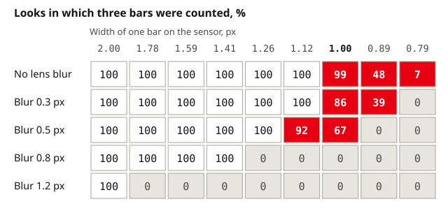
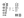

The USAF 1951 target is a pattern of three-bar elements that get smaller in fixed steps. You find the smallest element your system still resolves and read its resolution from the tables below. This page also tests, in simulation, how far such a reading can be trusted.



Each cell is 500 looks at one element with the chart at a random position on the pixels. White: three bars every time. Gray: never. Red: it depends on where the chart sits. Bars 1.00 px wide are at the sensor's Nyquist limit.

The tables are exact. The test is a simulation of a camera and of a rule that counts bars, not a measurement with a lens and a person. The last section says what that leaves out.

## The short answer

- **lp/mm = 2^(group + (element − 1) / 6).** Bar width in mm is 1 / (2 × lp/mm).
- **Bars wider than about 1.3 px on the sensor: the reading is steady.** With a soft lens every one of 500 looks gave the same element.
- **Bars near 1 px: the reading moves by itself.** With a sharp lens it ranged over three to four elements, with nothing changed but the position of the chart. With no blur at all: 0.89 to 1.26 times Nyquist.
- **Three bars can show above Nyquist.** With no lens blur, 51 % of looks counted three bars in an element finer than the sensor can sample.
- **A reading is a low-contrast point.** It landed where the system MTF was 0.14 to 0.17, not at MTF50.
- **The reader matters as much as the lens.** A strict and a lenient rule for "separate" were four elements apart on the same image.

## Formula

- **Resolution:** lp/mm = 2^(group + (element − 1) / 6)

- **Line width:** width (mm) = 1 / (2 × lp/mm)

- **Line length:** each bar is five times as long as it is wide.

From one element to the next the frequency rises by the sixth root of 2, about 12 %. From one group to the next it doubles. A reading cannot be finer than that 12 % step.

## Line pairs per millimeter (lp/mm)

| Element | Group -2 | Group -1 | Group 0 | Group 1 | Group 2 | Group 3 |
|---|---|---|---|---|---|---|
| 1 | 0.250 | 0.500 | 1.00 | 2.00 | 4.00 | 8.00 |
| 2 | 0.281 | 0.561 | 1.12 | 2.24 | 4.49 | 8.98 |
| 3 | 0.315 | 0.630 | 1.26 | 2.52 | 5.04 | 10.1 |
| 4 | 0.354 | 0.707 | 1.41 | 2.83 | 5.66 | 11.3 |
| 5 | 0.397 | 0.794 | 1.59 | 3.17 | 6.35 | 12.7 |
| 6 | 0.445 | 0.891 | 1.78 | 3.56 | 7.13 | 14.3 |

| Element | Group 4 | Group 5 | Group 6 | Group 7 | Group 8 | Group 9 |
|---|---|---|---|---|---|---|
| 1 | 16.0 | 32.0 | 64.0 | 128 | 256 | 512 |
| 2 | 18.0 | 35.9 | 71.8 | 144 | 287 | 575 |
| 3 | 20.2 | 40.3 | 80.6 | 161 | 323 | 645 |
| 4 | 22.6 | 45.3 | 90.5 | 181 | 362 | 724 |
| 5 | 25.4 | 50.8 | 102 | 203 | 406 | 813 |
| 6 | 28.5 | 57.0 | 114 | 228 | 456 | 912 |

## Line width (µm)

Width of one bar or one space, in micrometers.

| Element | Group -2 | Group -1 | Group 0 | Group 1 | Group 2 | Group 3 |
|---|---|---|---|---|---|---|
| 1 | 2000 | 1000 | 500 | 250 | 125 | 62.5 |
| 2 | 1782 | 891 | 445 | 223 | 111 | 55.7 |
| 3 | 1587 | 794 | 397 | 198 | 99.2 | 49.6 |
| 4 | 1414 | 707 | 354 | 177 | 88.4 | 44.2 |
| 5 | 1260 | 630 | 315 | 157 | 78.7 | 39.4 |
| 6 | 1122 | 561 | 281 | 140 | 70.2 | 35.1 |

| Element | Group 4 | Group 5 | Group 6 | Group 7 | Group 8 | Group 9 |
|---|---|---|---|---|---|---|
| 1 | 31.3 | 15.6 | 7.81 | 3.91 | 1.95 | 0.977 |
| 2 | 27.8 | 13.9 | 6.96 | 3.48 | 1.74 | 0.870 |
| 3 | 24.8 | 12.4 | 6.20 | 3.10 | 1.55 | 0.775 |
| 4 | 22.1 | 11.0 | 5.52 | 2.76 | 1.38 | 0.691 |
| 5 | 19.7 | 9.84 | 4.92 | 2.46 | 1.23 | 0.615 |
| 6 | 17.5 | 8.77 | 4.38 | 2.19 | 1.10 | 0.548 |

## How the chart is laid out

Bars are arranged in **groups**, and each group has six **elements**. Each element has three horizontal and three vertical bars, with spaces as wide as the bars.



Groups 0 to 3, drawn to scale: every bar has the width the formula gives for its group and element. Even-numbered groups keep their first element at the bottom right and run the other five down the left side. The next pair of groups sits in the middle at a quarter of the size.

## From chart to sensor

The table gives resolution on the chart. With optical magnification M (image size ÷ object size), the frequency on the sensor is the chart value ÷ M, and a bar is M times its chart width.

Compare that with the sensor's Nyquist limit, 1 / (2 × pixel pitch). A 3.45 µm pixel gives 1 / (2 × 0.00345 mm) ≈ 145 lp/mm on the sensor. At Nyquist a bar is exactly one pixel wide.

This script does the conversion. It needs only Python.

```python
"""What a USAF 1951 reading means on your sensor.
Usage: python usaf.py GROUP ELEMENT PIXEL_UM MAGNIFICATION     e.g.  python usaf.py 5 1 3.45 0.5"""
import sys

group, element = int(sys.argv[1]), int(sys.argv[2])
pixel_um, magnification = float(sys.argv[3]), float(sys.argv[4])

chart_lp_mm = 2 ** (group + (element - 1) / 6)
bar_um = 1000 / (2 * chart_lp_mm)
sensor_lp_mm = chart_lp_mm / magnification
bar_px = bar_um * magnification / pixel_um
nyquist = 1000 / (2 * pixel_um)

print(f"group {group}, element {element} on the chart: {chart_lp_mm:.3g} lp/mm, bars {bar_um:.3g} um wide")
print(f"on the sensor at {magnification:g}x: {sensor_lp_mm:.3g} lp/mm, bars {bar_px:.2f} px wide")
print(f"that is {sensor_lp_mm / nyquist:.2f} of the sensor's Nyquist limit ({nyquist:.4g} lp/mm)")
if bar_px < 1.3:
    print("bars under 1.3 px: move the chart a little and read again, this reading can change by itself")
else:
    print("bars over 1.3 px: the lens or the focus sets this reading, not the pixels")
```

A camera with 3.45 µm pixels views the chart at 0.5× and the finest element with three separate bars is group 5, element 1. `python usaf.py 5 1 3.45 0.5` prints:

```text
group 5, element 1 on the chart: 32 lp/mm, bars 15.6 um wide
on the sensor at 0.5x: 64 lp/mm, bars 2.26 px wide
that is 0.44 of the sensor's Nyquist limit (144.9 lp/mm)
bars over 1.3 px: the lens or the focus sets this reading, not the pixels
```

The same camera at 1× reading group 7, element 1, `python usaf.py 7 1 3.45 1`:

```text
group 7, element 1 on the chart: 128 lp/mm, bars 3.91 um wide
on the sensor at 1x: 128 lp/mm, bars 1.13 px wide
that is 0.88 of the sensor's Nyquist limit (144.9 lp/mm)
bars under 1.3 px: move the chart a little and read again, this reading can change by itself
```

The 1.3 px in the last line comes from the test below.

## The test

- **The element.** Three dark bars on a bright ground, spaces as wide as the bars, seen in one dimension across the bars.
- **The camera.** A lens blur, square pixels that collect light over their full width, and a random position of the bars against the pixel grid.
- **Lens blur.** A Gaussian spot. "Blur 0.5 px" is its sigma: the spot is about 1.2 px across at half height. Blur 1.2 px is a spot about 2.8 px across.
- **The reader.** A rule: a dark bar counts when it stands out from both neighbors by at least 10 % of the chart's black-to-white difference. An element is resolved when exactly three bars are counted.
- **A look.** Every element from 0.18 to 2 times Nyquist, each at its own random position. The reading is the last element before the first one that fails, going from coarse to fine.

500 looks per case.

## A sharp lens: the reading moves

| Lens blur | Lowest reading | Median | Highest | Two looks disagree | Three bars above Nyquist |
|---|---|---|---|---|---|
| None | 0.89 | 1.00 | 1.26 | 56 % | 51 % |
| 0.3 px | 0.89 | 1.00 | 1.12 | 64 % | 39 % |
| 0.5 px | 0.79 | 1.00 | 1.00 | 56 % | 0 % |
| 0.8 px | 0.71 | 0.71 | 0.71 | 0 % | 0 % |
| 1.2 px | 0.50 | 0.50 | 0.50 | 0 % | 0 % |
| 2.0 px | 0.31 | 0.31 | 0.31 | 0 % | 0 % |

Readings are in multiples of the Nyquist frequency. "Two looks disagree" pairs up the looks and counts the pairs with different readings. It stands for the horizontal and the vertical bars of one chart, or for the same chart read twice.

With a blur of 0.5 px or less the bars at the limit are about one pixel wide. Whether a bar falls on one pixel or straddles two decides if it shows. Nothing about the lens changed between the looks.

Above Nyquist the sensor cannot sample the pattern, but it can still show three dark stripes. With no lens blur, the element at 1.12 times Nyquist showed three bars in 48 % of looks and two bars in the rest.

## A soft lens: steady, and at low contrast

From a blur of 0.8 px on, every look gave the same element. The bars at the limit are 1.4 px wide or more, and the pixel grid no longer decides.

| Lens blur | Reading | Bar width at the reading | System MTF at the reading | One element finer |
|---|---|---|---|---|
| 0.8 px | 0.71 × Nyquist | 1.41 px | 0.17 | 0.10 |
| 1.2 px | 0.50 × Nyquist | 2.00 px | 0.15 | 0.09 |
| 2.0 px | 0.31 × Nyquist | 3.17 px | 0.14 | 0.08 |

System MTF is the contrast the lens blur and the pixels together pass at that frequency. The reading sits where 14 to 17 % is left. The frequency where half is left, MTF50, was 0.59 to 0.62 of the reading.

So a limiting-resolution reading and an MTF50 figure are different numbers for the same camera. The factor between them here belongs to a Gaussian blur. Another blur shape gives another factor.

## The reader

The same image, blur 1.2 px, read with a stricter or a more lenient rule for when a bar counts:

| A bar counts when it stands out by | Reading | System MTF at the reading |
|---|---|---|
| 2 % | 0.63 × Nyquist | 0.05 |
| 5 % | 0.56 × Nyquist | 0.09 |
| 10 % | 0.50 × Nyquist | 0.15 |
| 20 % | 0.45 × Nyquist | 0.22 |
| 30 % | 0.40 × Nyquist | 0.31 |

Four elements lie between the first row and the last, a factor of 1.59 in lp/mm. Two people, or one person and a script, can be this far apart on one image. A reading means little without the rule that produced it.

## Chart contrast and noise

With a blur of 0.5 px, a chart at half contrast and one at a fifth of full contrast gave the same median reading as a full-contrast chart. The rule scales with the chart's own black-to-white difference, as an eye adapts to a display.

Noise of 1 % and 3 % of full scale did not move the median either. Stronger noise against a weak chart makes the rule count grain as bars. We did not take the test there.

## How to read it

- Image the chart in focus and evenly lit. Go from the large groups to the small ones. Stop at the first element where you cannot count three bars, in either direction.
- Do not skip ahead. With a sharp lens, 4 to 6 % of looks showed three bars again in an element finer than the first failed one. That is the sampling, not the lens.
- Work out how wide the bars of your reading are in pixels. Above about 1.3 px, the reading is about the lens and the focus.
- Below that, shift the chart by a fraction of a bar and read again a few times. Report the range.
- Write down the rule: who or what decided, and at what contrast.
- Check the center and the corners of the field. Lenses usually resolve less at the edge.

## What we got wrong

The earlier version of this page was the tables and a few paragraphs on reading them. The tables stand, with one cell changed: the bar width of group 4, element 1 is 31.25 µm, now rounded to 31.3. Three statements did not hold up:

- **"The smallest element where you can still separate all three bars is your resolution limit."** With a sharp lens that element changed from look to look, over three to four elements. With no lens blur, half the looks showed three bars in an element above Nyquist.
- **"If horizontal and vertical bars stop at different elements, the lens may have astigmatism or the sensor may be sampling unevenly."** With a sharp lens two looks at the same camera disagreed in 56 to 64 % of pairs by chance. A difference means something only when the bars are wider than about 1.3 px.
- **"A reading depends on the person looking at it and on contrast."** On the person, yes: four elements. On chart contrast alone, not in this test.

## Beyond limiting resolution

For a measured MTF or SFR curve across the field, use a slanted-edge chart such as our [ISO 12233 resolution chart](/targets/resolution-chart/). For geometric calibration, see [camera calibration with OpenCV](/calibacademy/opencv-camera-calibration/).

## What this test is not

- **Simulation.** No lens, no sensor and no person were used.
- **A rule, not an eye.** A person looks at a whole element on a display, with zoom and interpolation in between. The rule looks at one row of numbers.
- **One dimension, bars lined up with the pixels.** A chart turned by a few degrees puts every row at a different position, which changes what is seen near one pixel.
- **A Gaussian blur.** Real lenses have other blur shapes, and defocus has its own. The MTF values at the reading depend on it.
- **A monochrome sensor.** No color filter, no demosaicing, no sharpening, no compression.
- **Noise up to 3 % of full scale.**

The scripts and the saved results are in our repository under `docs/content/experiments/usaf-reading/`.
